# Zero Waste (FoodShare) — Complete System Architecture Guide

> **AI Powered Smart Surplus Food Redistribution & Waste Reduction System**
>
> This guide explains the whole system: **what** each part is, **why** it exists, **what it is used for**, and **how** it all works together. It is written so that anyone can follow it, from a first-year student or a project reviewer to an experienced developer.
>
> Every statement was checked against the real source code (branch `dasun`, 2026-09-17). Where the code and `README.md` disagree, the code is treated as correct and the difference is pointed out.

---

## How to use this guide

The guide has four parts. You don't need to read it all in one go. Pick the path that fits you:

| If you are… | Start with | Then read |
|---|---|---|
| **New to software / non-technical** | [The system in 60 seconds](#the-system-in-60-seconds), then the glossary in [1.0](#10-a-few-words-you-will-see-a-lot-glossary) | The "story" at the start of each Part 3 section |
| **A reviewer or examiner** | [1.1 Big-picture overview](#11-big-picture-overview) and [1.2 High-level architecture](#12-high-level-architecture) | [Part 3](#part-3-how-it-works) flows, then [Part 4](#part-4--consolidated-findings-and-recommendations) |
| **A developer joining the project** | [Part 2](#part-2--configuration-build--setup) to get it running | [Part 1](#part-1--system-design) inventory, then [Part 3](#part-3-how-it-works) |
| **Deploying to a server** | [2.4 Docker Compose](#24-docker-compose-deployment) and [2.16 Security checklist](#216-production-security-checklist) | [Part 4](#part-4--consolidated-findings-and-recommendations) |

| Part | Question it answers | Contents |
|---|---|---|
| **Part 1: System Design** | *What is it built from, and why?* | Architecture, tech stack, every endpoint/service/model/page, data model, AI algorithms, security, design trade-offs |
| **Part 2: Configuration & Setup** | *How do I configure, build and run it?* | Ports, Docker, nginx, `application.yml`, environment variables, dependencies, run guides, troubleshooting |
| **Part 3: How It Works** | *What happens when someone uses it?* | Step-by-step flows for sign-up, donations, requests, QR pickup, AI, alerts, reports, chatbot, seeding, errors |
| **Part 4: Consolidated Findings** | *What should be fixed or improved?* | The most important issues from all three parts, ranked by priority |

> **About the diagrams:** the diagrams use [Mermaid](https://mermaid.js.org/). They render automatically on GitHub, GitLab, and in VS Code (with the "Markdown Preview Mermaid Support" extension). In other viewers you will see the diagram source text, which is still readable.

---

## The system in 60 seconds

**The problem.** Shops and restaurants throw away food that is still safe to eat, just because it is close to its expiry date. Meanwhile charities struggle to get enough food, and food that has truly expired, which could feed animals or become compost, goes to landfill.

**The solution.** Zero Waste is a website that connects the three groups:

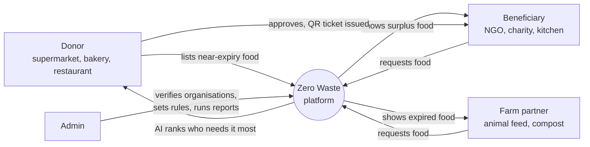

**The journey in 6 steps**

1. A **donor** uploads stock. The system automatically labels each item **fresh**, **surplus** (near expiry, donatable) or **expired**.
2. The donor **publishes** surplus items.
3. An admin-**verified** charity or farm **requests** an item.
4. The **AI service** scores the competing requests, and the donor approves one (fully or partly).
5. The charity gets a **QR-code ticket**. At pickup, the donor **scans** it to confirm the handover.
6. **Dashboards and reports** show kg of food saved, estimated meals and CO₂ avoided.

**What it is built with**

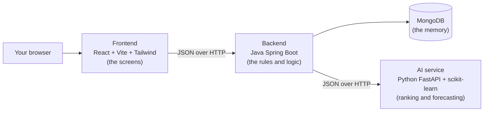

Analogy: the **frontend** is the shop counter you talk to, the **backend** is the manager who applies the rules, **MongoDB** is the filing cabinet, and the **AI service** is a specialist adviser the manager phones for a second opinion.

---

## Master table of contents

- **[Part 1 — System Design](#part-1--system-design)**
  - [1.0 A few words you will see a lot (glossary)](#10-a-few-words-you-will-see-a-lot-glossary)
  - [1.1 Big-picture overview](#11-big-picture-overview)
  - [1.2 High-level architecture](#12-high-level-architecture)
  - [1.3 Technology stack](#13-technology-stack)
  - [1.4 Layered backend design](#14-layered-backend-design)
  - [1.5 Component inventory (backend)](#15-component-inventory-backend)
  - [1.6 Data model](#16-data-model)
  - [1.7 Frontend design](#17-frontend-design)
  - [1.8 AI service design](#18-ai-service-design)
  - [1.9 Cross-cutting concerns](#19-cross-cutting-concerns)
  - [1.10 Design decisions and trade-offs](#110-design-decisions-and-trade-offs)
  - [1.11 Known limitations and improvement suggestions](#111-known-limitations-and-improvement-suggestions)
- **[Part 2 — Configuration, Build & Setup](#part-2--configuration-build--setup)**
  - [2.0 Glossary for beginners](#20-glossary-for-beginners)
  - [2.1 Prerequisites](#21-prerequisites)
  - [2.2 Repository and folder structure](#22-repository-and-folder-structure)
  - [2.3 Ports and network map](#23-ports-and-network-map)
  - [2.4 Docker Compose deployment](#24-docker-compose-deployment)
  - [2.5 Dockerfiles, line by line](#25-dockerfiles-line-by-line)
  - [2.6 nginx.conf explained](#26-nginxconf-explained)
  - [2.7 Spring Boot configuration](#27-spring-boot-configuration)
  - [2.8 Environment variable reference](#28-environment-variable-reference)
  - [2.9 Dependencies](#29-dependencies)
  - [2.10 Frontend build configuration](#210-frontend-build-configuration)
  - [2.11 AI service configuration](#211-ai-service-configuration)
  - [2.12 Step-by-step run guides](#212-step-by-step-run-guides)
  - [2.13 Testing, sample data and .gitignore](#213-testing-sample-data-and-gitignore)
  - [2.14 Known configuration issues found during review](#214-known-configuration-issues-found-during-review)
  - [2.15 Troubleshooting](#215-troubleshooting)
  - [2.16 Production security checklist](#216-production-security-checklist)
- **[Part 3: How It Works](#part-3-how-it-works)**
  - [3.1 The life of a request](#31-the-life-of-a-request)
  - [3.2 Registration, login, verification and access control](#32-registration-login-verification-and-access-control)
  - [3.3 Donation lifecycle and expiry handling](#33-donation-lifecycle-and-expiry-handling)
  - [3.4 Food request lifecycle](#34-food-request-lifecycle)
  - [3.5 Tickets, QR codes and pickup confirmation](#35-tickets-qr-codes-and-pickup-confirmation)
  - [3.6 AI features in depth](#36-ai-features-in-depth)
  - [3.7 Notifications and the food alert engine](#37-notifications-and-the-food-alert-engine)
  - [3.8 Dashboard and impact metrics](#38-dashboard-and-impact-metrics)
  - [3.9 Admin reports and PDF generation](#39-admin-reports-and-pdf-generation)
  - [3.10 The chatbot](#310-the-chatbot)
  - [3.11 Admin settings and how changes propagate](#311-admin-settings-and-how-changes-propagate)
  - [3.12 Data seeding on first startup](#312-data-seeding-on-first-startup)
  - [3.13 Role-by-role journeys and a day in the life](#313-role-by-role-journeys-and-a-day-in-the-life)
  - [3.14 Error handling at runtime](#314-error-handling-at-runtime)
  - [3.15 Summary of known gaps](#315-summary-of-known-gaps)
- **[Part 4 — Consolidated Findings and Recommendations](#part-4--consolidated-findings-and-recommendations)**
  - [4.1 Priority overview](#41-priority-overview)
  - [4.2 Priority 1 — Security](#42-priority-1--security)
  - [4.3 Priority 2 — Setup blockers](#43-priority-2--setup-blockers)
  - [4.4 Priority 3 — Logic bugs](#44-priority-3--logic-bugs)
  - [4.5 Priority 4 — Quality and scalability](#45-priority-4--quality-and-scalability)
  - [4.6 What the system already does well](#46-what-the-system-already-does-well)

---

# Part 1 — System Design

> **Scope of this part.** This section describes the *structure* of the Food Redistribution System: its pieces, how they are organised, what data it stores, and why it was built this way. Installation/configuration and step-by-step runtime flows are covered in the other parts of this document.
>
> Everything below was checked against the source code in `backend-spring/`, `frontend/`, `ai-service/` and `docker-compose.yml`. Where the code and the `README.md` disagree, the code is treated as the truth and the difference is pointed out.

---

## 1.0 A few words you will see a lot (glossary)

| Term | Plain-English meaning |
|---|---|
| **Frontend** | The part you see and click in a web browser. |
| **Backend** | The program running on a server that stores data, applies the rules and answers the frontend's questions. |
| **API** (Application Programming Interface) | A menu of requests one program can send to another, e.g. "give me all donations". Like a restaurant menu: you order from the list, and the kitchen stays out of sight. |
| **REST / REST API** | A common way of building APIs over the web. Each "thing" has an address (URL, e.g. `/api/donations`), and you use standard verbs: `GET` (read), `POST` (create), `PATCH` (partly update), `DELETE` (remove). |
| **Endpoint** | One item on that menu, e.g. `POST /api/requests`. |
| **JSON** | A plain-text data format (`{"name": "Bread", "quantityKg": 15}`) that programs use to send data to each other. |
| **SPA** (Single-Page Application) | A website that loads once and then redraws parts of the page as you move around, without reloading the whole page. The React frontend is an SPA. |
| **Microservice** | A small, separate program that does one job and talks to other programs over the network. The Python AI service is one. |
| **Database / MongoDB** | Where data is saved permanently. MongoDB is a "document" database: it stores records as JSON-like documents grouped into **collections** (roughly, tables). |
| **Model / Entity / Document class** | A Java class that describes the shape of one kind of stored record (e.g. `Donation`). |
| **DTO** (Data Transfer Object) | A simple class used only to carry data in or out of the API, e.g. the fields of a login form. Like a delivery box: it holds exactly what is being sent, nothing more. |
| **Repository** | The class that reads and writes one collection in the database. Like a librarian who fetches and files one kind of record. |
| **Service** | The class that holds the business rules ("a fresh item cannot be donated yet"). |
| **Controller** | The class that receives HTTP requests at an address and hands them to the right service. Like a receptionist. |
| **CORS** (Cross-Origin Resource Sharing) | A browser safety rule. A page served from one address can only call an API on another address if that API says it is allowed. |
| **Hashing (BCrypt)** | Turning a password into a scrambled one-way code so the real password is never stored. |
| **Context (React)** | A shared "noticeboard" in the frontend that any page can read, e.g. "who is logged in". |
| **Polling** | Asking the server again and again on a timer ("anything new?"), instead of the server pushing updates. |

---

## 1.1 Big-picture overview

### 1.1.1 What problem does the system solve?

Supermarkets, bakeries and restaurants throw away food that is still safe to eat, only because it is close to its expiry date. At the same time, charities and NGOs struggle to get enough food. Food that really has expired could still feed animals or become compost, but it usually goes to landfill.

**Zero Waste** (the codebase and Java package still use the older name **FoodShare**, `com.foodshare`) is a web platform that:

1. Lets **donors** upload their stock (one item at a time or as a CSV spreadsheet). The system automatically sorts each item into **fresh** (not donatable yet), **surplus** (near expiry, can be donated) or **expired** (for farms/compost only).
2. Lets donors **publish** surplus items so **beneficiaries** (NGOs, charities) and **farm partners** can see and request them.
3. Uses a separate **AI service** to **rank competing requests** (who needs this most?) and to **forecast** how much surplus is likely in the next week.
4. When a donor approves a request, it creates a **collection ticket with a QR code**. At pickup, the donor scans the QR code to confirm the handover.
5. Lets an **administrator** check new organisations, set the expiry and pickup-window rules, and produce **reports (on screen and as PDF)**.
6. Shows **impact numbers** (kg saved, estimated meals, estimated CO₂ saved) and offers a simple **chatbot**.

Analogy: think of it as a **lost-and-found desk for food**. Shops drop off what they can't sell, the desk decides who needs it most, hands out a claim ticket, and records how much food was saved.

### 1.1.2 User roles

Roles are stored as a plain text field `User.role` in the database. The code recognises exactly four values: `donor`, `beneficiary`, `farm`, `admin`. There is also a sub-type field `User.orgType` (e.g. `"NGO"`, `"Charity"`, `"Farm"`, `"Beneficiary Organization"`, `"Donor"`), which is used for display only.

| Role | Who they are in real life | What they can do (from `App.jsx`, `Sidebar.jsx` and backend services) | Needs admin verification? |
|---|---|---|---|
| **Guest** (not logged in) | Anyone visiting | See the landing page (`/`), browse published food (`/browse`, read-only), use the chatbot, register, log in. | — |
| **donor** | Supermarket / store / restaurant | Dashboard with impact stats; **My Donations** (add item, upload CSV, publish/unpublish, see AI ranking); **Food Requests** (approve / partly approve / reject, with AI insights); **Pickup Tickets**; **Scan QR Code** (pop-up window) to confirm pickups; **Impact & AI forecast**; **Pickup History**; Profile; Help. | A verification banner is shown and documents can be uploaded, but **no donor action is blocked** by the backend or frontend while unverified. |
| **beneficiary** | NGO, charity, community kitchen | Dashboard; **Available Food** (non-expired published items); submit requests with quantity and urgency; **My Requests** (accept or decline a donor's counter-offer, read rejection reasons); **My Tickets** (QR code, collection-window countdown); Impact; Profile; Help. | **Yes.** `RequestService.submit` refuses requests from unverified accounts (HTTP 409), and the frontend hides My Requests / My Tickets until verified. |
| **farm** | Farm, livestock feeder, compost facility | Same as beneficiary, but **Available Food** shows **only expired items** ("Expired Food for Compost / Feed"). No Impact link in the sidebar. | **Yes** (same rule as beneficiary). |
| **admin** | Platform operator | Admin dashboard (network-wide charts); **Verifications** (approve/reject donors, beneficiaries and farms, view uploaded documents); **Generate Reports** (on-screen and PDF); **Settings** (expiry thresholds and QR collection windows, global and per food category, with presets); **AI Insights** (the Impact page with the forecast). The chatbot is hidden for admins. | No |

> **Important honesty note:** these role rules are enforced **only in the browser**. The backend does not check who is calling. See §1.9.1.

---

## 1.2 High-level architecture

### 1.2.1 Architecture diagram

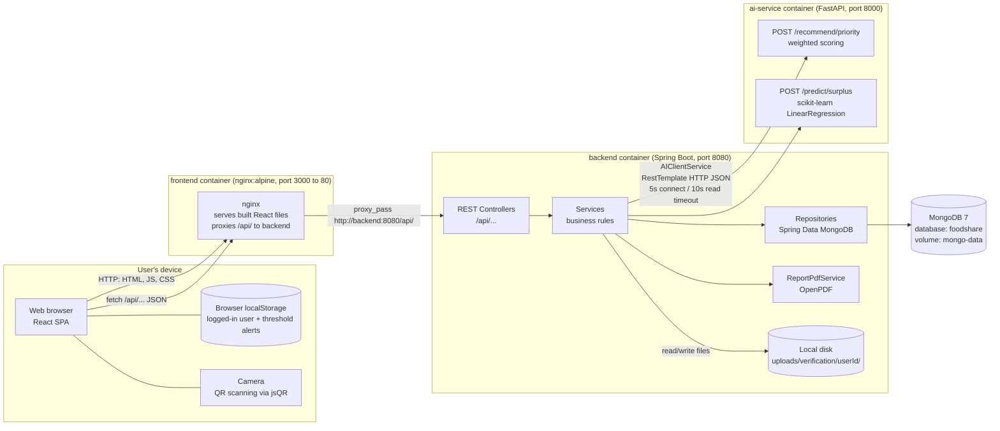

**How to read it:** the browser only ever talks to **one address** (the frontend's nginx in Docker, or the Vite dev server when developing). Any request whose path starts with `/api/` is passed on to the Spring Boot backend. **Only the backend** talks to the database and to the AI service. The AI service has **no database**: it gets all its input data in each request and returns an answer.

**External services:** there are **none** at runtime. No email/SMS provider, no maps API, no cloud storage, no payment or login provider. The only outside resources are:
- a placeholder avatar image loaded from `images.unsplash.com` in `Topbar.jsx` when a user has no avatar URL. In practice `avatar` is a single letter such as `"R"`, so the `` fails and the initial-letter fallback is shown;
- Docker base images and npm/Maven/pip packages, which are only needed at build time.

### 1.2.2 The four runtime units

| Unit | What it is | Why it exists | Port (Docker / dev) |
|---|---|---|---|
| **frontend** | React SPA, built by Vite and served as static files by **nginx** in Docker (`frontend/Dockerfile`, `nginx.conf`). In development, the Vite dev server serves it and proxies `/api` to the backend (`vite.config.js`). | Gives each role its screens. nginx is a small, fast static web server. It also forwards `/api/` calls, so the browser sees a single origin and CORS is not a problem in Docker. `try_files ... /index.html` makes deep links like `/tickets` work in an SPA. | 3000→80 / 5173 |
| **backend** | Spring Boot 3.3.2 (Java 17) REST API (`backend-spring/`). | The **single owner** of data and business rules: classification, stock reservation, tickets, notifications, reports, file storage. | 8080 |
| **ai-service** | Python FastAPI app (`ai-service/app`). | Keeps ranking and forecasting logic in Python, where the ML libraries are (scikit-learn, numpy). It can be changed or scaled without touching Java. Stateless. | 8000 |
| **mongodb** | `mongo:7` with a named Docker volume `mongo-data`. | Stores all records permanently. Collections are created automatically. | 27017 |

> **Port note (code vs README):** `application.yml` sets `server.port: 8080`, and Docker Compose uses 8080. However, `frontend/vite.config.js` proxies to **`http://localhost:8081`**, and the local log `backend-spring/backend-run.log` shows Tomcat started on **8081**. For local (non-Docker) development, the backend is therefore being run with a port override. The README still says 8080.

### 1.2.3 Where data lives

| Data | Storage | Owner |
|---|---|---|
| Users, donations, requests, tickets, notifications, settings, AI history | MongoDB collections (§1.6) | Backend |
| Verification documents (PDFs/images) | Backend's local filesystem, `uploads/verification/<userId>/<timestamp>-<safeName>` (default of `foodshare.uploads.dir`) | Backend (`VerificationDocumentService`) |
| "Who is logged in" | Browser `localStorage` key `zerowaste_user` (legacy key `foodshare_user` is still read) | Frontend (`AuthContext`) |
| Donor threshold alerts (unclaimed / urgent / composted) | Browser `localStorage` key `zerowaste_alerts_<userId>`, max 50 | Frontend (`FoodAlertContext`) |
| Generated PDF reports | Not stored. Built in memory and streamed to the browser. | Backend (`ReportPdfService`) |
| QR code images | Not stored. Drawn in the browser from the ticket's `qrCode` text using the `qrcode` library. | Frontend (`Tickets.jsx`) |

---

## 1.3 Technology stack

Versions are taken from `pom.xml`, `frontend/package.json`, `ai-service/requirements.txt`, the Dockerfiles and `docker-compose.yml`. A caret (`^`) in npm means "this version or a newer compatible minor version".

| Layer | Technology | Version | Why it is used here |
|---|---|---|---|
| Frontend – UI library | **React** / react-dom | ^18.3.1 | Builds the interface from reusable components. It has a large ecosystem and is a common teaching choice. |
| Frontend – routing | **react-router-dom** | ^6.26.0 | Maps URLs (`/dashboard`, `/tickets`) to pages inside the SPA and handles redirects for role-based access. |
| Frontend – build/dev server | **Vite** + @vitejs/plugin-react | ^5.4.0 / ^4.3.1 | Very fast dev server with hot reload and an `/api` proxy. Produces the optimised `dist/` bundle that nginx serves. |
| Frontend – styling | **Tailwind CSS** + PostCSS + Autoprefixer, plus a large hand-written `index.css` (~2,300 lines) | ^3.4.19 / ^8.5.28 / ^10.6.0 | Utility classes speed up layout work in newer pages. `preflight` (Tailwind's CSS reset) is **disabled** in `tailwind.config.js` so it does not break the existing custom CSS. |
| Frontend – icons | **lucide-react** + custom SVG icons in `components/Icons.jsx` | ^1.45.0 | Consistent icons. Custom brand logo and illustrations are hand-drawn SVGs. |
| Frontend – QR generate | **qrcode** | ^1.5.4 | Turns the ticket's `qrCode` string into a PNG data-URL for display and download. |
| Frontend – QR scan | **jsQR** | ^1.4.0 | Reads QR codes from camera video frames in the browser, so no native app is needed. |
| Web server (prod) | **nginx** (`nginx:alpine`), built with `node:20-alpine` | image tags | Serves static files efficiently, reverse-proxies `/api/`, and falls back to `index.html` for SPA routes. |
| Backend – framework | **Spring Boot** (`spring-boot-starter-web`) | 3.3.2 | Mature Java framework. Embedded Tomcat server, dependency injection, JSON conversion via Jackson. |
| Backend – language/runtime | **Java** (Eclipse Temurin JRE in Docker) | 17 | Long-term-support Java version required by Spring Boot 3. |
| Backend – data access | **Spring Data MongoDB** | managed by Boot 3.3.2 | Repository interfaces generate queries from method names (e.g. `findByDonorId`), so almost no database code is written by hand. |
| Backend – validation | **spring-boot-starter-validation** (Jakarta Bean Validation) | managed | `@NotBlank`, `@Email` on login/register DTOs. |
| Backend – password hashing | **spring-security-crypto** (BCrypt only) | managed | Secure password hashing **without** pulling in the full Spring Security login/authorisation framework (see the comment in `pom.xml`). |
| Backend – CSV | **Apache Commons CSV** | 1.11.0 | Parses donors' bulk inventory uploads. |
| Backend – PDF | **OpenPDF** (`com.github.librepdf`) | 1.3.30 | Free, open-source (LGPL/MPL) PDF generation for admin reports. |
| Backend – HTTP client | Spring **RestTemplate** | managed | Calls the Python AI service. |
| Backend – build | **Maven** (`maven:3.9-eclipse-temurin-17` image) | 3.9 | Standard Java build and dependency tool. |
| Backend – tests | spring-boot-starter-test (JUnit 5) | managed | One test: `ReportSmokeTest` builds a sample PDF. |
| AI – web framework | **FastAPI** | 0.115.0 | Quick to write typed JSON APIs in Python. Generates interactive docs at `/docs` automatically. |
| AI – server | **Uvicorn** [standard] | 0.30.6 | The ASGI web server that runs FastAPI. |
| AI – schemas | **Pydantic** | 2.9.2 | Checks and parses incoming JSON into typed objects. |
| AI – ML | **scikit-learn** | 1.5.2 | `LinearRegression` for surplus forecasting. |
| AI – numerics | **NumPy** | 2.1.1 | Arrays for the regression. |
| AI – runtime | **Python** (`python:3.11-slim`) | 3.11 | Small official image. |
| Database | **MongoDB** (`mongo:7`) | 7 | Flexible document storage. Nested data such as `categoryRules` maps and `verificationDocuments` lists is stored naturally, with no schema migrations. |
| Orchestration | **Docker Compose** (file `version: "3.9"`) | — | Starts all four containers together with one command and wires their network names (`mongodb`, `ai-service`, `backend`). |

---

## 1.4 Layered backend design

### 1.4.1 The layers

The Spring Boot backend follows the classic **layered architecture**. Each layer only talks to the layer directly below it (with a few shortcuts, noted below).

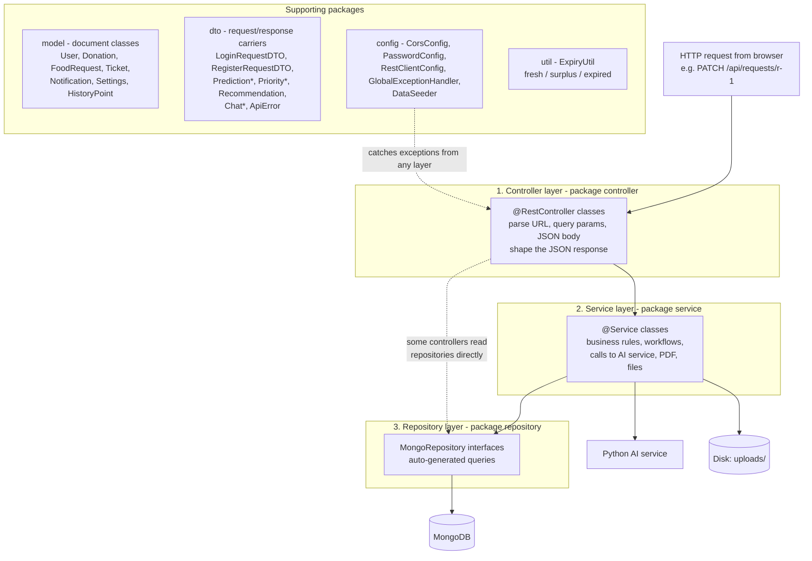

| Layer / package | What it does | Why it is separate | Analogy |
|---|---|---|---|
| **controller** | Receives HTTP requests at a URL, reads parameters/body, calls a service, and returns a JSON-ready `Map` or DTO. Most responses are wrapped in a named key, e.g. `{"donation": {...}}`, `{"requests": [...]}`. | Keeps web concerns (URLs, status codes) out of business logic. | Receptionist |
| **service** | Business rules: expiry classification on create/upload, "only verified beneficiaries may request", counter-offer workflow, stock reservation, ticket generation, notifications, dashboards, reports, PDF, AI calls, file storage. | One place to find and test the rules. Controllers stay thin. | The actual staff doing the work |
| **repository** | Interfaces extending `MongoRepository<Entity, String>`. Spring writes the implementation at startup from the method names. | No manual database code; the database can be swapped or mocked for tests. | Librarian / filing clerk |
| **model** | Plain Java classes annotated `@Document(collection = "...")`. Each maps to one MongoDB collection. Fields have simple defaults (e.g. `status = "fresh"`). | Describes the shape of stored data. | Blank form templates |
| **dto** | Small classes for API inputs and outputs that are not stored as-is, e.g. `LoginRequestDTO` (with validation annotations), `PredictionRequestDTO` (payload sent to Python), `ApiError` (error body). | Only the needed fields cross the boundary, and validation rules can be attached. | Delivery box |
| **config** | Startup wiring: CORS rules, the BCrypt `PasswordEncoder` bean, the `RestTemplate` bean with timeouts, the global exception→HTTP-status mapper, and the demo-data seeder. | Cross-cutting setup kept in one place. | Building management |
| **util** | `ExpiryUtil`, a stateless helper that counts days until expiry and classifies an item. | Used by several services and controllers. | A shared calculator |

**Dependency injection:** every controller and service receives its collaborators through its **constructor** (e.g. `RequestService(FoodRequestRepository, DonationRepository, ...)`). Spring creates one shared instance of each class and passes them in. This makes classes loosely coupled and testable.

**Deliberate shortcuts in the code:** several controllers use repositories directly instead of going through a service:
- `AuthController` uses `UserRepository` for `/me/{id}`.
- `DonationController` uses `DonationRepository` for `GET /{id}`.
- `RequestController` uses `DonationRepository` and `UserRepository` to add item and beneficiary details to the list response.
- `TicketController` uses `DonationRepository` to add the item.
- `AIController` uses `HistoryPointRepository`.

This is pragmatic, but it blurs the layer boundaries.

**Response enrichment ("joins" in code):** MongoDB has no SQL joins, so controllers look up related documents one by one. For example, `RequestController.list` fetches the item and the beneficiary for **each** request. This is the "N+1 queries" pattern: fine for demo data, slow for large data.

### 1.4.2 Backend class dependency map

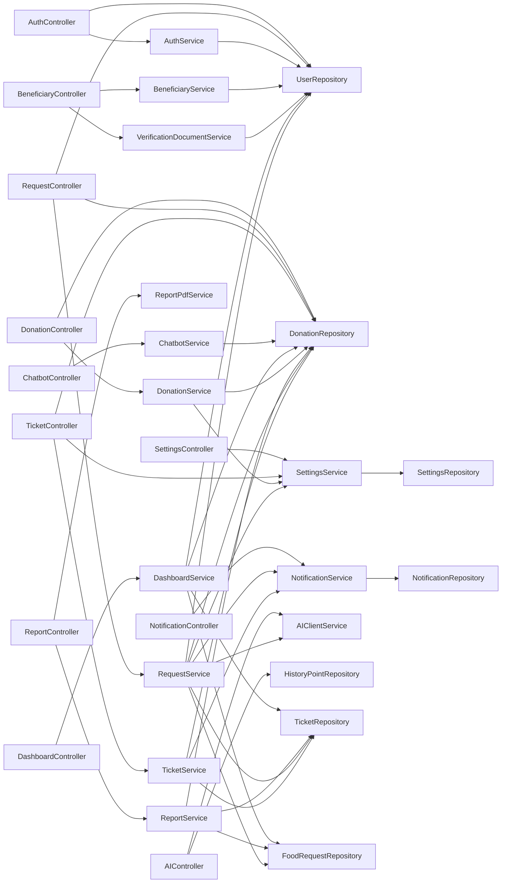

`RequestService` is the busiest class: it links requests, stock, tickets, notifications, settings and the AI service.

---

## 1.5 Component inventory (backend)

### 1.5.1 Controllers and every endpoint

All paths are prefixed with `/api`. "Called by" lists the frontend file(s) that actually call the endpoint (found by searching every `api.*` call in `frontend/src`). **Unused** means no frontend code calls it today.

Every endpoint is **publicly callable**: no login token or role check exists on the server (§1.9.1).

#### `AuthController` — base path `/api/auth`
| Method | Path | Input | Purpose / behaviour | Response | Called by |
|---|---|---|---|---|---|
| POST | `/login` | `LoginRequestDTO` `{email, password}` (validated) | Finds the user by email (case-insensitive) and checks the password against its BCrypt hash. On failure throws "Invalid email or password" → **400**. | `{user}` (password hash is never serialised) | `Login.jsx` |
| POST | `/register` | `RegisterRequestDTO` (validated) | Rejects a duplicate email (**409**). Creates the user with a hashed password, `verified=false`, `verificationStatus="pending"`, and the avatar set to the first letter of the name. Returns **201**. | `{user, message:"Registered. Awaiting admin verification."}` | `Register.jsx` |
| GET | `/me/{id}` | path id | Returns the user by id (404 if missing). | `{user}` | **Unused** |

#### `BeneficiaryController` — base path `/api/beneficiaries`
(Despite the name, it manages donors as well as beneficiaries and farms.)

| Method | Path | Input | Purpose / behaviour | Response | Called by |
|---|---|---|---|---|---|
| GET | `` | query `verified?`, `role?`, `status?` | Lists users. With no `role`, the roles are `beneficiary`, `farm` and `donor` (admins are never listed). `status` takes priority over `verified`. | `{beneficiaries:[User]}` | `AdminVerifications.jsx` (`status=pending/approved/rejected`) |
| PATCH | `/{id}/verify` | `{verified: boolean}` | `true`: requires at least one uploaded document (otherwise **409** "Verification document required for approval"); sets `verificationStatus="approved"`. `false`: sets it back to `pending`. Clears `rejectionReason` either way. | `{user}` | `AdminVerifications.jsx` |
| PATCH | `/{id}/reject` | `{reason}` | Requires a non-blank reason (**400**). Sets `verified=false`, `verificationStatus="rejected"`, `rejectionReason`. | `{user}` | `AdminVerifications.jsx` |
| POST | `/{id}/documents` | multipart `file` | Saves the file to disk under the user's folder and adds the stored filename to `verificationDocuments`. If the user was `rejected`, resets them to `pending` (re-submission). | `{user}` | `VerificationUpload.jsx`; `Register.jsx` (code path exists, but see §1.10) |
| GET | `/{id}/documents/{filename}` | path | Streams the file inline with a detected content type. Path-traversal protected. | file bytes | `AdminVerifications.jsx` (link + download), `VerificationUpload.jsx` (link) |

#### `ChatbotController` — base path `/api/chatbot`
| Method | Path | Input | Purpose | Response | Called by |
|---|---|---|---|---|---|
| POST | `` | `ChatRequestDTO {message}` | Rule-based reply (§1.9.8). | `ChatResponseDTO {reply}` | `Chatbot.jsx` |

#### `DashboardController` — base path `/api/dashboard`
| Method | Path | Purpose | Response keys | Called by |
|---|---|---|---|---|
| GET | `/{donorId}` | Donor statistics and impact (formulas in §1.5.2). | `stats{totalDonations,totalFoodKg,mealsEquivalent,peopleHelped,co2SavedKg}`, `impact{percentile,mealsProvided,wasteDivertedKg,communitiesHelped}`, `recentDonations[5]`, `nextPickup`, `activeListings`, `pendingRequests` | `Dashboard.jsx` (DonorDashboard), `Impact.jsx` |
| GET | `/admin/overview` | Network-wide totals and chart data. | `totalUsers,totalDonors,totalBeneficiaries,pendingVerifications,totalListings,surplusItems,expiredItems,totalTickets,pendingRequests,categoryBreakdown,topItems,topDonors,topOrganizations,requestStatusBreakdown,foodOutcome` | `Dashboard.jsx` (AdminDashboard) |

> Route-order note: `/admin/overview` has two path segments, so it does not clash with `/{donorId}`.

#### `DonationController` — base path `/api/donations`
| Method | Path | Input | Purpose / behaviour | Response | Called by |
|---|---|---|---|---|---|
| GET | `` | query `donorId?`, `status?`, `published?` | **First re-classifies every non-collected donation** against the current rules and saves any changes (`DonationService.reclassifyAll`). Then filters the full list in memory and adds `daysUntilExpiry` to each item. | `{donations:[...]}` | `MyDonations.jsx`, `BrowseFood.jsx`, `Dashboard.jsx`, `FoodAlertContext.jsx` |
| GET | `/{id}` | — | One donation plus `daysUntilExpiry`. | `{donation}` | **Unused** |
| POST | `` | `Donation` JSON (the entity itself, not a DTO) | Rejects past-expiry items unless `listingType="expired"`. Rejects items still **fresh** under the category threshold. Sets status, `published=false`, `createdAt`, default unit and listing type. **201**. | `{donation}` | `MyDonations.jsx` (AddItemForm) |
| POST | `/upload` | multipart `file` (CSV) + `donorId` | Bulk import. Columns: `name,category,batchNumber,quantityKg,expiryDate`. A `pickupLocation` column is ignored - every row takes the donor's registered location. Accepts five date formats. Skips rows without name/expiry and **skips fresh rows**. Saves surplus/expired rows as unpublished. **201**. | `{message, surplusDetected, expiredDetected, freshSkipped, items}` | `MyDonations.jsx` |
| PATCH | `/{id}` | partial `Donation` | Updates `published` (if different), `quantityKg`, `status`, `listingType`. | `{donation}` | `MyDonations.jsx` (publish toggle) |
| DELETE | `/{id}` | — | Deletes (404 if missing). | `{message:"Deleted"}` | **Unused** |

#### `HealthController` — base path `/api`
| Method | Path | Purpose | Response | Called by |
|---|---|---|---|---|
| GET | `/health` | Liveness check for humans and monitoring. | `{status:"ok", service:"Zero Waste Spring Boot API"}` | Not called by the UI (ops use) |

#### `NotificationController` — base path `/api/notifications`
| Method | Path | Purpose | Response | Called by |
|---|---|---|---|---|
| GET | `/{userId}` | The user's notifications, newest first, plus an unread count. | `{notifications, unreadCount}` | `Topbar.jsx` |
| PATCH | `/{id}/read` | Marks one as read. | `{notification}` | `Topbar.jsx` |
| PATCH | `/{userId}/read-all` | Marks all of the user's notifications as read. | `{message}` | `Topbar.jsx` |

> The two PATCH routes share the pattern `/{x}/...`, but their last segments differ (`read` vs `read-all`), so they do not collide.

#### `ReportController` — base path `/api/reports`
| Method | Path | Input | Purpose | Response | Called by |
|---|---|---|---|---|---|
| GET | `` | `startDate`, `endDate` (ISO `yyyy-MM-dd`) | Builds report data for the date range (§1.9.5). | `{period, summary, categoryBreakdown, statusBreakdown, trend, donations}` | `AdminReports.jsx` |
| GET | `/pdf` | same | Same data rendered as an A4 PDF, sent as an attachment named `foodshare-report-<start>_to_<end>.pdf`. | `application/pdf` | `AdminReports.jsx` (`api.download`) |

#### `RequestController` — base path `/api/requests`
| Method | Path | Input | Purpose / behaviour | Response | Called by |
|---|---|---|---|---|---|
| GET | `` | query `donorId?` / `beneficiaryId?` / `itemId?` (first one present wins, in that order), `status?` | Lists requests. **Returns an empty list if none of the three ids is given.** Each request is enriched with `item` (full Donation) and a trimmed `beneficiary` (`id,name,organizationName,orgType,role,location,verified`). | `{requests:[...]}` | `Requests.jsx`, `MyRequests.jsx`, `Dashboard.jsx`, `Impact.jsx`, `FoodAlertContext.jsx` |
| POST | `` | `FoodRequest` JSON `{itemId, beneficiaryId, quantityKg, urgency, distanceKm}` | Beneficiary must exist and be **verified** (else **409**). Item must exist and must not be expired unless it is an expired listing. Forces `status="pending"` and a default urgency of `medium`. Notifies the donor. **201**. | `{request}` | `BrowseFood.jsx` (RequestModal) |
| GET | `/recommendations/{itemId}` | — | Collects the item's **pending** requests and their beneficiaries, and asks the AI service to rank them. If the AI service is down, falls back to the original order with score 0. | `{itemId, ranking:[RecommendationDTO]}` | `MyDonations.jsx` (RecommendationPanel), `Requests.jsx` (AI insights toggle) |
| PATCH | `/{id}` | `{status, approvedQuantityKg?, reason?}` | State machine: approve / counter-offer / reject / cancel (§1.6.3). Reserves or releases stock, creates tickets, sends notifications. | `{request}` | `Requests.jsx`, `MyDonations.jsx`, `MyRequests.jsx` |

#### `SettingsController` — base path `/api/settings`
| Method | Path | Input | Purpose | Response | Called by |
|---|---|---|---|---|---|
| GET | `` | — | The single settings document (created with defaults if missing). | `{settings}` | `AdminSettings.jsx`, `FoodAlertContext.jsx` |
| PATCH | `` | `{expiryThresholdDays?, ticketCollectionWindowHours?}` | Updates the global fallbacks. | `{settings}` | `AdminSettings.jsx` |
| PATCH | `/category-rules` | `{cooked_bakery:{expiryThresholdHours,collectionWindowHours}, ...}` | **Replaces** the whole category rule map. | `{settings}` | `AdminSettings.jsx` |

#### `TicketController` — base path `/api/tickets`
| Method | Path | Input | Purpose / behaviour | Response | Called by |
|---|---|---|---|---|---|
| GET | `` | `donorId?` / `beneficiaryId?`, `status?` | Lists tickets (empty list if no id). Enriches each with `item` and `collectionWindowHours` (resolved from the item's category **now**, while `expiresAt` was fixed at creation). | `{tickets:[...]}` | `Tickets.jsx`, `PickupHistory.jsx`, `Dashboard.jsx`, `Impact.jsx` |
| GET | `/{id}` | — | Ticket plus item. | `{ticket, item}` | **Unused** |
| PATCH | `/{id}` | `{status}` | Sets any status and `updatedAt`, with no rules. | `{ticket}` | **Unused** |
| POST | `/scan` | `{qrCode, donorId}` | Finds the ticket by QR string **or by ticket id** (manual entry). Checks the item belongs to that donor (else **400**) and is not already collected (else **409**). Sets `collected` and notifies the beneficiary. | `{ticket, item}` | `ScanTicketPanel.jsx` |

#### `AIController` — base path `/api/ai`
| Method | Path | Input | Purpose | Response | Called by |
|---|---|---|---|---|---|
| GET | `/predict` | `daysAhead` (default 7) | Loads **all** `HistoryPoint`s and forwards them to Python `/predict/surplus`. If the AI service is unreachable, returns an empty forecast with an explanatory `note`. | `PredictionResponseDTO {predictions, totalPredictedKg, note, daysAhead}` | `Impact.jsx` |
| GET | `/history` | — | Raw history points. | `{history}` | **Unused** |

**Totals:** 12 controllers, 36 endpoints (7 not used by the current UI).

### 1.5.2 Services

| Service | Responsibility | Key rules / numbers in the code |
|---|---|---|
| **AuthService** | Login check and account creation. | Email lookup is case-insensitive. BCrypt `matches`. Register copies DTO fields, defaults size/capacity to 0, `allocationsLast30Days=0`, `verified=false`, avatar = first letter of name (upper-case). **Does not restrict which `role` may be registered.** |
| **BeneficiaryService** | Lists partner accounts; approve / un-approve / reject verification. | Approval requires ≥1 document. Rejection requires a reason. Default role filter: `beneficiary, farm, donor`. |
| **VerificationDocumentService** | Stores and serves verification files on local disk. | Base dir `foodshare.uploads.dir` (default `uploads/verification`, relative to the working directory). The filename is cleaned to `[a-zA-Z0-9._-]` and prefixed with `System.currentTimeMillis()-`. Both the user folder and the file path are `normalize()`d and checked with `startsWith` to block `../` path traversal. Content type comes from `Files.probeContentType`, falling back to `application/octet-stream`. There are no file-type or virus checks. The size limit is 10 MB (`spring.servlet.multipart`). |
| **DonationService** | Classification, manual create, CSV bulk upload, partial update, delete. | `reclassifyAll()` runs on every donation list call: for every item except `collected`, it recomputes the status; if the new status is `expired` it sets `listingType="expired"`, and if an item stops being expired it resets the listing type to `donation`. `create()` rejects past-expiry items (unless listing type is expired) and **fresh** items. CSV date formats: `yyyy-MM-dd`, `M/d/yyyy`, `d/M/yyyy`, `M-d-yyyy`, `d-M-yyyy` (tried in that order, so an ambiguous `3/4/2026` is read as March 4). Invalid numbers become `0.0`. Missing category → `"Other"`, missing batch → `"N/A"`. |
| **SettingsService** | Singleton settings; maps categories to rules. | `resolveCategoryKey`: text containing `cook/bake/bread/meal/hot food` → `cooked_bakery`; `dairy/milk/veg/fruit/produce/perishable` → `perishable_dairy`; `pack/dry/canned/ration/grain` → `packaged_dry`; otherwise `null` (use the global setting). `resolveExpiryThresholdDays` = `max(1, ceil(hours/24))`. For example, cooked food's 4 h becomes **1 day** for backend classification. |
| **RequestService** | Submit requests, AI ranking, the approval state machine, tickets, stock. | See §1.6.3. Ticket id = `"t-"` + first 8 characters of a UUID. `pickupDate` = tomorrow, `pickupTime` = `"10:00 AM"` (fixed). `qrCode` = `FSQR-<ticketId>-<itemId>-<beneficiaryId>`. `expiresAt` = now + the category's collection window (hours). `reserveStock` subtracts kg (floor 0) and sets `reserved` at 0. `releaseStock` adds kg back and turns `reserved` into `fresh`. |
| **TicketService** | Ticket queries, raw status update, QR completion. | `completeByQrCode` accepts the QR string or the ticket id. Checks donor ownership and that the ticket isn't already collected, then sets `collected` + `updatedAt` and notifies the beneficiary. **Does not change the donation's status.** |
| **NotificationService** | Stores and reads in-app notifications. | `notify(userId, type, message)`. Types used by the code: `request`, `ticket` (plus `expiry` in seed data; `system` is documented but never created). |
| **AIClientService** | Bridge to the Python service. | `POST {base}/recommend/priority` and `POST {base}/predict/surplus`. On `RestClientException` it logs a warning and returns a fallback (unranked list with score 0 and name "Unknown", or an empty forecast). |
| **DashboardService** | Donor and admin dashboard aggregates. | `MEALS_PER_KG = 2.0`, `CO2_KG_SAVED_PER_KG_FOOD = 2.5`. Donor `totalFoodKg` = Σ(remaining item kg + kg on that item's tickets). This adds back stock that `reserveStock` subtracted. `peopleHelped` = Σ over distinct ticket beneficiaries of `round(organizationSize × 0.3)`, or **20** if size is unknown. `percentile` = % of other donors with lower total kg (100 if they are the only donor, 0 if they donated nothing). Admin `foodOutcome`: Saved = kg of donations with status `collected`; Wasted = `listingType=donation` and status `expired`; Expired/Redirected = `listingType=expired`. Top-6 lists for items, donors and receiving organisations. |
| **ReportService** | Date-range report data. | Validation: both dates required, end ≥ start, end not in the future, start no older than 2 years. Filters donations, tickets and requests by `createdAt` in UTC days. Trend is grouped **by day** if the range is ≤31 days, otherwise **by month**. Meals and CO₂ use the same constants as the dashboard. |
| **ReportPdfService** | Renders the report as a PDF. | A4 with 36/36/48/40 pt margins. Brand green `#1E7B34`. Sections: title + period, 8-cell summary grid, "Donations by Category" bar list, Daily/Monthly Trend bar list, striped "Donation Records" table (Date, Item, Category, Qty, Status, Location). Bars are drawn as nested table cells (no chart library). |
| **ChatbotService** | Keyword FAQ bot plus live "what's available" answers. | See §1.9.8. |

### 1.5.3 Models (MongoDB documents)

All ids are `String`s. Seeded data uses readable ids (`u-donor-1`, `d-1001`, `r-1`, `t-9001`, `n-1`). New records get MongoDB-generated ObjectId strings, except tickets, which get `t-xxxxxxxx`.

#### `User` — collection `users`
| Field | Type | Default | Meaning |
|---|---|---|---|
| `id` | String | generated | Primary key |
| `role` | String | — | `donor` \| `beneficiary` \| `farm` \| `admin` |
| `orgType` | String | — | Sub-type label: `NGO`, `Charity`, `Farm`, `Donor`, `Beneficiary Organization` |
| `name` | String | — | Contact person's name |
| `email` | String | — | Login id (matched case-insensitively; **no unique index**, only the service-level check) |
| `passwordHash` | String | — | BCrypt hash. The getter is `@JsonIgnore`, so it is **never sent** to clients |
| `organizationName` | String | — | Store/NGO/farm name |
| `location` | String | — | Free-text city |
| `latitude`, `longitude` | Double | null | Coordinates (seeded only; not used in any calculation) |
| `organizationSize` | Integer | 0 | Approximate people served. The beneficiary form stores "People Served Daily" here |
| `handlingCapacityKg` | Double | 0.0 | kg the organisation can handle (not collected by the current beneficiary form) |
| `allocationsLast30Days` | Integer | 0 | Fairness input for AI ranking. **Only set by the seeder/registration; never updated** when food is allocated |
| `phone` | String | — | Contact phone |
| `storageCapacity` | String | — | Storage type. The model comment says `AMBIENT/COLD/FREEZER`; the UI actually sends `"Ambient / Dry"`, `"Refrigerated / Cold"`, `"Deep Freezer"` |
| `registrationNumber` | String | — | NGO reg. no. / trust id (in the DTO, but no current form sends it) |
| `verified` | boolean | false | Master "may request food" flag |
| `verificationStatus` | String | `pending` | `pending` \| `approved` \| `rejected` |
| `rejectionReason` | String | null | Admin's reason when rejected |
| `avatar` | String | — | In practice a single initial letter |
| `verificationDocuments` | List\<String\> | `[]` | Stored filenames on disk |

#### `Donation` — collection `donations`
| Field | Type | Default | Meaning |
|---|---|---|---|
| `id` | String | generated | Primary key |
| `donorId` | String | — | → `User.id` (donor) |
| `name` | String | — | Product name |
| `category` | String | — | Free text: UI offers `Vegetables, Dairy, Bakery, Cooked Meals, Fruits, Packaged Goods, Other` |
| `batchNumber` | String | — | Stock batch |
| `quantityKg` | Double | — | **Currently available** kg (drops as requests are approved) |
| `unit` | String | `kg` | Always kg in practice |
| `expiryDate` | LocalDate | — | Calendar date (no time) |
| `pickupLocation` | String | — | Set from the donor's profile (org + location), not client input |
| `latitude`, `longitude` | Double | null | Unused by logic |
| `listingType` | String | `donation` | `donation` (human consumption) \| `expired` (farm/compost) |
| `status` | String | `fresh` | `fresh` \| `surplus` \| `expired` \| `reserved` \| `collected` |
| `published` | boolean | false | Visible on Browse/Available Food |
| `createdAt` | Instant | now | Listing time (used by reports and "unclaimed" alerts) |

#### `FoodRequest` — collection `requests`
| Field | Type | Default | Meaning |
|---|---|---|---|
| `id` | String | generated | Primary key |
| `itemId` | String | — | → `Donation.id` |
| `beneficiaryId` | String | — | → `User.id` (beneficiary or farm) |
| `quantityKg` | Double | — | kg requested |
| `urgency` | String | `medium` | `critical` \| `high` \| `medium` \| `low` |
| `distanceKm` | Double | 10.0 | Distance to pickup. **The UI currently sends a random value between 1 and 9 km** (`BrowseFood.jsx`) |
| `status` | String | `pending` | `pending` \| `counter_offer` \| `approved` \| `rejected` \| `cancelled` |
| `approvedQuantityKg` | Double | null | kg the donor approved. Less than `quantityKg` means a counter-offer |
| `rejectionReason` | String | null | Donor's reason, shown to the beneficiary |
| `createdAt` | Instant | now | Submission time |

#### `Ticket` — collection `tickets`
| Field | Type | Default | Meaning |
|---|---|---|---|
| `id` | String | `t-` + 8 chars of UUID | Primary key, also accepted as a manual pickup code |
| `requestId` | String | — | → `FoodRequest.id` |
| `itemId` | String | — | → `Donation.id` |
| `beneficiaryId` | String | — | → `User.id` |
| `quantityKg` | Double | — | kg to collect |
| `pickupLocation` | String | — | Copied from the item |
| `pickupDate` | LocalDate | tomorrow | Scheduled date |
| `pickupTime` | String | `"10:00 AM"` | Scheduled time (fixed text) |
| `status` | String | `pending` | `pending` \| `collected` \| `expired`. `expired` is **never written** by the backend; the UI shows "expired" when `expiresAt` has passed |
| `qrCode` | String | `FSQR-<ticketId>-<itemId>-<beneficiaryId>` | Text encoded into the QR image |
| `createdAt` | Instant | now | Creation time |
| `updatedAt` | Instant | null | Last status change |
| `expiresAt` | Instant | — | End of the collection window (creation + category window hours) |

#### `Notification` — collection `notifications`
| Field | Type | Default | Meaning |
|---|---|---|---|
| `id` | String | generated | Primary key |
| `userId` | String | — | → `User.id` (recipient) |
| `type` | String | — | `request` \| `ticket` \| `expiry` \| `system` |
| `message` | String | — | Text shown in the bell dropdown |
| `read` | boolean | false | Read flag |
| `createdAt` | Instant | now | Time |

#### `Settings` — collection `settings` (one document)
| Field | Type | Default | Meaning |
|---|---|---|---|
| `id` | String | generated | — |
| `expiryThresholdDays` | int | 3 | Global fallback: items within this many days of expiry are `surplus` |
| `ticketCollectionWindowHours` | int | 24 | Global fallback pickup window |
| `categoryRules` | Map\<String, CategoryRule\> | see below | Per-category overrides |

Embedded `Settings.CategoryRule`: `expiryThresholdHours` (int), `collectionWindowHours` (int).

| Rule key | Default expiry threshold | Default collection window |
|---|---|---|
| `cooked_bakery` | 4 h | 2 h |
| `perishable_dairy` | 36 h | 12 h |
| `packaged_dry` | 144 h (6 days) | 36 h |

#### `HistoryPoint` — collection `history`
| Field | Type | Meaning |
|---|---|---|
| `id` | String | Primary key |
| `category` | String | Food category |
| `date` | LocalDate | Day |
| `quantityKg` | Double | kg of surplus that day |

This is **dummy training data**: 20 days × 6 categories, generated by `DataSeeder` as base + trend × day + sine noise + random noise. Nothing in the application adds real history points.

#### DTOs
| DTO | Fields | Used for |
|---|---|---|
| `LoginRequestDTO` | `email` (@NotBlank @Email), `password` (@NotBlank) | Login body |
| `RegisterRequestDTO` | `role`\*, `orgType`, `name`\*, `email`\*(@Email), `password`\*, `organizationName`\*, `organizationSize`, `handlingCapacityKg`, `location`, `latitude`, `longitude`, `phone`, `storageCapacity`, `registrationNumber` (\* = @NotBlank) | Registration body |
| `PredictionRequestDTO` | `daysAhead` int, `history` List\<Map\> `{category,date,quantityKg}` | Sent to Python |
| `PredictionResponseDTO` | `predictions` Map\<String,Double\>, `totalPredictedKg` double, `note` String, `daysAhead` int | Returned by Python / to UI |
| `PriorityRequestDTO` | `item` Map, `requests` List\<Map\>, `beneficiaries` List\<Map\> | Sent to Python |
| `RecommendationDTO` | `requestId`, `beneficiaryId`, `beneficiaryName`, `score` double | Ranking entries |
| `ChatRequestDTO` / `ChatResponseDTO` | `message` / `reply` | Chatbot |
| `ApiError` | `error` String | Every error response body |

### 1.5.4 Repositories and their custom queries

All repositories extend `MongoRepository<T, String>`, which provides `findAll`, `findById`, `findAllById`, `save`, `saveAll`, `deleteById`, `existsById`, `count`. Spring generates the listed extra methods from their names (so-called **derived queries**).

| Repository | Entity | Custom query methods | Used by |
|---|---|---|---|
| `UserRepository` | User | `findByEmailIgnoreCase(email)` → Optional; `findByRole(role)`; `findByRoleInAndVerified(roles, verified)`; `findByRoleInAndVerificationStatus(roles, status)`; `findByRoleIn(roles)` | AuthService, BeneficiaryService (`findByRole` is unused) |
| `DonationRepository` | Donation | `findByDonorId`; `findByPublished`; `findByStatus`; `findByDonorIdAndStatus` | Dashboard, Ticket, Request, Chatbot services (`findByStatus`, `findByDonorIdAndStatus` unused) |
| `FoodRequestRepository` | FoodRequest | `findByBeneficiaryId`; `findByItemId`; `findByItemIdAndStatus`; `findByStatus`; `findByItemIdIn(itemIds)` | RequestService, DashboardService (`findByStatus` unused) |
| `TicketRepository` | Ticket | `findByBeneficiaryId`; `findByItemIdIn`; `findByStatus`; `findByQrCode` → Optional | TicketService, DashboardService (`findByStatus` unused) |
| `NotificationRepository` | Notification | `findByUserIdOrderByCreatedAtDesc` | NotificationService |
| `SettingsRepository` | Settings | none | SettingsService, DataSeeder |
| `HistoryPointRepository` | HistoryPoint | re-declares `findAll()` returning `List` | AIController, DataSeeder |

**No indexes** are declared (`@Indexed` is not used anywhere). Queries by `email`, `donorId`, `itemId`, `qrCode` scan whole collections. This is fine for demo data but not at scale.

### 1.5.5 Config and startup classes

| Class | Role |
|---|---|
| `FoodshareApplication` | `main()` entry point (`@SpringBootApplication`). |
| `CorsConfig` | Allows the origins in `foodshare.cors.allowed-origins` (env `FRONTEND_ORIGIN`, comma-separated; default `http://localhost:5173`) to call `/api/**` with GET/POST/PATCH/PUT/DELETE/OPTIONS and any header. |
| `PasswordConfig` | Registers a `BCryptPasswordEncoder` bean (default strength 10). |
| `RestClientConfig` | `RestTemplate` bean with a 5 s connect timeout and a 10 s read timeout. |
| `GlobalExceptionHandler` | `@RestControllerAdvice` mapping exceptions to HTTP status + `ApiError` (§1.9.2). |
| `DataSeeder` | `CommandLineRunner` that runs at startup: (1) **back-fills** a hash of `password123` for any user missing a password; (2) if the `users` collection is empty, seeds settings, 6 users, 6 donations, 5 requests, 1 ticket, 4 notifications and 120 history points. |

Seeded accounts (all with password **`password123`**):

| id | role | org | email | verified |
|---|---|---|---|---|
| u-donor-1 | donor | ABC Supermarket Hub | perera@abcsupermarket.lk | yes |
| u-admin-1 | admin | — | admin@foodshare.lk | yes |
| u-ngo-1 | beneficiary (NGO) | Hope Kitchen Foundation | contact@hopekitchen.lk | yes |
| u-ngo-2 | beneficiary (Charity) | Caring Hands Charity | info@caringhands.lk | yes |
| u-farm-1 | farm | Green Acres Farm | farm@greenacres.lk | yes |
| u-ngo-3 | beneficiary (NGO) | New Hope Community Center | pending@newhope.lk | no (pending) |

> README mismatch: the README's "Demo accounts (no password…)" section is out of date. Passwords **are** required and checked with BCrypt, and the login page has no quick-login buttons.

---

## 1.6 Data model

### 1.6.1 Entity-relationship diagram

MongoDB does not enforce relationships. The links below are **by convention**: one document stores another document's `id` as a string, and services look it up.

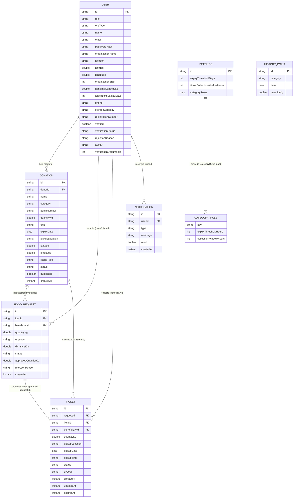

`HISTORY_POINT` is not linked to anything. It is standalone input for the forecast.

**Design notes:**
- **Denormalisation:** tickets copy `pickupLocation` and `itemId`/`beneficiaryId` so they can be shown without walking back through the request.
- **No foreign-key protection:** deleting a donation (`DELETE /api/donations/{id}`) leaves its requests and tickets pointing to a missing item. The list endpoints then return `item: null`.
- **No cascading or transactions:** multi-step operations (save the request → reserve stock → create the ticket → notify) are separate writes. A crash in the middle can leave partial state.

### 1.6.2 Enumerations and statuses (all stored as plain strings)

| Field | Allowed values | Meaning |
|---|---|---|
| `User.role` | `donor`, `beneficiary`, `farm`, `admin` | Permissions in the UI |
| `User.verificationStatus` | `pending`, `approved`, `rejected` | Admin review state |
| `Donation.status` | `fresh`, `surplus`, `expired`, `reserved`, `collected` | Lifecycle (see below) |
| `Donation.listingType` | `donation`, `expired` | Human food vs. farm/compost |
| `FoodRequest.urgency` | `critical`, `high`, `medium`, `low` | Beneficiary-declared need |
| `FoodRequest.status` | `pending`, `counter_offer`, `approved`, `rejected`, `cancelled` | Workflow |
| `Ticket.status` | `pending`, `collected` (`expired` documented but not written) | Pickup state |
| `Notification.type` | `request`, `ticket`, `expiry`, `system` | Bell icon colour/category |
| Frontend alert `type` | `info`, `warning`, `urgent` | Client-side threshold alerts |
| Category rule keys | `cooked_bakery`, `perishable_dairy`, `packaged_dry` | Settings map keys |

Because these are strings rather than Java `enum`s, a typo (e.g. `"aproved"`) would be stored without complaint. `PATCH /api/tickets/{id}` and `PATCH /api/donations/{id}` accept **any** status.

### 1.6.3 State diagrams

**Donation status (expiry classification by `ExpiryUtil.classify`):**

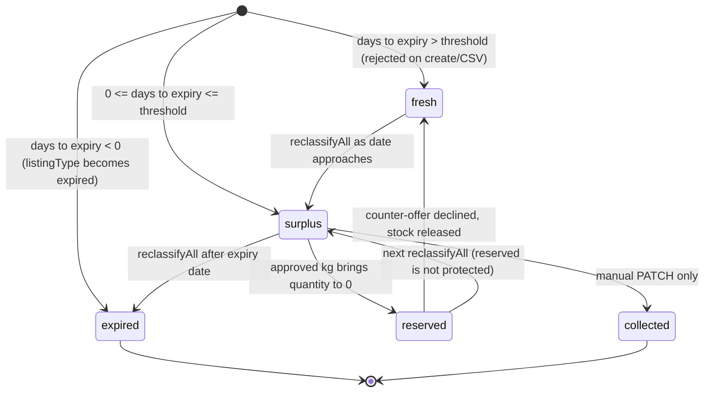

> The `collected` donation status is **only reachable by a manual PATCH**. Nothing in the UI or services sets it. Scanning a ticket marks the **ticket** collected, not the donation. Because `reclassifyAll` only skips `collected`, a `reserved` item is overwritten back to `surplus`/`expired` the next time anyone lists donations.

Classification rule (`ExpiryUtil`): `d = days between today and expiryDate`. `d < 0` → **expired**; `d ≤ thresholdDays` → **surplus**; otherwise **fresh**. `thresholdDays` comes from `SettingsService.resolveExpiryThresholdDays(category)`.

**Food request workflow (`RequestService.updateStatus`):**

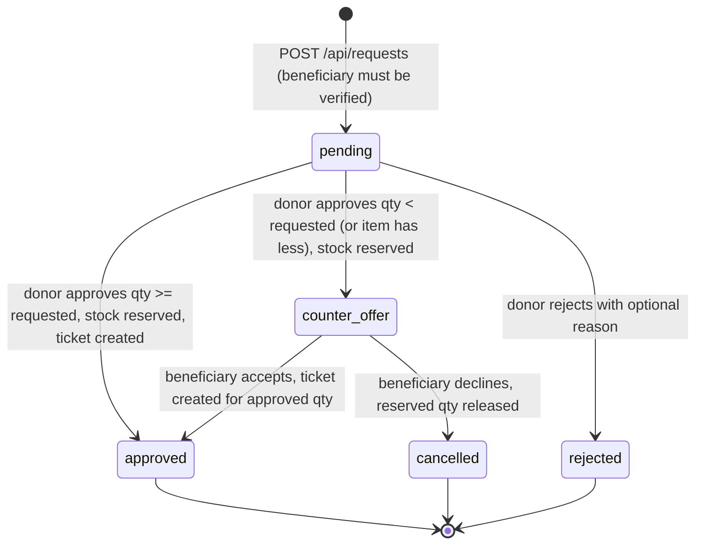

The approved quantity is capped at the item's remaining kg (`min(qty, item.quantityKg)`). Any other status string is saved as-is, without side effects.

**Verification workflow (`BeneficiaryService` + `VerificationDocumentService`):**

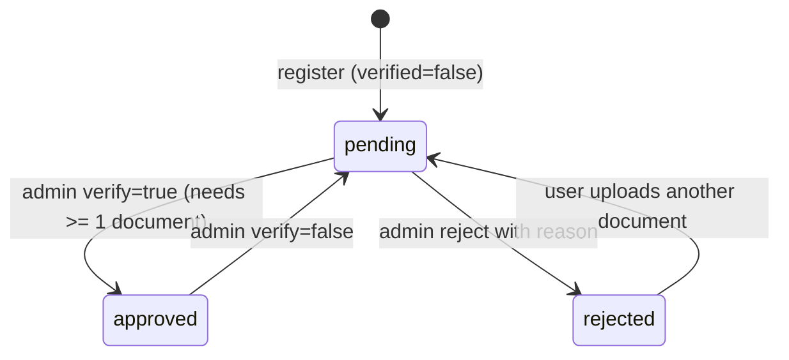

**Ticket:** `pending` → `collected` via `POST /api/tickets/scan`. The frontend shows **Window Expired** when `now > expiresAt` and the ticket is not collected, but the backend still accepts a scan after the window.

---

## 1.7 Frontend design

### 1.7.1 Structure

```
frontend/
├── index.html              (title, favicon, #root)
├── nginx.conf / Dockerfile (production serving)
├── vite.config.js          (dev server :5173, /api proxy)
├── public/                 (logos, auth-hero.jpg, sample_inventory.csv)
└── src/
    ├── main.jsx            (mount React, BrowserRouter)
    ├── App.jsx             (providers + all routes + guards)
    ├── api.js              (the only HTTP helper)
    ├── AuthContext.jsx     (who is logged in)
    ├── FoodAlertContext.jsx(donor threshold alerts: polling + storage)
    ├── alertEngine.js      (pure alert rules)
    ├── timeAgo.js          ("5m ago" formatter)
    ├── index.css           (global styles, ~2,300 lines)
    ├── components/         (reusable UI pieces)
    └── pages/              (one file per screen)
```

### 1.7.2 Provider and layout tree

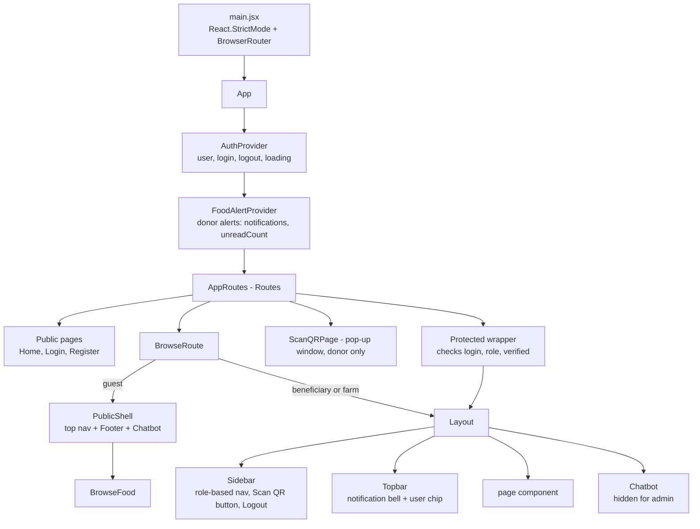

### 1.7.3 Routing and access rules (every route in `App.jsx`)

Guards:
- **`Protected`**: not logged in → `/login`. If `roles` is given and the user's role is not in it → `/dashboard`. If `requireVerified` is set and the user is an unverified beneficiary/farm → `/dashboard`. Otherwise the page is wrapped in `Layout`.
- **`BrowseRoute`**: guests get `PublicShell`. Beneficiary/farm users (verified or not) get `Layout`. Other logged-in roles are sent to `/dashboard`.

| Path | Who can open it | Guard | Page component | Notes |
|---|---|---|---|---|
| `/` | Guests | redirect logged-in users → `/dashboard` | `Home` | Marketing landing page |
| `/login` | Guests | logged-in → `/dashboard` | `Login` | |
| `/register` | Guests | logged-in → `/dashboard` | `Register` | |
| `/scan` | **donor** only | else → `/login` | `ScanQRPage` | Opened as a pop-up by the Sidebar; no Layout |
| `/dashboard` | any logged-in | `Protected` | `Dashboard` | Switches to Donor / Admin / Beneficiary (also farm) dashboard |
| `/profile` | any logged-in | `Protected` | `Profile` | |
| `/help` | any logged-in | `Protected` | `Help` | |
| `/impact` | any logged-in | `Protected` | `Impact` | Donor/admin: analytics + AI forecast. Others: `BeneficiaryImpact` |
| `/donations` | donor | `Protected roles=[donor]` | `MyDonations` | |
| `/requests` | donor | `Protected roles=[donor]` | `Requests` | |
| `/requests/beneficiary` | — | redirect → `/requests` | — | Legacy URL |
| `/requests/farm` | — | redirect → `/requests` | — | Legacy URL |
| `/pickups` | donor | `Protected roles=[donor]` | `PickupHistory` | |
| `/browse` | guests, beneficiary, farm | `BrowseRoute` | `BrowseFood` | Read-only for guests and unverified users |
| `/my-requests` | verified beneficiary/farm | `Protected roles=[beneficiary,farm] requireVerified` | `MyRequests` | |
| `/tickets` | donor, verified beneficiary/farm | `Protected roles=[beneficiary,farm,donor] requireVerified` | `Tickets` | Donor view has no QR image |
| `/admin/beneficiaries` | admin | `Protected roles=[admin]` | `AdminVerifications` | |
| `/admin/settings` | admin | `Protected roles=[admin]` | `AdminSettings` | |
| `/admin/reports` | admin | `Protected roles=[admin]` | `AdminReports` | |
| `*` (anything else) | — | → `/dashboard` if logged in, else `/login` | — | |

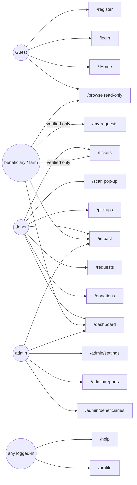

Sidebar menus (`Sidebar.jsx` `NAV_BY_ROLE`). Help & Support and Logout are always added; donors also get "Scan QR Code".

| donor | beneficiary | farm | admin |
|---|---|---|---|
| Dashboard, My Donations, Food Requests, Pickup Tickets, Impact, Pickup History, Profile | Dashboard, Available Food, My Requests\*, My Tickets\*, Impact, Profile | Dashboard, Expired Food, My Requests\*, My Tickets\*, Profile | Dashboard, Verifications, Generate Reports, Settings, AI Insights (`/impact`) |

\* hidden while unverified.

### 1.7.4 Contexts (shared state)

**`AuthContext.jsx` — "who am I?"**
- **What:** holds `user` (the full user JSON returned by login/register), `login(u)`, `logout()`, and `loading`.
- **How it persists:** saves `user` to `localStorage["zerowaste_user"]` and reads it back on page load (also accepts the legacy key `foodshare_user`). `logout` removes both keys.
- **Why this design:** very simple, with no server session or token. A page refresh keeps you logged in.
- **Consequences:** the stored user is a **snapshot**. If an admin verifies you, your browser still shows `verified: false` until you log in again or an upload returns the updated user (`VerificationUpload` calls `login(updated)`). `loading` is set to false immediately after mount, so it is effectively always false. `GET /api/auth/me/{id}` exists but is not used to refresh the snapshot.

**`FoodAlertContext.jsx` — donor "threshold alert" engine (the "when")**
- **What:** for **donors only**, calls `scan()` immediately and then **every 60 s** (`POLL_INTERVAL_MS`). Each scan fetches `/donations?donorId`, `/requests?donorId` and `/settings` in parallel.
- For each non-collected donation it asks `alertEngine.evaluateItem` which states apply, and builds alert messages.
- **Deduplication:** at most **one alert per (item, alert type)** is ever stored, so the same alert never repeats.
- Keeps the newest **50** alerts in `localStorage["zerowaste_alerts_<userId>"]`, so they survive refresh. Exposes `notifications`, `unreadCount`, `markRead(id)`, `markAllRead()`.
- Errors are swallowed silently, and the next tick retries.
- **Why client-side:** no backend scheduler or job is needed. **Trade-off:** alerts only appear while the donor has the app open, are per-browser, and are not shared across devices.
- **Side effect:** each poll triggers `reclassifyAll` on the backend (via `GET /donations`), so an open donor tab also keeps donation statuses up to date.

### 1.7.5 `alertEngine.js` — pure alert rules (the "what")

Pure functions (no React, no network), so they are easy to test.

| Function | What it does |
|---|---|
| `resolveCategoryKey(category)` | Same keyword mapping as `SettingsService.resolveCategoryKey` (regex version). |
| `ruleFor(category, settings)` | Returns the category rule, or a global fallback `{expiryThresholdHours: expiryThresholdDays×24, collectionWindowHours: ticketCollectionWindowHours}` (defaults 3 days / 24 h). |
| `evaluateItem(item, requestCount, settings, now)` | `expiresAt` = **end of the expiry day** (23:59:59.999 local time). `hoursRemaining` = expiresAt − now. `hoursListed` = now − createdAt. **EXPIRED** if hoursRemaining ≤ 0 (and nothing else). Otherwise **UNCLAIMED** if listed ≥ 1 h with 0 requests, and **URGENT** if hoursRemaining ≤ the category's `expiryThresholdHours`. Both can apply at once. |
| `buildAlert(item, state, hours)` | UNCLAIMED → "Unclaimed Food" (`warning`); URGENT → "Urgent Expiry Alert … expires in N hours" (`urgent`); EXPIRED → "Rerouted to Composting" (`info`). |

> **Consistency note:** the frontend uses the rule in **hours** (e.g. 4 h for cooked food). The backend rounds up to whole **days** (`ceil(4/24)` = 1 day). So an item can be "surplus" on the server a day before the client calls it "urgent". Also, `UNCLAIMED` counts all requests for the item, whatever their status.

### 1.7.6 `api.js` — the HTTP layer

A tiny wrapper around the browser's `fetch`, so every page calls the backend the same way:

| Function | Does |
|---|---|
| `api.get(path)` | `GET /api{path}` |
| `api.post(path, body)` | JSON POST |
| `api.patch(path, body)` | JSON PATCH |
| `api.del(path)` | DELETE (unused) |
| `api.upload(path, formData)` | multipart POST (CSV, documents) |
| `api.download(path, filename)` | fetches a binary file, turns it into a Blob URL and clicks a hidden `<a download>` (PDF reports, documents) |

`handle(res)` parses JSON and, if the status is not 2xx, throws `new Error(data.error || "Request failed")`. This works because every backend error has the shape `{"error": "..."}` (§1.9.2).

**Why relative `/api`:** the same build works behind the Vite proxy (dev) and the nginx proxy (Docker) without changing any URL.

**No auth header** is ever attached.

### 1.7.7 Page inventory

| Page | Route | Purpose | Backend calls |
|---|---|---|---|
| `Home.jsx` | `/` | Public landing page: hero, 6 feature cards (AI matching, forecasting, QR pickup, real-time requests, verified network, role dashboards), 4-step "how it works", 4 role cards, **static** impact numbers (500+ kg, 1,000+ meals, 120+ kg CO₂, 5+ communities), Footer, Chatbot. Uses `Reveal` scroll animations. | none |
| `Login.jsx` | `/login` | Split-screen sign-in with show/hide password. The "remember me" checkbox is UI-only (the user is always saved to localStorage). On success: `login(user)` → `/dashboard`. | `POST /auth/login` |
| `Register.jsx` | `/register` | Step 1: choose **Donor** or **Receiving Organization**. Donor uses an inline form; organisations use `BeneficiaryRegistrationForm` (beneficiary vs farm). Step 2: **agreement** screen (Donor Pledge / Recipient Disclaimer / Farm & Compost Partner Disclaimer). Confirm → register → auto-login → `/dashboard`. | `POST /auth/register`, (conditional) `POST /beneficiaries/{id}/documents` |
| `Dashboard.jsx` | `/dashboard` | **DonorDashboard**: verification banner + `VerificationUpload`, stat cards, impact ring, recent donations, next pickup. **BeneficiaryDashboard** (beneficiary & farm): banner/upload, available-item count (farms count expired items), tickets, requests. **AdminDashboard**: totals, category bars, top items/donors/organisations (`RankedBarList`, `ItemsBarChart`), request-status donut (`DonutChart`), food-outcome chart, line chart (`DetailedLineChart`). Charts are hand-drawn SVG, no chart library. | `GET /dashboard/{id}`; `GET /donations?published=true`, `/tickets?beneficiaryId`, `/requests?beneficiaryId`; `GET /dashboard/admin/overview` |
| `MyDonations.jsx` | `/donations` | Donor inventory with tabs All/Surplus/Fresh/Expired. **Add Item** form (category dropdown). **Upload CSV** (+ "Download Sample CSV" from `/public`). Publish/unpublish toggle. **RecommendationPanel** shows the AI ranking for an item with approve (full qty) / reject buttons. | `GET /donations?donorId`, `POST /donations`, `POST /donations/upload`, `PATCH /donations/{id}`, `GET /requests/recommendations/{itemId}`, `PATCH /requests/{id}` |
| `Requests.jsx` | `/requests` | Donor's incoming requests, tabs All / Beneficiary / Farm-Compost, 7 per page. **AI insights toggle** fetches rankings for every item with pending requests and shows "NN% Match – Closest Distance / Highest Urgency / Best Overall Fit / Priority #k" (the justification text is computed **in the browser**, not by the AI). `RequestDetailModal`: approve with an editable quantity (lower = counter-offer) or reject with a reason. | `GET /requests?donorId`, `GET /requests/recommendations/{itemId}`, `PATCH /requests/{id}` |
| `BrowseFood.jsx` | `/browse` | Grid of published items. Beneficiaries/guests see non-expired items; farms see only expired. **RequestModal** (quantity, urgency; `distanceKm` random 1–9). **LockedModal** for guests ("log in") and unverified users ("pending"). | `GET /donations?published=true`, `POST /requests` |
| `MyRequests.jsx` | `/my-requests` | Beneficiary/farm request table, 8 per page, status and urgency badges. For `counter_offer`: **Accept** (→ approved) / **Decline** (→ cancelled). `RejectionReasonModal` shows the donor's reason. | `GET /requests?beneficiaryId`, `PATCH /requests/{id}` |
| `Tickets.jsx` | `/tickets` | `CollectionTicketCard` per ticket. Beneficiary view renders the QR image from `qrCode` (downloadable PNG) and a **live collection-window countdown** (refreshes every minute; "Window Expired" when past `expiresAt`). Donor view shows the same cards without QR. Exports `CollectionTicketCard` for reuse. | `GET /tickets?donorId` or `?beneficiaryId` |
| `PickupHistory.jsx` | `/pickups` | Donor's ticket history as cards with status pills, 6 per page. | `GET /tickets?donorId` |
| `ScanQRPage.jsx` | `/scan` | Stand-alone pop-up hosting `ScanTicketPanel`. On success it `postMessage`s `{type:"zerowaste-scan-completed"}` to the opener window (same origin only) and closes itself after 1.2 s. The Sidebar listens, shows a toast and reloads the page. | via `ScanTicketPanel` |
| `Impact.jsx` | `/impact` | Donor/admin: impact ring (`percentile`), waste diverted, meals, and a **7-day AI surplus forecast** bar chart per category. Admins get the forecast only. Beneficiary/farm: `BeneficiaryImpact`, which computes kg received and meals (2 meals/kg) from their tickets and requests in the browser. | `GET /dashboard/{id}`, `GET /ai/predict?daysAhead=7`, `GET /tickets?beneficiaryId`, `GET /requests?beneficiaryId` |
| `Profile.jsx` | `/profile` | Read-only profile card from the stored user (name, email, organisation, category, verification badge). **No editing.** | none |
| `Help.jsx` | `/help` | 5 static FAQs. | none |
| `AdminVerifications.jsx` | `/admin/beneficiaries` | Tabs All / Donors / Beneficiaries-NGOs. Sections: Pending (approve / reject), Verified, Rejected (shows reason). Document viewer/download. `RejectModal` with preset reasons (Invalid/Unclear Document, Mismatched Details, Expired Registration, Suspected Fraud, Other). | `GET /beneficiaries?status=…` ×3, `PATCH /beneficiaries/{id}/verify`, `PATCH /beneficiaries/{id}/reject`, document GET/download |
| `AdminSettings.jsx` | `/admin/settings` | Global threshold (days) and collection window (hours). **Category Rules** for 3 categories with hours/days unit display. **Presets**: *Strict* (global 2 d/12 h; cooked 2 h/1 h; perishable 24 h/6 h; packaged 96 h/24 h) and *Relaxed* (5 d/48 h; 6 h/4 h; 48 h/24 h; 168 h/48 h). The two save buttons call separate endpoints. | `GET /settings`, `PATCH /settings`, `PATCH /settings/category-rules` |
| `AdminReports.jsx` | `/admin/reports` | Pick Year → optional Month → optional Day (limited to the last 2 years, up to today). Computes start/end dates. Shows summary stat cards, category/status/trend charts, donation table. **Download PDF**. | `GET /reports`, `GET /reports/pdf` |

### 1.7.8 Component inventory

| Component | Purpose | Used by |
|---|---|---|
| `Layout.jsx` | App shell for logged-in pages: Sidebar + Topbar + content + Chatbot (not for admin). | `App.jsx` (Protected, BrowseRoute) |
| `Sidebar.jsx` | Role-based navigation, hides verified-only links, donor "Scan QR Code" pop-up launcher with pop-up-blocked toast, listens for scan-completed messages, Logout. | Layout |
| `Topbar.jsx` | Notification bell merging **backend notifications** (loaded once when the user changes, no polling) and **client threshold alerts**, sorted by time, top 8 shown. Opening the dropdown marks all read. Coloured dots: urgent red, warning amber, info green, others grey. User chip → `/profile`. | Layout |
| `Chatbot.jsx` | Floating chat button + window; sends messages to `/api/chatbot`. Conversation is kept only in component state. | Layout, PublicShell, Home |
| `PublicShell.jsx` | Guest wrapper: top nav (Log in / Get Started), main area, Footer (not on auth routes), Chatbot. | BrowseRoute |
| `Footer.jsx` | Site footer with platform/portal links. Legal links are placeholders (`href="#"`). | Home, PublicShell |
| `BeneficiaryRegistrationForm.jsx` | Organisation sign-up form: Beneficiary vs Farm toggle cards, contact name, email, org name, phone, city, people served daily & storage type (beneficiary only), password (≥8 chars) + confirm. Validates on blur and on submit. Calls `onSubmit(values, null)`. | Register |
| `VerificationUpload.jsx` | Upload proof-of-organisation documents, list uploaded ones as links, refresh the stored user. | Dashboard (donor, beneficiary, farm banners) |
| `ScanTicketPanel.jsx` | Opens the rear camera (`getUserMedia`), decodes frames with **jsQR** on a hidden canvas every animation frame, or accepts a typed ticket id. Posts to `/tickets/scan`. Stops the camera on success/unmount. | ScanQRPage |
| `StatCard.jsx` | Icon + label + value + unit + sub-text card. | Dashboard, AdminReports |
| `ProgressRing.jsx` | SVG circular percentage ring. | Dashboard, Impact |
| `Pagination.jsx` | Prev / numbered / Next pill buttons (hidden if one page). | Requests, MyRequests, PickupHistory |
| `Reveal.jsx` | Fade/slide-in when scrolled into view (IntersectionObserver, 15% visible, runs once). | Home |
| `Icons.jsx` | ~50 hand-made SVG React components: brand (`LogoZeroWasteMark`, `BrandWordmark`), nav icons, stat icons, step icons, illustrations (`GraphicEcoTruck`, `GraphicEarthSprout`, `GraphicSidebarSalad`), utility icons (upload, download, calendar, sparkle, bot, spinner…). | Everywhere |
| `CollectionTicketCard` (exported from `pages/Tickets.jsx`) | Ticket pass with QR, details, countdown badge, PNG download. | Tickets |
| `timeAgo.js` (helper) | "just now / Xm / Xh / Xd ago". | Topbar |

> `ScanTicketModal.jsx` was **deleted** in the working tree (git status). `ScanTicketPanel`'s comment still mentions "the in-page modal", but only the pop-up page uses it now.

---

## 1.8 AI service design

### 1.8.1 Why a separate Python service?

| Reason | Explanation |
|---|---|
| **Right tool for the job** | Python has the standard ML libraries (scikit-learn, NumPy). Doing regression in Java would mean less common libraries. |
| **Independent change** | Data scientists can swap the scoring or forecasting model (e.g. to Prophet/ARIMA or a learning-to-rank model) without rebuilding or redeploying the Java app, as long as the JSON contract stays the same. The module docstrings say this explicitly. |
| **Stateless and scalable** | No database, no sessions. Each call carries all its input, so it can be restarted or replicated freely. |
| **Graceful degradation** | The Java side catches connection errors and falls back, so the platform keeps working if the AI service is down. |
| **Security boundary** | The browser never calls it directly. Only Spring Boot does. (In Docker its port 8000 is still published to the host, and CORS is `*`.) |

Analogy: the backend is the **shop manager** who knows all the records. The AI service is an **outside consultant**: the manager photocopies the relevant files, posts them over, and gets a recommendation back. The consultant keeps no copies.

### 1.8.2 Endpoints

| Method | Path | Request schema | Response schema | Called by |
|---|---|---|---|---|
| GET | `/health` | — | `{status:"ok", service:"Zero Waste AI/ML Service"}` | Humans / monitoring |
| POST | `/recommend/priority` | `PriorityRequest` | `PriorityResponse` | `AIClientService.rankRequests` |
| POST | `/predict/surplus` | `PredictionRequest` | `PredictionResponse` | `AIClientService.predictSurplus` |
| GET | `/docs` | — | Swagger UI (FastAPI built-in) | Developers |

### 1.8.3 Schemas (`app/schemas.py`, Pydantic)

| Schema | Fields (type = default) |
|---|---|
| `RequestItem` | `id: str`, `itemId: str`, `beneficiaryId: str`, `quantityKg: float`, `urgency: str = "medium"`, `distanceKm: float = 10.0`, `status: str = "pending"` |
| `BeneficiaryProfile` | `id: str`, `organizationName: str? = "Unknown"`, `organizationSize: int? = 0`, `handlingCapacityKg: float? = 0.0`, `allocationsLast30Days: int? = 0` |
| `ItemInfo` | `id: str`, `name: str? = None`, `category: str? = None` |
| `PriorityRequest` | `item: ItemInfo`, `requests: List[RequestItem]`, `beneficiaries: List[BeneficiaryProfile]` |
| `RankedRequest` | `requestId: str`, `beneficiaryId: str`, `beneficiaryName: str`, `score: float` |
| `PriorityResponse` | `ranking: List[RankedRequest]` |
| `HistoryEntry` | `category: str`, `date: str` (ISO `YYYY-MM-DD`), `quantityKg: float` |
| `PredictionRequest` | `daysAhead: int = 7`, `history: List[HistoryEntry]` |
| `PredictionResponse` | `daysAhead: int`, `predictions: dict[str, float]`, `totalPredictedKg: float`, `note: str` |

If Java sent invalid data (e.g. a `null` `quantityKg`), FastAPI would reply 422. Java treats that as a `RestClientException` and falls back.

### 1.8.4 Priority ranking algorithm (`app/ml/priority.py`)

**In plain words:** each pending request gets a score from 0 to 1. It is a weighted mix of five "points" questions. Higher score = should be served first. This is a **transparent rule-based formula, not a trained model**, chosen on purpose so allocation decisions for essential resources can be explained.

Only requests with `status == "pending"` are scored. Results are sorted high → low. If a request's beneficiary profile is missing, it scores 0 with the name "Unknown".

| Factor | Weight | Sub-score (0–1) | Meaning |
|---|---|---|---|
| Urgency | **0.40** | critical 1.0, high 0.75, medium 0.5, low 0.25 (unknown → 0.5) | How badly they say they need it |
| Distance | **0.20** | `1 − min(distanceKm / 50, 1)` | Closer is better; 50 km or more scores 0 |
| Organisation size | **0.15** | `min((organizationSize or 1) / 500, 1)` | More people served is better; 500+ is the maximum |
| Handling capacity | **0.15** | `min((handlingCapacityKg or 50) / 500, 1)` | Can realistically take the food; a 0/missing value is treated as **50 kg** |
| Fairness (history) | **0.10** | `1 − min(allocationsLast30Days / 10, 1)` | Fewer recent allocations is better; 10+ scores 0 |

**Formula:**

```
score = 0.40·urgency + 0.20·(1 − dist/50) + 0.15·(size/500) + 0.15·(capacity/500) + 0.10·(1 − allocations/10)
        (each ratio capped at 1; score rounded to 3 decimals)
```

**Worked example (seed data):** Hope Kitchen requests bread with urgency *high*, distance 4.2 km, size 120, capacity 200 kg, 3 allocations:
`0.40×0.75 + 0.20×(1−0.084) + 0.15×0.24 + 0.15×0.40 + 0.10×(1−0.3)`
`= 0.300 + 0.183 + 0.036 + 0.060 + 0.070 = 0.649`.
The Requests page shows this as "65% Match".

**Caveats grounded in code:** `distanceKm` is currently random (from the UI); `allocationsLast30Days` never changes after seeding; new beneficiaries register with `handlingCapacityKg = 0` (scored as 50 kg). So in practice the ranking is driven mainly by **urgency** and **organisation size**.

### 1.8.5 Surplus prediction algorithm (`app/ml/prediction.py`)

**In plain words:** for each food category, draw the best straight line through the past daily quantities, extend that line into the next *N* days, and add up the values.

Steps for each category:
1. Group history entries by category and sort by date.
2. `y` = the list of daily kg values; `x` = position 0, 1, 2 … *n−1*. The **real calendar dates are ignored**, so missing days are not accounted for.
3. If there is only 1 point, predicted daily kg = that value.
4. Otherwise fit **`sklearn.linear_model.LinearRegression`** (least squares: `y ≈ intercept + slope·x`).
   If scikit-learn/NumPy are not installed, a **pure-Python fallback** computes the same thing:
   `slope = Σ(x−x̄)(y−ȳ) / Σ(x−x̄)²`, `intercept = ȳ − slope·x̄`.
5. Predict for `x = n … n+daysAhead−1`, set negative predictions to 0, and take the mean → `predicted_daily`.
6. `prediction[category] = round(max(predicted_daily, 0) × daysAhead, 1)`.

The route adds `totalPredictedKg = round(Σ predictions, 1)` and a `note` naming the model and the number of data points.

**Example:** seeded "Bakery" has base 8 kg/day and trend +0.3 kg/day. After 20 days the line is near 13–14 kg/day and still rising, so the 7-day forecast is roughly 7 × ~15 ≈ 100 kg (exact numbers vary because the seeder adds random noise).

**Caveat:** the history is **synthetic** seed data, so the forecast shows the mechanism, not real-world accuracy.

### 1.8.6 Integration contract (Java ⇄ Python)

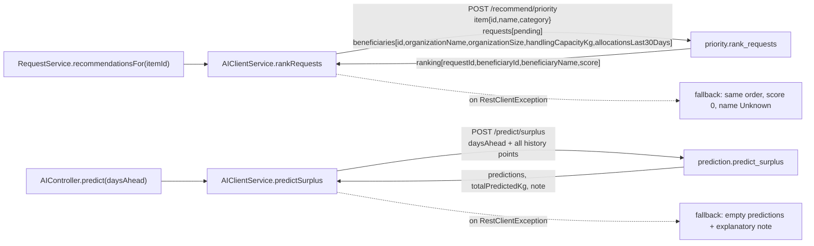

Base URL: `foodshare.ai-service.base-url` (env `AI_SERVICE_URL`, default `http://localhost:8000`; Docker `http://ai-service:8000`).

---

## 1.9 Cross-cutting concerns

### 1.9.1 Security

| Aspect | What the code does | Assessment |
|---|---|---|
| **Password storage** | BCrypt via `spring-security-crypto` (`PasswordConfig`). The hash is `@JsonIgnore`d so it never appears in API responses. Seeded and back-filled accounts use `password123`. | Good practice for storage. The shared demo password must not reach production. |
| **Password rules** | Frontend organisation form: ≥ 8 characters + confirmation. Backend: only `@NotBlank`. | Server-side strength is not enforced. |
| **Authentication (proving who you are)** | `POST /api/auth/login` returns the user object. **No session, cookie, JWT or other token** is issued. The frontend stores the user JSON in `localStorage`. | **Missing.** Every later request is anonymous as far as the server is concerned. |
| **Authorisation (what you may do)** | Enforced **only in React** (`Protected`, `BrowseRoute`, sidebar filtering). The backend trusts whatever ids are in the URL or body (`donorId`, `beneficiaryId`, `userId`). The only server-side checks are business rules: beneficiary must be `verified` to request, and scanning donor must own the item. | **Missing.** Anyone who can reach the API can, for example, approve verifications, change settings, list all users with emails and phones, read other users' notifications, delete donations, approve requests, download verification documents, or pass another donor's id to `/tickets/scan`. |
| **Registration role** | `RegisterRequestDTO.role` is only `@NotBlank`; `AuthService.register` stores it as given. | **Privilege escalation:** a direct API call can register `role: "admin"`, and the frontend admin routes only check `role`. |
| **Tampering with localStorage** | Editing `zerowaste_user` in DevTools (e.g. `role: "admin"`, `verified: true`) unlocks those screens. | Follows from the two rows above. |
| **CORS** | Backend: only `FRONTEND_ORIGIN` origins (default `http://localhost:5173`; Docker `http://localhost:5173,http://localhost:3000`). AI service: `allow_origins=["*"]`. | CORS only restricts **browsers**. It is not access control. In Docker, same-origin nginx proxying means CORS isn't even needed for the UI. |
| **Transport** | Plain HTTP everywhere (nginx listens on port 80; no TLS config). | HTTPS termination would need to be added in front. |
| **Database** | `mongodb://mongodb:27017/foodshare` with **no username/password**. Port 27017 is published to the host in Compose. | Open database if the host is reachable. |
| **Secrets** | No real secrets in the code (no API keys). The demo password is hard-coded in `DataSeeder`. `.gitignore` excludes `.env`. | OK for a prototype. |
| **File uploads** | Filename sanitised, path-traversal checks, 10 MB limit. No type allow-list, no antivirus. Files served `inline` with a sniffed content type. | An uploaded HTML/SVG could be rendered inline from the API origin (stored XSS risk). Upload and download endpoints are also unauthenticated. |
| **Injection** | Spring Data derived queries are parameterised. No string-built queries. | Low NoSQL-injection risk. |
| **XSS** | React escapes rendered text by default. No `dangerouslySetInnerHTML` found in the files reviewed. | OK. |
| **Scan pop-up messaging** | `postMessage` is sent to `window.location.origin` and the receiver checks `e.origin`. | Correctly scoped. |
| **Rate limiting / brute force** | None on login or any endpoint. | Missing. |

### 1.9.2 Error handling

All errors from controllers/services pass through `GlobalExceptionHandler` and come back as JSON `{"error": "<message>"}` (`ApiError`):

| Exception thrown | HTTP status | Typical sources |
|---|---|---|
| `IllegalArgumentException` whose message contains "not found" (case-insensitive) | **404** | "Item not found", "Beneficiary not found", "Ticket not found", "Document not found" |
| other `IllegalArgumentException` | **400** | "Invalid email or password", fresh/expired item on create, bad CSV date, report range errors, wrong donor on scan, missing rejection reason |
| `IllegalStateException` | **409 Conflict** | duplicate email, unverified beneficiary requesting, approving without documents, ticket already collected |
| `MethodArgumentNotValidException` (Bean Validation) | **400** | message = "`<field> <constraint message>`" for the **first** failing field |
| any other `Exception` | **500** | "Unexpected error: …", e.g. a `NullPointerException` if `POST /donations` has no `expiryDate` |

On the frontend, `api.js` turns any non-2xx response into a JavaScript `Error(data.error)`, which pages show inline (e.g. red text in forms). Several pages call `.catch(() => {})` and fail silently (dashboards, Topbar, FoodAlertContext).

**Design choice:** using standard Java exceptions plus message inspection avoids custom exception classes, but it is fragile. The 404-vs-400 decision depends on the English wording of the message, and a failed login returns 400 rather than 401.

AI-service failures never surface as errors: they are converted into fallback responses (§1.8.6).

### 1.9.3 Validation

| Where | What is validated |
|---|---|
| Backend – Bean Validation | `LoginRequestDTO` (email format, not blank), `RegisterRequestDTO` (role, name, email format, password, organizationName not blank). `@Valid` is also placed on `Donation` and `FoodRequest` bodies, but those classes have **no constraint annotations**, so it does nothing. |
| Backend – business validation (services) | Duplicate email; donation not past expiry / not fresh; CSV date formats; request only by a verified beneficiary for a non-expired item; approval needs a document; rejection needs a reason; report date range rules; scan ownership / already collected; upload not empty. |
| Backend – not validated | Negative or zero quantities; requested kg greater than available (capped only at approval); `urgency`/`status` values; `role` values; `quantityKg` null on request submit (would cause errors later). |
| Frontend | `BeneficiaryRegistrationForm` (required fields, email regex, password ≥ 8 and match); donor register form (passwords match); HTML `required` attributes on the add-item form; AdminReports restricts selectable dates. |
| AI service | Pydantic type checking of all fields (422 on mismatch). |

### 1.9.4 Configuration-driven business rules

Admin settings (§1.5.3 Settings) drive three things:
1. **Classification** in `DonationService` (backend, whole days).
2. **Ticket collection windows** (`RequestService.createTicket` → `expiresAt`; shown by `Tickets.jsx`).
3. **Client alerts** in `alertEngine` (hours).

Categories are matched by **keywords in free text**, so a category like "Seafood" matches no rule and uses the global defaults.

### 1.9.5 Reports and PDF generation

- **Data** (`ReportService.generateReport`): filters donations, tickets and requests created within `[startDate 00:00 UTC, endDate+1 00:00 UTC)`.
  **Summary:** total donations, total kg, tickets, collected kg (tickets with status `collected`), requests, distinct beneficiaries served, meals = round(kg × 2), CO₂ = kg × 2.5.
  **Breakdowns:** category kg (sorted descending) and status counts.
  **Trend:** per day (≤ 31 days) or per month, with donation count + kg.
  **Rows:** all donations, newest first.
- **PDF** (`ReportPdfService.build`): OpenPDF document written to a byte array in memory, then returned with `Content-Disposition: attachment`. The layout mirrors the admin screen: brand-green title, 4×2 summary grid, two horizontal bar lists drawn with table cells, striped records table with a repeating header row.
- **Why server-side PDF:** consistent output across browsers, and no heavy PDF library in the frontend bundle.
- **Limitation:** everything is loaded with `findAll()` and filtered in memory. Large datasets would need database-side date queries.
- **Test:** `ReportSmokeTest` builds a PDF from hand-made data (no MongoDB needed) and asserts it is valid.

The meal and CO₂ factors (2 meals/kg, 2.5 kg CO₂/kg) are **fixed estimates in code**. No source for them is cited.

### 1.9.6 File storage

- **What is stored:** only organisation verification documents.
- **Where:** `<working dir>/uploads/verification/<userId>/<epochMillis>-<sanitisedName>` (setting `foodshare.uploads.dir`, **not** listed in `application.yml`, so the default applies). The database keeps only the filename list in `User.verificationDocuments`.
- **Why local disk:** simplest possible option for a prototype. No cloud account needed.
- **Trade-offs:** in Docker there is **no volume** for `/app/uploads`, so documents are **lost when the backend container is recreated** (MongoDB data survives because it has `mongo-data`). Files are not replicated, so multiple backend instances would not share them. There is no deletion endpoint.
- **CSV uploads** are parsed in memory and never saved as files.
- **Static public files** (`frontend/public/`): logo images, `auth-hero.jpg`, and `sample_inventory.csv` (same content as `sample-data/sample_inventory.csv`).

### 1.9.7 Notifications (two separate systems)

| | Backend notifications | Client threshold alerts |
|---|---|---|
| Stored in | MongoDB `notifications` | Browser localStorage |
| Created by | `NotificationService.notify` from `RequestService` (new request → donor; approved / counter-offer / declined / ticket generated → beneficiary) and `TicketService` (pickup confirmed → beneficiary) | `FoodAlertContext` + `alertEngine` (donor only) |
| Delivery | Fetched by `Topbar` **once when the user loads**. No polling, WebSocket or push, so new messages appear after navigation/reload that re-mounts the Topbar or after re-login. | Poll every 60 s while the app is open |
| Types | `request`, `ticket` (`expiry` in seed data only) | `warning` (unclaimed), `urgent` (near expiry), `info` (rerouted to compost) |
| Shown in | Same bell dropdown (merged, newest first, top 8) | Same bell dropdown |
| Email / SMS | **None** (explicitly out of scope in the README) | None |

### 1.9.8 Chatbot

- **Design:** a deterministic, **offline, rule-based** assistant (`ChatbotService`), with no AI/LLM and no outside service. The code comment says this keeps it dependency-free and suggests Dialogflow or an LLM as future options.
- **Step 1 – availability questions:** if the message contains `available`, `what food`, `what's on`, `any food`, or `food` together with `today`/`now`:
  - It optionally pulls a city from a trailing "in \<city\>" (regex `\bin\s+([a-z][a-z\s]{1,30}?)\s*[?.!]*$`), ignoring "the app", "stock", "my area", "general", "total".
  - It then lists up to **5** published items that are not expired/collected/reserved, sorted by soonest expiry, optionally filtered by `pickupLocation` containing the city.
  - Each line shows name, quantity, location and days left. **Donor identity is never included.**
- **Step 2 – FAQ keywords:** checks 8 keyword groups in order (donate/publish; expiry/threshold; request/beneficiary/NGO; ticket/QR/pickup; register/verify; predict/AI; CO₂/impact; expired/compost/farm) and returns the first match.
- **Otherwise:** a fallback pointing to Help & Support.
- **Quirk:** "expire" (group 2) is a substring of "expired", so questions about *expired* food get the threshold answer rather than the compost answer. Short keywords like `ai` also match inside other words (e.g. "av**ai**lable" is caught earlier by the availability check, but "det**ai**ls" would trigger the AI FAQ).
- **Frontend:** `Chatbot.jsx` floating widget, shown to guests, donors, beneficiaries and farms (hidden for admins). History is not saved.

### 1.9.9 Logging, monitoring, testing

- Logging: Spring default with `com.foodshare: INFO`. `AIClientService` logs a warning when the AI service is unreachable. Uvicorn access logs.
- Health checks: `GET /api/health` (backend), `GET /health` (AI). Docker Compose defines **no healthchecks**; `depends_on` only orders startup and does not wait for readiness.
- Tests: one backend smoke test (PDF). No frontend or AI-service tests.

---

## 1.10 Design decisions and trade-offs

| # | Decision | Why it was made (benefit) | Cost / trade-off |
|---|---|---|---|
| 1 | **Three-tier + separate AI microservice** (React / Spring Boot / FastAPI) | Clear ownership: UI, business+data, ML. Each can be developed and deployed independently. Python for ML, Java for robust APIs. | More moving parts (4 containers), network hops, JSON contracts to keep in sync, two languages to maintain. |
| 2 | **Backend is the only gateway** (browser never calls AI) | One API surface; AI inputs are assembled from trusted DB data; AI port not needed by the browser. | Extra latency. Backend has to map payloads by hand (`Map<String,Object>`). |
| 3 | **Graceful AI fallback** | Platform keeps working if the AI service is down. | Failures are silent to users (ranking shows 0% / "Unknown"), and the problem may go unnoticed. |
| 4 | **Rule-based weighted scoring instead of a trained ranker** | Explainable, auditable, needs no training data, tunable weights. | Weights are hand-picked; the quality depends on inputs that are currently random or never updated. |
| 5 | **Linear regression for forecasting** | Simple, fast, interpretable. Easy to replace behind `predict_surplus`. | Cannot capture weekly seasonality; ignores date gaps; trained on synthetic data. |
| 6 | **MongoDB (document DB)** | No schema migrations; nested maps/lists (category rules, document lists) fit naturally; quick prototyping with Spring Data. | No foreign keys, joins or multi-document transactions used; N+1 lookups in controllers; no indexes defined; string statuses are unchecked. |
| 7 | **Status and role as plain strings** | Easy to read in the DB and JSON; flexible. | Typos aren't caught; no compile-time safety; logic duplicated between Java and JS (`resolveCategoryKey` exists twice). |
| 8 | **No authentication tokens; user object in localStorage** | Very simple to build and demo; no session infrastructure. | **No real security**: any client can call any endpoint as anyone, self-register as admin, or edit localStorage. Stale verification state. |
| 9 | **BCrypt via crypto module only** (not full Spring Security) | Secure hashing without configuring filters, login pages or CSRF. | Leaves authorisation entirely unimplemented. |
| 10 | **Reclassify donations on every list read** | Status always fresh without a scheduler/cron job. | A `GET` writes to the DB (side effects on reads). `findAll()` + full scan on every call, including every 60-second donor poll. Also overwrites `reserved`. |
| 11 | **Client-side threshold alerts** (polling + localStorage) | No backend job queue; instant UI; pure `alertEngine` is testable. | Only works while a donor has the app open; per device; duplicated rules; extra server load from polling. |
| 12 | **Category rules via keyword matching** | Donors can type free-text categories; admins manage 3 simple buckets. | Unexpected category names fall back silently; hours are rounded up to days on the server but not on the client. |
| 13 | **Counter-offer workflow with stock reservation** | Donors can partly fulfil requests; stock is held while the beneficiary decides. | No expiry of counter-offers; reservation is lost to `reclassifyAll` status overwrite; no transaction safety. |
| 14 | **QR = readable text (`FSQR-ticket-item-beneficiary`), rendered and scanned in the browser** | No native app; `qrcode` + `jsQR` work on any device with a camera; manual ticket-id fallback. | QR content is guessable (not signed); the ticket id alone is enough to complete a pickup; the collection window isn't enforced on scan. |
| 15 | **Server-side PDF (OpenPDF)** | Consistent output, small frontend bundle, open-source licence. | Manual layout code (~230 lines); charts drawn as table cells. |
| 16 | **Local-disk document storage** | Zero setup. | Not persisted in Docker (no volume); not shareable across instances; unauthenticated download. |
| 17 | **nginx reverse proxy in production; Vite proxy in development** | Same relative `/api` URLs everywhere; avoids CORS in Docker; SPA deep-link support. | Dev proxy port (8081) doesn't match the documented backend port (8080). |
| 18 | **DataSeeder with fixed ids + password back-fill** | Instant demo on first run; restarts are safe; old DBs keep working. | Known shared password; seeded ids/data could leak into a real deployment. |
| 19 | **Hand-written SVG charts and icons** | No chart/icon dependency for dashboards; full visual control. | More custom code (~900-line Icons file, several chart components) to maintain. |
| 20 | **Rule-based chatbot** | Offline, predictable, no API costs, never leaks donor identity. | Limited understanding; keyword collisions. |

---

## 1.11 Known limitations and improvement suggestions

### 1.11.1 Security (highest priority)
1. **Add real authentication.** Issue a signed token (e.g. JWT) or a secure HTTP-only session cookie at login. Send it on every `api.js` call; validate it with Spring Security.
2. **Enforce authorisation on the server.** Take the user's identity from the token instead of from `donorId`/`beneficiaryId`/`userId` parameters. Restrict `/api/beneficiaries/*`, `/api/settings` PATCH, `/api/reports`, `/api/dashboard/admin/*` to admins; check ownership on donations, requests, tickets, notifications and documents.
3. **Block self-registration as `admin`** (and, ideally, as anything other than `donor`/`beneficiary`/`farm`) in `AuthService.register`.
4. Remove the shared demo password outside development; add login rate limiting and a server-side password policy.
5. Secure MongoDB (credentials, don't publish 27017), stop publishing the AI port, restrict AI CORS, add HTTPS.
6. Uploaded documents: allow-list file types (PDF/JPG/PNG), serve with `Content-Disposition: attachment` or from a separate domain, and add a Docker volume or object storage (e.g. S3).
7. Sign or randomise QR payloads and enforce `expiresAt` in `completeByQrCode`.

### 1.11.2 Correctness / logic gaps found in the code
8. **Donation never reaches `collected`.** When a ticket is scanned, update the donation (or track collected kg), otherwise admin "Saved (Collected)" stays at 0.
9. **`reserved` status is overwritten** by `reclassifyAll` (it only protects `collected`). Protect `reserved`, or better, calculate availability from reservations.
10. **`allocationsLast30Days` is never updated.** Increment it when tickets are created or collected (and roll it over after 30 days), otherwise the fairness factor is meaningless.
11. **`distanceKm` is random** in `BrowseFood.jsx`. Compute it from donor/beneficiary coordinates (the `latitude`/`longitude` fields already exist).
12. `handlingCapacityKg` and `registrationNumber` aren't collected by the organisation form. Collect them, or drop them from scoring.
13. **Ticket `expired` status is never persisted.** Add a scheduled job or check on read, and release stock for expired tickets.
14. `Register.jsx` passes `null` as the file (`onSubmit(values, null)`), so the "upload document at registration" path never runs. Wire in a file input or remove the dead code.
15. Validate `Donation`/`FoodRequest` input (non-null `expiryDate`, positive `quantityKg`, valid enums), ideally using dedicated DTOs instead of binding entities directly.
16. Make hours-vs-days threshold handling consistent between `SettingsService` and `alertEngine`.
17. Chatbot keyword ordering (`expire` vs `expired`) and whole-word matching.
18. `Topbar` backend notifications should poll or use push (WebSocket/SSE) so users see new request/ticket messages without reloading.
19. Refresh the stored user from `GET /api/auth/me/{id}` on app load so verification changes appear without re-login.
20. Counter-offers should expire after some time so reserved stock isn't held forever.
21. A failed login should return 401. Exception-to-status mapping should use custom exception types rather than message text.

### 1.11.3 Performance and scalability
22. Stop writing on `GET /api/donations`. Move reclassification to a `@Scheduled` job, or compute status on the fly.
23. Replace `findAll()` + in-memory filtering (donation lists, dashboards, reports, percentile) with repository queries, and add `@Indexed` on `email` (unique), `donorId`, `itemId`, `beneficiaryId`, `userId`, `qrCode`, `createdAt`.
24. Remove N+1 lookups in `RequestController`/`TicketController` (batch `findAllById`, or MongoDB aggregation `$lookup`).
25. Add server-side pagination for lists (currently all records are sent and paginated in the browser).
26. Add Docker healthchecks and readiness-based `depends_on`.

### 1.11.4 Data and AI quality
27. Record real `HistoryPoint`s (e.g. daily from actual donations) instead of synthetic seeds; use real dates (not just index order) and consider seasonal models.
28. Base CO₂/meal factors on cited sources, and keep them in one shared config instead of three places (`DashboardService`, `ReportService`, `Impact.jsx`).
29. Log AI fallbacks visibly in the UI (e.g. "AI unavailable" badge) instead of 0% scores.

### 1.11.5 Maintainability and documentation
30. Update `README.md`: passwords (`password123`), no quick-login buttons, a real QR library is used, dev proxy port 8081, "View Requests" flow names.
31. Replace string statuses and roles with Java `enum`s plus shared constants for the frontend.
32. Remove or use dead code: unused endpoints (`/auth/me`, `GET/DELETE /donations/{id}`, `GET/PATCH /tickets/{id}`, `/ai/history`), unused repository methods, the stale "in-page modal" comment, `ai-service.zip` in the repo root, and committed `*.log` files.
33. Add tests: service unit tests (classification, request state machine, settings resolution), controller integration tests, `alertEngine` unit tests, and Python tests for `priority` and `prediction`.
34. Add a profile editing feature (Profile page is read-only) and a way for donors to delete or edit listings from the UI (the backend DELETE exists but has no UI).

---

# Part 2 — Configuration, Build & Setup

> **System:** Zero Waste / FoodShare — AI Powered Smart Surplus Food Redistribution & Waste Reduction System
> **Scope of this part:** everything you need to *configure, build, run, test and deploy* the system. How the parts are designed and how requests flow at runtime are covered in the other parts of this document.
> **Source of truth:** every statement below was checked against the files in the repository (branch `dasun`, including uncommitted working-tree changes as of 2026-09-17). File paths are relative to the repository root.

---

## 2.0 Glossary for beginners

| Term | Plain-English meaning |
|---|---|
| **Port** | A numbered "door" on a computer. One machine can run many programs; each listens on its own port (e.g. the backend on 8080). A URL like `http://localhost:8080` means "this computer, door 8080". |
| **localhost** | A special name meaning "this same computer". |
| **Environment variable** | A named setting (e.g. `MONGODB_URI`) given to a program by the operating system or Docker when it starts, instead of being written in code. Lets you change behaviour (database address, URLs) without rebuilding. |
| **Dependency** | A third-party library the project uses (e.g. React, FastAPI). Listed in `package.json`, `pom.xml`, `requirements.txt` and downloaded by a package manager (npm, Maven, pip). |
| **Build** | Turning source code into something runnable: Maven compiles Java into a `.jar`; Vite bundles React code into static HTML/JS/CSS in `dist/`. |
| **Docker** | A tool that packages an application together with everything it needs (OS libraries, runtime) so it runs the same everywhere. |
| **Image** | A read-only package/template produced by a `Dockerfile` (e.g. "backend image"). |
| **Container** | A running instance of an image — like a lightweight, isolated mini-computer. |
| **Multi-stage build** | A Dockerfile with several `FROM` lines: an early "build" stage has heavy tools (Maven, Node) to compile; the final stage copies only the result into a small runtime image. |
| **Volume** | Storage managed by Docker that survives when a container is deleted — used here so database data is not lost. |
| **Docker Compose** | A tool that starts several containers together from one file (`docker-compose.yml`) and connects them on a private network. |
| **Proxy / reverse proxy** | A middle-man server that receives a request and forwards it to another server. Vite (in development) and nginx (in Docker) forward `/api/...` calls to the Spring Boot backend. |
| **CORS** (Cross-Origin Resource Sharing) | A browser security rule: a web page loaded from one origin (scheme + host + port, e.g. `http://localhost:5173`) may only call an API on a *different* origin (e.g. `http://localhost:8080`) if that API explicitly allows it. |
| **SPA** (Single-Page Application) | A web app (React here) where one `index.html` is loaded and JavaScript switches "pages" without full reloads. |
| **Seed data** | Demo records inserted automatically into an empty database so you can try the app immediately. |
| **MongoDB** | A document ("NoSQL") database. Data is stored as JSON-like documents in *collections* inside a *database* (here the database is named `foodshare`). |
| **JAR** | "Java ARchive" — a single file containing the compiled Spring Boot application; run with `java -jar app.jar`. |
| **venv** | A Python "virtual environment": a private folder of Python packages for one project. |

---

## 2.1 Prerequisites

### 2.1.1 Option A — Docker only (simplest)

| Software | Required version | Why |
|---|---|---|
| Docker Engine / Docker Desktop | Any recent version with **Compose v2** (`docker compose`) | Builds and runs all four containers. Every other runtime (Java, Node, Python, MongoDB) is downloaded inside the images. |
| Free disk space | ~3–4 GB | Base images: `maven:3.9-eclipse-temurin-17`, `eclipse-temurin:17-jre`, `node:20-alpine`, `nginx:alpine`, `python:3.11-slim`, `mongo:7`, plus dependency downloads. |
| Internet access | During first build | Maven, npm and pip download dependencies; the UI also loads the "Plus Jakarta Sans" font from Google Fonts at runtime. |

### 2.1.2 Option B — Run each service locally (no Docker)

| Software | Required version | Where the version comes from | Why it is needed |
|---|---|---|---|
| **Java JDK** | **17** (target). 17–21 recommended. | `pom.xml` → `<java.version>17</java.version>`; `backend-spring/Dockerfile` uses `eclipse-temurin-17`. | Compiles and runs the Spring Boot backend. *Note:* the local run log (`backend-spring/backend-run.log`) shows it was started on **Java 26**; it works but prints "restricted method" warnings from Tomcat. Java < 17 will **not** work (Spring Boot 3 requires 17+). |
| **Apache Maven** | **3.9.x** | `backend-spring/Dockerfile` uses `maven:3.9-...`; log shows plugins from Maven 3.9 era. | Downloads Java dependencies and builds/runs the backend. There is **no Maven Wrapper** (`mvnw`) in the repo, and `.mvn/` is git-ignored, so Maven must be installed globally. |
| **Spring Boot** | 3.3.2 (downloaded automatically) | `pom.xml` `<parent>` | Not installed separately — Maven fetches it. |
| **Node.js** | **20** recommended (18.x minimum) | `frontend/Dockerfile` uses `node:20-alpine`; installed Vite 5.4.21 declares `engines.node: "^18.0.0 \|\| >=20.0.0"` (in `package-lock.json`). README says "Node.js 18+". | Runs the Vite dev server and builds the React app. |
| **npm** | Bundled with Node | — | Installs frontend dependencies. |
| **Python** | **3.11** recommended (3.10–3.12 safe) | `ai-service/Dockerfile` uses `python:3.11-slim`; README says 3.10+. Pinned `numpy==2.1.1` publishes wheels for Python 3.10–3.13 only. | Runs the FastAPI AI service. *Note:* the existing local `ai-service/venv` was created with **Python 3.14.3** and contains newer, un-pinned package versions (e.g. numpy 2.5.2, fastapi 0.141.1, scikit-learn 1.9.0) — i.e. it does **not** match `requirements.txt`. On Python 3.13+ `pip install -r requirements.txt` may fail to find wheels; use 3.11/3.12. |
| **MongoDB** | **7.x** | `docker-compose.yml` → `image: mongo:7`; README uses `mongo:7`. Local log shows wire version 28 (a newer server) also works. | The database. Must listen on `localhost:27017` unless you set `MONGODB_URI`. |
| Git | Any | — | To clone the repository. |
| A modern browser | Chrome/Edge/Firefox | — | The camera-based QR scanner (`jsqr`) needs browser camera permission. |

---

## 2.2 Repository and folder structure

Generated/ignored folders (`node_modules/`, `venv/`, `target/`, `__pycache__/`, `dist/`) are omitted.

```text
FoodRedistributionSystem/
├── .claude/
│   └── scheduled_tasks.lock        # Tooling artifact from an AI coding assistant; not used by the app (committed by accident).
├── .github/
│   └── modernize/java-upgrade/     # Artifacts of the "GitHub Copilot App Modernization – Java upgrade" VS Code extension.
│       ├── .gitignore              # Contains "**/*" – ignores everything in this folder.
│       └── hooks/scripts/          # recordToolUse.ps1 / .sh – log extension tool calls to JSONL. NOT a CI pipeline.
├── .gitignore                      # Files Git should never commit (node_modules, target, venv, .env, *.log …).
├── README.md                       # Project overview + quick-start (partly outdated, see §2.14).
├── docker-compose.yml              # Starts MongoDB, AI service, backend, frontend together.
├── ai-service.zip                  # ~91 MB untracked archive of the AI service (incl. venv). Not used by the build – do not commit.
├── sample-data/
│   └── sample_inventory.csv        # Example CSV for the donor "Upload CSV" feature.
│
├── ai-service/                     # Python FastAPI micro-service (AI/ML).
│   ├── Dockerfile                  # Builds the AI service image (python:3.11-slim).
│   ├── requirements.txt            # Pinned Python dependencies.
│   ├── uvicorn.out.log / .err.log  # Local run logs (git-ignored via *.log).
│   └── app/
│       ├── __init__.py             # Marks "app" as a Python package.
│       ├── main.py                 # FastAPI app: /health, /recommend/priority, /predict/surplus; CORS middleware.
│       ├── schemas.py              # Pydantic request/response models (JSON contract with Spring Boot).
│       └── ml/
│           ├── __init__.py
│           ├── priority.py         # Weighted priority-scoring for beneficiary requests.
│           └── prediction.py       # scikit-learn LinearRegression surplus forecast (pure-Python fallback).
│
├── backend-spring/                 # Java Spring Boot REST API.
│   ├── Dockerfile                  # Multi-stage build: Maven → JRE.
│   ├── pom.xml                     # Maven project file: Java version, dependencies, plugins.
│   ├── backend-run.log             # Local run log (git-ignored).
│   ├── uploads/verification/       # Created at runtime: uploaded verification documents, one sub-folder per user. NOT git-ignored.
│   └── src/
│       ├── main/java/com/foodshare/
│       │   ├── FoodshareApplication.java   # Entry point (main method, @SpringBootApplication).
│       │   ├── config/
│       │   │   ├── CorsConfig.java          # Which browser origins may call /api/**.
│       │   │   ├── PasswordConfig.java      # BCrypt password encoder bean (UNTRACKED in git – see §2.14).
│       │   │   ├── RestClientConfig.java    # RestTemplate with timeouts, used to call the AI service.
│       │   │   ├── DataSeeder.java          # Inserts demo data on first start.
│       │   │   └── GlobalExceptionHandler.java # Maps Java exceptions to JSON errors + HTTP status codes.
│       │   ├── controller/   # REST endpoints (/api/auth, /api/donations, /api/requests, /api/tickets, …).
│       │   ├── dto/          # Request/response objects.
│       │   ├── model/        # MongoDB documents (User, Donation, FoodRequest, Ticket, Settings, …).
│       │   ├── repository/   # Spring Data MongoDB repositories.
│       │   ├── service/      # Business logic, AIClientService, CSV import, PDF reports, file uploads.
│       │   └── util/ExpiryUtil.java  # Fresh / surplus / expired classification helper.
│       ├── main/resources/
│       │   └── application.yml      # All Spring Boot settings (port, MongoDB URI, AI URL, CORS, upload size).
│       └── test/java/com/foodshare/service/
│           └── ReportSmokeTest.java # JUnit tests for PDF report generation.
│
└── frontend/                       # React single-page app (Vite + Tailwind).
    ├── Dockerfile                  # Multi-stage build: Node → nginx.
    ├── nginx.conf                  # nginx web server config used inside the frontend container.
    ├── index.html                  # HTML shell; loads /src/main.jsx; favicon + page title.
    ├── package.json                # npm scripts and dependencies.
    ├── package-lock.json           # Exact resolved dependency versions.
    ├── vite.config.js              # Dev server port + /api proxy.
    ├── tailwind.config.js          # Tailwind CSS config (UNTRACKED in git).
    ├── postcss.config.js           # PostCSS plugins: tailwindcss + autoprefixer (UNTRACKED in git).
    ├── *.log                       # vite-dev.log, vite-run.log, npm-install.log … (git-ignored).
    ├── public/                     # Copied as-is to the web root.
    │   ├── zero-waste-logo.svg     # Favicon (UNTRACKED in git) ; zero-waste-logo.jpg / logo.jpg – logos.
    │   ├── auth-hero.jpg           # Image on login/register screens.
    │   └── sample_inventory.csv    # Downloadable copy of the sample CSV (identical to sample-data/).
    └── src/
        ├── main.jsx                # Mounts <App/> inside <BrowserRouter>, imports index.css.
        ├── App.jsx                 # Routes.
        ├── api.js                  # Tiny fetch wrapper; all calls go to relative "/api".
        ├── AuthContext.jsx, FoodAlertContext.jsx, alertEngine.js, timeAgo.js
        ├── index.css               # Global styles, Tailwind directives, colour variables, Google Font import.
        ├── components/             # Sidebar, Topbar, Chatbot, ScanTicketPanel, VerificationUpload, …
        └── pages/                  # Home, Login, Register, Dashboard, MyDonations, Tickets, AdminReports, …
```

---

## 2.3 Ports and network map

### 2.3.1 Port table

| Service | Port inside | Port on your machine | Container name (Compose) | Who calls it | Calls out to |
|---|---|---|---|---|---|
| React dev server (Vite) — *local dev only* | — | **5173** | — | Your browser | Proxies `/api/*` → `http://localhost:8081` (see warning below) |
| Frontend (nginx) — *Docker* | 80 | **3000** | `foodshare-frontend` | Your browser | Proxies `/api/*` → `http://backend:8080/api/` |
| Spring Boot backend | 8080 | **8080** | `foodshare-backend` | Vite proxy / nginx proxy / browser (CORS) | MongoDB (27017), AI service (8000) |
| AI service (FastAPI/uvicorn) | 8000 | **8000** | `foodshare-ai-service` | Spring Boot only (`AIClientService`) | nothing |
| MongoDB | 27017 | **27017** | `foodshare-mongo` | Spring Boot only | nothing |

> **Warning — port mismatch in the current working tree.** `frontend/vite.config.js` proxies to **`http://localhost:8081`**, but `application.yml` sets `server.port: 8080` and the README says 8080. The local log shows the backend was actually run on 8081 (via an override such as `SERVER_PORT=8081`). In git (`HEAD`) the proxy target is still 8080. When running locally, **either** start the backend with `SERVER_PORT=8081` **or** change the proxy target back to `8080`. Docker is unaffected (nginx uses 8080).

### 2.3.2 Network diagram — Docker Compose

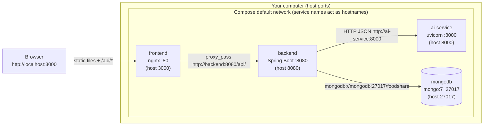

### 2.3.3 Network diagram — local development (no Docker)

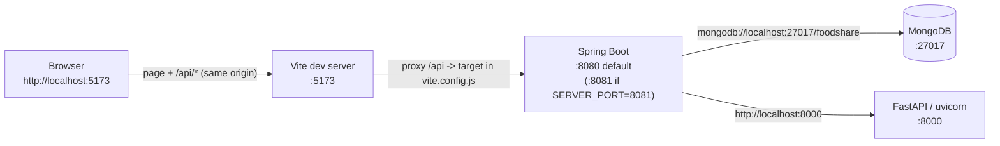

### 2.3.4 Important rules

- **The browser never talks to the AI service or MongoDB directly.** Only Spring Boot does.
- **The frontend always calls a relative URL `/api/...`** (`frontend/src/api.js`: `const BASE = "/api"`). There is no configurable API base URL and no `import.meta.env` usage. That is why a proxy (Vite or nginx) is required in front of the backend.
- Because the proxy makes the API look like it is on the same origin as the page, **CORS is normally not involved**. CORS only matters if you open the frontend on one origin and point it directly at the backend on another.
- **Health endpoints:** backend `GET http://localhost:8080/api/health` → `{"status":"ok","service":"Zero Waste Spring Boot API"}`; AI service `GET http://localhost:8000/health` → `{"status":"ok","service":"Zero Waste AI/ML Service"}`; AI Swagger UI at `http://localhost:8000/docs`.

---

## 2.4 Docker Compose deployment

### 2.4.1 Deployment diagram

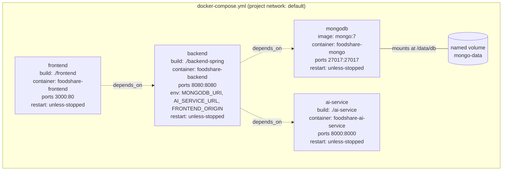

### 2.4.2 `docker-compose.yml`, line by line

```yaml
version: "3.9"
```
Declares the Compose file format. **Obsolete** in Compose v2 — it is ignored and prints a warning (`the attribute 'version' is obsolete`). Safe to delete.

```yaml
services:
```
Starts the list of containers to run. Each key below is a *service name*; on the Compose network that name also works as a hostname (e.g. `http://backend:8080`).

#### Service `mongodb`

| Line | Meaning | Why |
|---|---|---|
| `image: mongo:7` | Use the official MongoDB 7 image from Docker Hub (no build). | Provides the database. |
| `container_name: foodshare-mongo` | Fixed, human-readable container name. | Easier `docker logs foodshare-mongo`. Also means you cannot run two copies of this stack at once. |
| `ports: - "27017:27017"` | `HOST:CONTAINER`. Publishes Mongo on your machine's port 27017. | Lets you inspect the DB with MongoDB Compass / `mongosh`. **Not needed by the app** (backend uses the internal network) and **exposes an unauthenticated DB** — remove in production. Conflicts with a locally installed MongoDB. |
| `volumes: - mongo-data:/data/db` | Mount the named volume `mongo-data` at Mongo's data folder. | Data survives `docker compose down` / container rebuilds. Deleted only by `docker compose down -v`. |
| `restart: unless-stopped` | Docker restarts the container if it crashes or the Docker daemon restarts, unless you stopped it manually. | Resilience. |

No environment variables are set, so **MongoDB runs without a username/password** (`MONGO_INITDB_ROOT_USERNAME`/`PASSWORD` are not used).

#### Service `ai-service`

| Line | Meaning | Why |
|---|---|---|
| `build: ./ai-service` | Build an image from `ai-service/Dockerfile`. | Custom Python app. |
| `container_name: foodshare-ai-service` | Fixed container name. | Readability. |
| `ports: - "8000:8000"` | Publish uvicorn's port. | Lets you open `http://localhost:8000/docs` for testing. Not required by the backend (it uses `http://ai-service:8000`). Consider removing in production. |
| `restart: unless-stopped` | Auto-restart. | Resilience. |

#### Service `backend`

| Line | Meaning | Why |
|---|---|---|
| `build: ./backend-spring` | Build from `backend-spring/Dockerfile`. | Custom Java app. |
| `container_name: foodshare-backend` | Fixed name. | Readability. |
| `depends_on: [mongodb, ai-service]` | Start those containers **first**. | Ordering only — Compose does **not** wait until Mongo is *ready*. The MongoDB Java driver retries (30 s server-selection timeout), so this is usually fine. |
| `environment: MONGODB_URI: mongodb://mongodb:27017/foodshare` | Overrides the default `localhost` URI. Host `mongodb` = the service name; database `foodshare`. | Inside a container, `localhost` means the container itself, so the service name must be used. |
| `AI_SERVICE_URL: http://ai-service:8000` | Where `AIClientService` sends AI requests. | Same reason — use the service name. |
| `FRONTEND_ORIGIN: http://localhost:5173,http://localhost:3000` | Comma-separated list of browser origins allowed by CORS. | Allows both the Vite dev server and the Docker frontend. (With the nginx proxy, requests are same-origin, so this is mostly a safety net.) |
| `ports: - "8080:8080"` | Publish the API. | Lets tools like Postman/curl call `http://localhost:8080/api/...` and lets a locally running Vite dev server use the Docker backend. |
| `restart: unless-stopped` | Auto-restart. | Resilience. |

No volume is mounted for uploads, so verification documents saved to `/app/uploads/verification` **are lost when the container is re-created** (see §2.14).

#### Service `frontend`

| Line | Meaning | Why |
|---|---|---|
| `build: ./frontend` | Build from `frontend/Dockerfile` (React build served by nginx). | Production-style static hosting. |
| `container_name: foodshare-frontend` | Fixed name. | Readability. |
| `depends_on: [backend]` | Start the backend first. | nginx resolves the hostname `backend` in `proxy_pass` at start-up; if the `backend` service does not exist nginx fails to start. |
| `ports: - "3000:80"` | nginx listens on 80 inside; you open **http://localhost:3000**. | Avoids needing admin rights for port 80 on the host. |
| `restart: unless-stopped` | Auto-restart. | Resilience. |

```yaml
volumes:
  mongo-data:
```
Declares the named volume used by MongoDB. Docker stores it in its own data area (e.g. inside Docker Desktop's VM).

No `networks:` section exists, so Compose creates a single default bridge network named `<folder>_default` (e.g. `foodredistributionsystem_default`) that all four services join.

---

## 2.5 Dockerfiles, line by line

### 2.5.1 `backend-spring/Dockerfile` (multi-stage: build with Maven → run on JRE)

```dockerfile
FROM maven:3.9-eclipse-temurin-17 AS build
```
Stage 1, named `build`. Base image contains **Maven 3.9 + Eclipse Temurin JDK 17** — everything needed to compile.

```dockerfile
WORKDIR /app
```
All following commands run in `/app` (created if missing).

```dockerfile
COPY pom.xml .
RUN mvn -q dependency:go-offline
```
Copy **only** `pom.xml` first and download all dependencies. Docker caches each step as a *layer*; as long as `pom.xml` is unchanged, rebuilding after a code change skips the slow dependency download. `-q` = quiet output.

```dockerfile
COPY src ./src
RUN mvn -q clean package -DskipTests
```
Copy source code and build the executable JAR into `target/`. `-DskipTests` skips `ReportSmokeTest` for a faster, network-independent image build (run tests separately — §2.13).

```dockerfile
FROM eclipse-temurin:17-jre
```
Stage 2 (final image). A **JRE only** (Java runtime, no compiler, no Maven) — much smaller and with less attack surface.

```dockerfile
WORKDIR /app
COPY --from=build /app/target/*.jar app.jar
```
Copy just the built JAR from the `build` stage and rename it `app.jar`. Everything else from stage 1 is discarded.

```dockerfile
EXPOSE 8080
```
Documentation that the app listens on 8080 (it does not publish the port — `ports:` in Compose does).

```dockerfile
ENTRYPOINT ["java", "-jar", "app.jar"]
```
Command run when the container starts. No JVM memory flags or Spring profile are set; configuration comes from environment variables (§2.8).

> The container runs as **root** (no `USER` instruction). The working directory `/app` is where `uploads/verification` will be created.

### 2.5.2 `frontend/Dockerfile` (multi-stage: build with Node → serve with nginx)

```dockerfile
FROM node:20-alpine AS build
WORKDIR /app
```
Stage 1: small Alpine Linux image with Node.js 20.

```dockerfile
COPY package.json ./
RUN npm install
```
Copy the dependency list and install packages (cached layer). **Note:** `package-lock.json` is *not* copied and `npm install` (not `npm ci`) is used, so the image may resolve **different dependency versions** than your local lock file.

```dockerfile
COPY . .
RUN npm run build
```
Copy all frontend files and run `vite build`, producing static files in `/app/dist`.
**Caution:** there is no `.dockerignore`, so `COPY . .` also copies your local `node_modules/` (and `*.log` files) over the freshly installed Linux ones. If you ran `npm install` on Windows/macOS, native binaries (e.g. esbuild/rollup) may be for the wrong OS and the build can fail. Fix: add `frontend/.dockerignore` containing `node_modules`, `dist`, `*.log` (§2.14).

```dockerfile
FROM nginx:alpine
```
Stage 2: tiny nginx web server image. Node is not in the final image.

```dockerfile
COPY --from=build /app/dist /usr/share/nginx/html
```
Put the built site in nginx's default web root.

```dockerfile
COPY nginx.conf /etc/nginx/conf.d/default.conf
```
Replace nginx's default site config with the project's (SPA fallback + API proxy).

```dockerfile
EXPOSE 80
CMD ["nginx", "-g", "daemon off;"]
```
Document port 80; run nginx in the foreground (`daemon off;`) — a container stops when its main process exits, so nginx must not background itself.

### 2.5.3 `ai-service/Dockerfile` (single stage)

```dockerfile
FROM python:3.11-slim
```
Minimal Debian image with Python 3.11. Single stage is fine because Python is interpreted (nothing to compile; scikit-learn/numpy install as pre-built wheels).

```dockerfile
WORKDIR /app
COPY requirements.txt .
RUN pip install --no-cache-dir -r requirements.txt
```
Install pinned dependencies first (cached layer). `--no-cache-dir` avoids storing pip's download cache in the image (smaller image).

```dockerfile
COPY app ./app
```
Copy only the `app/` package — the local `venv/` and log files are **not** copied (good).

```dockerfile
EXPOSE 8000
CMD ["uvicorn", "app.main:app", "--host", "0.0.0.0", "--port", "8000"]
```
Start the uvicorn ASGI server serving the `app` object from `app/main.py`. `--host 0.0.0.0` is required so other containers can reach it (the default `127.0.0.1` would only accept connections from inside the container itself). No `--reload` (that is for development only).

---

## 2.6 `nginx.conf` explained

File: `frontend/nginx.conf` (copied to `/etc/nginx/conf.d/default.conf` in the frontend image).

```nginx
server {
    listen 80;                         # Accept HTTP on port 80 inside the container (published as host 3000).
    server_name _;                     # "_" = catch-all; respond to any hostname.
    root /usr/share/nginx/html;        # Folder containing the Vite build output.
    index index.html;                  # File served for "/".

    location /api/ {                                  # Any request whose path starts with /api/ ...
        proxy_pass http://backend:8080/api/;           # ... is forwarded to the Spring Boot container.
        proxy_set_header Host $host;                   # Pass the original Host header through.
        proxy_set_header X-Real-IP $remote_addr;       # Tell the backend the real client IP.
    }

    location / {                                       # Everything else ...
        try_files $uri $uri/ /index.html;              # ... serve the file if it exists, otherwise index.html.
    }
}
```

| Directive | What it does | Why it is needed |
|---|---|---|
| `location /api/` + `proxy_pass` | **Reverse proxy**: the browser calls `http://localhost:3000/api/donations`; nginx fetches `http://backend:8080/api/donations` and returns the answer. | `api.js` uses relative `/api` URLs, so the API must be reachable on the same origin as the page. This also avoids CORS entirely. `backend` is the Compose service name. |
| `proxy_set_header Host` / `X-Real-IP` | Forwards original host and client IP. | Logging/diagnostics. (`X-Forwarded-For` and `X-Forwarded-Proto` are not set.) |
| `try_files $uri $uri/ /index.html` | **SPA fallback.** | React Router handles URLs like `/dashboard` in the browser. If a user refreshes on `/dashboard`, no such file exists on disk; without this line nginx would return 404. With it, nginx serves `index.html` and React shows the right page. |

**Not configured (defaults apply):**

- `client_max_body_size` → nginx default **1 MB**. Spring Boot accepts uploads up to 10 MB, but through the Docker frontend any CSV or verification document **larger than 1 MB is rejected by nginx with `413 Request Entity Too Large`**. Add `client_max_body_size 10M;` inside `server { }` (§2.14).
- No gzip, cache headers, HTTPS, or security headers.

---

## 2.7 Spring Boot configuration

### 2.7.1 How Spring reads configuration

Spring Boot loads `src/main/resources/application.yml` from inside the JAR. The syntax `${ENV_NAME:default}` means *"use environment variable `ENV_NAME` if set, otherwise use `default`"*. In addition, **any** property can be overridden by an environment variable using Spring's "relaxed binding" (upper-case, dots and dashes → underscores; e.g. `server.port` → `SERVER_PORT`) or by a command-line argument (e.g. `--server.port=8081`). No Spring *profiles* (`application-dev.yml`, etc.) exist; the log confirms `No active profile set, falling back to 1 default profile: "default"`.

### 2.7.2 `application.yml` — every property

```yaml
server:
  port: 8080
spring:
  application:
    name: foodshare-backend
  data:
    mongodb:
      uri: ${MONGODB_URI:mongodb://localhost:27017/foodshare}
  servlet:
    multipart:
      max-file-size: 10MB
      max-request-size: 10MB
foodshare:
  ai-service:
    base-url: ${AI_SERVICE_URL:http://localhost:8000}
  cors:
    allowed-origins: ${FRONTEND_ORIGIN:http://localhost:5173}
logging:
  level:
    com.foodshare: INFO
```

| Key | Value / default | Meaning | Used by | What happens if you change it |
|---|---|---|---|---|
| `server.port` | `8080` | TCP port of the embedded Tomcat web server. | Spring Boot | The API moves to the new port. You must also update the Vite proxy target (`vite.config.js`), `nginx.conf` `proxy_pass`, the Dockerfile `EXPOSE`, and Compose `ports`. Override: `SERVER_PORT`. |
| `spring.application.name` | `foodshare-backend` | Logical application name. | Appears in log lines (`[foodshare-backend]`). | Cosmetic only. |
| `spring.data.mongodb.uri` | `${MONGODB_URI:mongodb://localhost:27017/foodshare}` | MongoDB connection string: host `localhost`, port `27017`, database `foodshare`, no credentials. | Spring Data MongoDB (all repositories) | Points the app at another server/database. A new, empty database triggers the `DataSeeder` again. A wrong host makes requests fail after ~30 s ("Timed out after 30000 ms while waiting for a server"). For authenticated/Atlas databases use `mongodb://<user>:<password>@<host>:27017/foodshare?authSource=admin` or `mongodb+srv://<user>:<password>@<cluster>/foodshare` — supply it via env var, never commit it. |
| `spring.servlet.multipart.max-file-size` | `10MB` | Largest single uploaded file. | CSV upload (`POST /api/donations/upload`), verification documents (`POST /api/beneficiaries/{id}/documents`) | Larger files are rejected (`MaxUploadSizeExceededException` → HTTP 500 JSON via `GlobalExceptionHandler`). Remember nginx's own 1 MB default in Docker. |
| `spring.servlet.multipart.max-request-size` | `10MB` | Largest whole multipart request. | Same | Should be ≥ `max-file-size`. |
| `foodshare.ai-service.base-url` | `${AI_SERVICE_URL:http://localhost:8000}` | Base URL of the Python AI service (custom property). | `AIClientService` via `@Value("${foodshare.ai-service.base-url}")`; it appends `/recommend/priority` and `/predict/surplus`. | Wrong/unreachable URL → backend logs `AI service unreachable…` and **falls back**: requests are listed first-come-first-served with score 0, and the forecast is empty with a note "AI service unavailable". The app keeps working. |
| `foodshare.cors.allowed-origins` | `${FRONTEND_ORIGIN:http://localhost:5173}` | Comma-separated list of browser origins allowed to call `/api/**` cross-origin. | `CorsConfig` | Missing your frontend's origin → browser shows "blocked by CORS policy" (only when not using a proxy). Do not use `*` in production. |
| `logging.level.com.foodshare` | `INFO` | Log verbosity for the project's own packages. | Logback (Spring default logging) | `DEBUG` shows more detail; `WARN` hides info messages. Override: `LOGGING_LEVEL_COM_FOODSHARE=DEBUG`. |
| `foodshare.uploads.dir` *(not in the file — code default)* | `uploads/verification` | Folder for verification documents, resolved relative to the **working directory** (locally `backend-spring/uploads/verification`; in Docker `/app/uploads/verification`). | `VerificationDocumentService` via `@Value("${foodshare.uploads.dir:uploads/verification}")` | Change to an absolute path or a mounted volume for persistence. Override: `FOODSHARE_UPLOADS_DIR`. |

### 2.7.3 Spring configuration classes (`com.foodshare.config`)

#### `FoodshareApplication.java`
`@SpringBootApplication` + `main()` — the entry point. It enables component scanning of `com.foodshare.*` (so all config classes, controllers, services are found) and auto-configuration (Tomcat, Jackson JSON, MongoDB client, validation).

#### `CorsConfig.java` — CORS rules

| Setting | Value | Meaning |
|---|---|---|
| Path pattern | `/api/**` | Rules apply to every API endpoint. |
| `allowedOrigins` | `foodshare.cors.allowed-origins` split on `,` | Only these origins get CORS headers. Values must match exactly (scheme + host + port, **no spaces**, no trailing slash — the code does not trim). |
| `allowedMethods` | `GET, POST, PATCH, PUT, DELETE, OPTIONS` | HTTP methods browsers may use cross-origin. `OPTIONS` is the "pre-flight" check browsers send first. |
| `allowedHeaders` | `*` | Any request header allowed (e.g. `Content-Type: application/json`). |
| `allowCredentials` | not set (false) | Cookies are not sent cross-origin — fine because the app uses no cookies/sessions. |

**Why needed:** only when the page and the API are on different origins (e.g. opening `http://localhost:5173` while calling `http://localhost:8080` directly). With the proxies, it is a safety net.

#### `PasswordConfig.java` — password hashing

Declares one bean: `PasswordEncoder` = `BCryptPasswordEncoder()` (default strength 10). Comes from `spring-security-crypto` only — **Spring Security's web security (login filters, CSRF, sessions) is NOT enabled**.
- **Used by:** `AuthService.register` (hashes new passwords) and `AuthService.login` (`passwordEncoder.matches`), and `DataSeeder` (hashes demo passwords).
- **Why:** passwords are stored only as one-way BCrypt hashes (`User.passwordHash`), never in plain text.
- **If changed** (e.g. to another algorithm): all existing hashes stop matching and nobody can log in.
- ⚠ This file is currently **untracked** in git. A fresh clone without it fails at start-up with "required a bean of type PasswordEncoder that could not be found".

#### `RestClientConfig.java` — HTTP client for the AI service

Creates the `RestTemplate` bean used by `AIClientService`:

| Setting | Value | Meaning / effect |
|---|---|---|
| `setConnectTimeout` | 5 seconds | If the AI service cannot be reached within 5 s, give up and use the fallback. |
| `setReadTimeout` | 10 seconds | If the AI service connects but takes > 10 s to answer, give up and use the fallback. |

The base URL is **not** set here; it is injected into `AIClientService` from `foodshare.ai-service.base-url`.

#### `GlobalExceptionHandler.java` — error responses

Converts exceptions into JSON `{"error": "<message>"}` (the `ApiError` DTO — which is what `frontend/src/api.js` reads as `data.error`):

| Exception | HTTP status |
|---|---|
| `IllegalArgumentException` whose message contains "not found" | 404 Not Found |
| other `IllegalArgumentException` (e.g. "Invalid email or password") | 400 Bad Request |
| `IllegalStateException` (e.g. "An account with this email already exists") | 409 Conflict |
| `MethodArgumentNotValidException` (bean validation) | 400, message = `"<field> <reason>"` |
| any other `Exception` (incl. upload-too-large, Mongo timeouts) | 500, message = `"Unexpected error: " + details` — ⚠ leaks internal details; tighten for production. |

#### `DataSeeder.java` — demo data on first start

A `CommandLineRunner`, so it runs automatically once the application has started.

1. **`backfillMissingPasswords()`** — *every start*: any user without a `passwordHash` (e.g. data created before passwords were added) gets the demo password hash, so old databases keep working.
2. **If the `users` collection already has documents → stop.** Seeding therefore happens **only on an empty database** and restarts are safe. To re-seed, drop the `foodshare` database (or `docker compose down -v`).
3. Otherwise it inserts:

| Collection | What is created |
|---|---|
| `settings` | One default `Settings` document (only if none): `expiryThresholdDays = 3`, `ticketCollectionWindowHours = 24`, category rules `cooked_bakery` (expiry threshold 4 h / collection window 2 h), `perishable_dairy` (36 h / 12 h), `packaged_dry` (144 h / 36 h). These are *runtime* settings editable in **Admin → Settings**, stored in MongoDB rather than in `application.yml`. |
| `users` | 6 accounts (table below). |
| `donations` | 6 listings `d-1001`…`d-1006` (Cooked Rice & Curry, Bread & Pastries, Mixed Vegetables, Dairy Yoghurt Cups [expired], Assorted Fruits, Canned Packaged Goods), expiry dates relative to *today*. |
| `requests` (FoodRequest) | 5 requests `r-1`…`r-5` in states pending / approved / rejected / counter_offer. |
| `tickets` | 1 pickup ticket `t-9001` for request `r-3` (QR code string `FSQR-9001-D1001-NGO1`). |
| `notifications` | 4 notifications for the donor. |
| history points | 20 days × 6 categories = **120** synthetic daily quantity records used as training data for the AI surplus forecast (base + trend + sine noise + random noise). |

**Seeded demo accounts** (all share the demo password defined by the constant `DEMO_PASSWORD` in `DataSeeder.java`, which is the clearly-demo value `password123`):

| Role | Org type | Name / organisation | Email | Verified |
|---|---|---|---|---|
| donor | — | R. Perera — ABC Supermarket Hub (Colombo 05) | `perera@abcsupermarket.lk` | yes |
| admin | — | S. Fernando | `admin@foodshare.lk` | yes |
| beneficiary | NGO | H. De Silva — Hope Kitchen Foundation (Kandy) | `contact@hopekitchen.lk` | yes |
| beneficiary | Charity | N. Jayasuriya — Caring Hands Charity (Kandy) | `info@caringhands.lk` | yes |
| farm | Farm | W. Gunawardena — Green Acres Farm (Kadawatha) | `farm@greenacres.lk` | yes |
| beneficiary | NGO | P. Rathnayake — New Hope Community Center (Peradeniya) | `pending@newhope.lk` | **no** (pending — appears in Admin → Verifications) |

> ⚠ **Security:** these accounts and the shared demo password exist in *any* environment that starts with an empty database, including production. Disable the seeder (e.g. guard it with a property/profile) or change/delete these accounts before going live. The README still says the demo accounts have "no password" — that is outdated.

---

## 2.8 Environment variable reference

An environment variable is set **before** starting a program. Examples: PowerShell `$env:MONGODB_URI="..."`, CMD `set MONGODB_URI=...`, macOS/Linux `export MONGODB_URI=...`, Docker Compose `environment:`.

### 2.8.1 Explicitly referenced in the project

| Variable | Service | Read in | Default (if unset) | Value in `docker-compose.yml` | Purpose |
|---|---|---|---|---|---|
| `MONGODB_URI` | backend | `application.yml` → `spring.data.mongodb.uri` | `mongodb://localhost:27017/foodshare` | `mongodb://mongodb:27017/foodshare` | Database connection string (host, port, DB name, optional credentials). Treat as a **secret** when it contains a password: `<your-mongodb-uri>`. |
| `AI_SERVICE_URL` | backend | `application.yml` → `foodshare.ai-service.base-url` | `http://localhost:8000` | `http://ai-service:8000` | Where to reach the FastAPI AI service. No trailing slash. |
| `FRONTEND_ORIGIN` | backend | `application.yml` → `foodshare.cors.allowed-origins` | `http://localhost:5173` | `http://localhost:5173,http://localhost:3000` | CORS allow-list (comma-separated, no spaces). |

### 2.8.2 Useful Spring Boot overrides (standard relaxed binding, not referenced by name in the repo)

| Variable | Overrides | Default | When to use |
|---|---|---|---|
| `SERVER_PORT` | `server.port` | `8080` | Run the backend on another port (e.g. `8081` to match the current `vite.config.js`). |
| `FOODSHARE_UPLOADS_DIR` | `foodshare.uploads.dir` | `uploads/verification` | Store verification documents in a persistent/absolute folder or Docker volume. |
| `LOGGING_LEVEL_COM_FOODSHARE` | `logging.level.com.foodshare` | `INFO` | Turn on `DEBUG` logs. |
| `SPRING_SERVLET_MULTIPART_MAX_FILE_SIZE` / `..._MAX_REQUEST_SIZE` | multipart limits | `10MB` | Allow bigger uploads. |
| `JAVA_TOOL_OPTIONS` | JVM options (read by the JVM itself) | none | e.g. `-Xmx512m` to limit memory in a container. |

### 2.8.3 Frontend and AI service

| Service | Environment variables | Notes |
|---|---|---|
| **frontend** | **None.** No `import.meta.env`/`VITE_*` usage, no `.env` files. | API base is hard-coded as relative `/api` in `src/api.js`; the backend address is decided by the proxy (`vite.config.js` locally, `nginx.conf` in Docker). |
| **ai-service** | **None.** No `os.environ`/`getenv` usage. | Host/port are passed as uvicorn command-line flags (`--host 0.0.0.0 --port 8000` in Docker; `--reload --port 8000` locally). CORS is hard-coded to allow all origins. |
| **mongodb** (container) | None set. | Standard image variables such as `MONGO_INITDB_ROOT_USERNAME` / `MONGO_INITDB_ROOT_PASSWORD` could be added to enable authentication (then update `MONGODB_URI`). |

`.env` is listed in `.gitignore`, so if you create a `.env` file next to `docker-compose.yml` (Compose reads it automatically for `${VAR}` substitution) it will not be committed.

---

## 2.9 Dependencies

### 2.9.1 Backend — `backend-spring/pom.xml`

| Item | Version | Purpose |
|---|---|---|
| Parent `spring-boot-starter-parent` | **3.3.2** | Supplies tested versions for all Spring libraries, default plugin configuration, and Java compiler settings. Versions without an explicit `<version>` below are managed by it. |
| Property `java.version` | **17** | Java language level the code is compiled for. |
| Project coordinates | `com.foodshare:foodshare-backend:1.0.0`, packaging `jar` (default) | Name of the produced artifact `target/foodshare-backend-1.0.0.jar`. |

| Dependency | Version | Scope | What it provides / why it is used |
|---|---|---|---|
| `spring-boot-starter-web` | managed (3.3.2) | compile | Embedded **Tomcat** web server (10.1.26 per log), Spring MVC for `@RestController` endpoints, Jackson for JSON, `RestTemplate` for calling the AI service. |
| `spring-boot-starter-data-mongodb` | managed | compile | MongoDB Java driver (5.0.1 per log) + Spring Data repositories (`UserRepository`, `DonationRepository`, …). |
| `spring-boot-starter-validation` | managed | compile | Hibernate Validator for `@Valid` on request DTOs (e.g. login/register). |
| `spring-security-crypto` | managed | compile | **Only** the crypto module: `BCryptPasswordEncoder` for password hashing. Does not turn on Spring Security's authentication filters. |
| `org.apache.commons:commons-csv` | **1.11.0** | compile | Parses donor inventory CSV uploads (`DonationService.bulkUpload`). |
| `com.github.librepdf:openpdf` | **1.3.30** | compile | Generates the admin PDF report (`ReportPdfService`, `GET /api/reports/pdf`). |
| `spring-boot-starter-test` | managed | **test** | JUnit 5, AssertJ, Mockito, Spring Test — used only when running tests; not in the final JAR. |

| Plugin | Purpose |
|---|---|
| `spring-boot-maven-plugin` | Repackages the build into a single executable "fat" JAR (`java -jar`) and adds the `mvn spring-boot:run` goal. |

### 2.9.2 Frontend — `frontend/package.json`

Package metadata: `"name": "foodshare-frontend"`, `"version": "1.0.0"`, `"private": true` (prevents accidental `npm publish`), `"type": "module"` (config files use `import`/`export` syntax). No `engines` field is declared.

**Scripts**

| Script | Command | What it does |
|---|---|---|
| `npm run dev` | `vite` | Starts the development server on port 5173 with hot-module reload and the `/api` proxy. |
| `npm run build` | `vite build` | Produces an optimised production bundle in `frontend/dist/` (used by the Dockerfile). |
| `npm run preview` | `vite preview` | Serves the built `dist/` locally (default port 4173) to test the production build. |

There are no `test` or `lint` scripts.

**dependencies** (shipped to the browser)

| Package | Declared | Resolved (lock) | Purpose in this project |
|---|---|---|---|
| `react` | ^18.3.1 | 18.3.1 | UI library. |
| `react-dom` | ^18.3.1 | 18.3.1 | Renders React into the page (`ReactDOM.createRoot` in `main.jsx`). |
| `react-router-dom` | ^6.26.0 | 6.30.6 | Client-side routing (`BrowserRouter`, pages). Requires the nginx SPA fallback. |
| `qrcode` | ^1.5.4 | 1.5.4 | Generates QR code images for pickup tickets (`pages/Tickets.jsx`). |
| `jsqr` | ^1.4.0 | 1.4.0 | Decodes QR codes from camera frames when scanning tickets (`components/ScanTicketPanel.jsx`). |
| `lucide-react` | ^1.45.0 | 1.45.0 | Icon components (`Register.jsx`, `BeneficiaryRegistrationForm.jsx`, `Tickets.jsx`). |

**devDependencies** (build-time tools only)

| Package | Declared | Resolved | Purpose |
|---|---|---|---|
| `vite` | ^5.4.0 | 5.4.21 | Dev server + production bundler. |
| `@vitejs/plugin-react` | ^4.3.1 | 4.7.0 | JSX compilation and React Fast Refresh in Vite. |
| `tailwindcss` | ^3.4.19 | 3.4.19 | Utility-class CSS framework (processes `@tailwind` directives in `index.css`). |
| `postcss` | ^8.5.28 | 8.5.28 | CSS transformation pipeline that runs Tailwind and Autoprefixer. |
| `autoprefixer` | ^10.6.0 | 10.6.0 | Adds vendor prefixes (`-webkit-` …) for browser compatibility. |

`^` means "this version or any newer compatible minor/patch". `frontend/npm-install.log` reports **4 known vulnerabilities (3 moderate, 1 high)** — run `npm audit` for details.

### 2.9.3 AI service — `ai-service/requirements.txt`

| Package | Pinned version | Purpose |
|---|---|---|
| `fastapi` | 0.115.0 | Web framework: routes (`/health`, `/recommend/priority`, `/predict/surplus`), automatic validation, Swagger UI at `/docs`. |
| `uvicorn[standard]` | 0.30.6 | ASGI server that actually runs the FastAPI app; `[standard]` adds faster extras (uvloop/httptools where supported, watchfiles for `--reload`). |
| `pydantic` | 2.9.2 | Data models in `schemas.py` (JSON contract with Spring Boot). |
| `scikit-learn` | 1.5.2 | `LinearRegression` model for surplus forecasting (`ml/prediction.py`). Pulls in `scipy`, `joblib`, `threadpoolctl`. |
| `numpy` | 2.1.1 | Arrays for model input/output. |

`prediction.py` wraps the numpy/scikit-learn import in `try/except ImportError`; if they are missing it uses a pure-Python linear-regression fallback, so the service still runs (with the same maths).

---

## 2.10 Frontend build configuration

### 2.10.1 `vite.config.js`

```js
export default defineConfig({
  plugins: [react()],
  server: {
    port: 5173,
    proxy: {
      "/api": { target: "http://localhost:8081", changeOrigin: true },
    },
  },
});
```

| Setting | Meaning | Why |
|---|---|---|
| `plugins: [react()]` | Enables JSX + React Fast Refresh. | Needed to compile `.jsx` files. |
| `server.port: 5173` | Dev server port. | Matches the default CORS origin in `application.yml`. If 5173 is busy Vite picks the next free port (5174…) — that origin is then *not* in the CORS list, but the proxy still avoids CORS issues. |
| `server.proxy["/api"].target` | Requests to `http://localhost:5173/api/...` are forwarded to this address. | Lets `api.js` use relative `/api` URLs. ⚠ Currently `8081` (working-tree change; git HEAD has `8080`). Must match the backend's actual port. |
| `changeOrigin: true` | Rewrites the `Host` header to the target. | Makes the backend see the request as addressed to itself. |

The proxy applies only to `npm run dev` (and `vite preview`, which inherits `server.proxy`). It does **not** exist in the production build — there nginx does the proxying.

### 2.10.2 `tailwind.config.js`

| Setting | Value | Meaning |
|---|---|---|
| `content` | `["./index.html", "./src/**/*.{js,jsx}"]` | Files Tailwind scans for class names; unused utility classes are removed from the final CSS. |
| `corePlugins.preflight` | `false` | Disables Tailwind's global CSS reset, because `index.css` defines its own base styles (headings, links, buttons) that the reset would otherwise wipe. |
| `theme.extend` | `{}` | **No custom Tailwind colours or fonts** — Tailwind defaults only. |
| `plugins` | `[]` | No Tailwind plugins. |

The **brand theme lives in `src/index.css`** as CSS custom properties:

| Variable | Value | Use |
|---|---|---|
| `--primary` | `#1E7B34` | Main brand green |
| `--primary-dark` | `#145E28` | Hover/darker green |
| `--primary-light` | `#EBF7EE` | Light green backgrounds |
| `--primary-lighter` | `#F6FCF7` | Very light green |
| `--accent` | `#22C55E` | Accent green |
| `--text-dark` / `--text-mid` / `--text-light` | `#0F172A` / `#475569` / `#94A3B8` | Text colours |
| `--border` / `--card-border` | `#E2E8F0` / `#EDF2EE` | Borders |
| `--white` | `#ffffff` | White |
| `--danger` / `--warning` | `#EF4444` / `#F59E0B` | Error / warning states |
| `--radius` / `--radius-sm` | `18px` / `11px` | Corner rounding |
| `--shadow`, `--shadow-md`, `--shadow-lg` | layered box-shadows | Card elevation |
| body background | `#F8FAF9` | Page background |
| **Font** | `'Plus Jakarta Sans'` (weights 400–800) loaded via `@import` from `fonts.googleapis.com`, falling back to Inter, system-ui, Segoe UI, Roboto, sans-serif | Typography. Offline machines use the fallback fonts. |

`index.css` also contains `@tailwind base; @tailwind components; @tailwind utilities;` which PostCSS replaces with generated CSS.

### 2.10.3 `postcss.config.js`

```js
export default { plugins: { tailwindcss: {}, autoprefixer: {} } };
```
Vite automatically runs PostCSS on CSS files. This tells it to (1) expand Tailwind directives, then (2) add vendor prefixes. Without this file the `@tailwind` lines would not be processed. ⚠ Untracked in git.

### 2.10.4 `index.html`

| Element | Purpose |
|---|---|
| `<meta charset="UTF-8">` | Correct character encoding (e.g. the em dash in the title). |
| `<meta name="viewport" content="width=device-width, initial-scale=1.0">` | Responsive layout on mobile. |
| `<title>Zero Waste — Smart Surplus Food Redistribution & Waste Reduction</title>` | Browser tab title. |
| `<link rel="icon" type="image/svg+xml" href="/zero-waste-logo.svg?v=2">` | Favicon from `public/`. `?v=2` busts the browser cache. ⚠ `zero-waste-logo.svg` is untracked; git HEAD referenced `zero-waste-logo.jpg`. |
| `<div id="root">` | Where React mounts the app. |
| `<script type="module" src="/src/main.jsx">` | Entry point; Vite rewrites it to the hashed bundle during `build`. |

Files in `public/` are served from the web root unchanged (e.g. `/sample_inventory.csv` is the download link in `MyDonations.jsx`).

---

## 2.11 AI service configuration

All configuration is in code (`ai-service/app/main.py`):

| Item | Value | Notes |
|---|---|---|
| App metadata | title "Zero Waste AI/ML Service", version 1.0.0 | Shown in Swagger UI (`/docs`) and ReDoc (`/redoc`). |
| CORS middleware | `allow_origins=["*"]`, all methods, all headers | Comment says it is internal (service-to-service only). Browsers never call it in normal use. Restrict or remove in production and do not publish port 8000. |
| Endpoints | `GET /health`, `POST /recommend/priority`, `POST /predict/surplus` | Called by Spring Boot's `AIClientService`. |
| Defaults in `schemas.py` | `urgency="medium"`, `distanceKm=10.0`, `status="pending"`, `daysAhead=7` | Used when the backend omits a field. |
| State | Stateless — no database, no model files, no env vars | Can be scaled or restarted freely. |

---

## 2.12 Step-by-step run guides

### 2.12.1 Start-up order

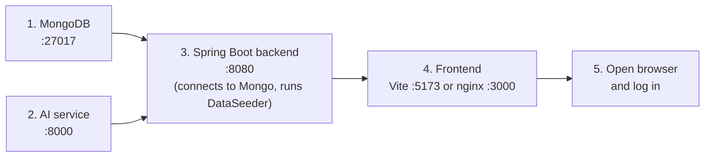

- MongoDB must be up **before** the backend, otherwise seeding and every API call fail (the backend itself starts, then errors on first DB access after a 30 s timeout).
- The AI service is **optional** for start-up: if it is down, the backend uses fallbacks.
- The frontend can start anytime but API calls fail until the backend is up.

### 2.12.2 (a) Run everything with Docker Compose

1. **Install Docker Desktop** and start it.
2. **Get the code**
   ```bash
   git clone <your-repository-url> FoodRedistributionSystem
   cd FoodRedistributionSystem
   ```
   Make sure the currently untracked files (`PasswordConfig.java`, `tailwind.config.js`, `postcss.config.js`, `zero-waste-logo.svg`, new `src` components) are committed — otherwise the build breaks (§2.14).
3. **(Recommended) add `frontend/.dockerignore`** with `node_modules`, `dist`, `*.log`, and add `client_max_body_size 10M;` to `nginx.conf` (§2.14).
4. **Build and start**
   ```bash
   docker compose up --build
   ```
   Add `-d` to run in the background. First build takes several minutes.
5. **Check health**
   - Frontend: http://localhost:3000
   - Backend: http://localhost:8080/api/health
   - AI service: http://localhost:8000/health and http://localhost:8000/docs
   - MongoDB: `localhost:27017` (e.g. MongoDB Compass)
6. **Log in** with a seeded account (§2.7.3).
7. **Useful commands**

   | Command | Effect |
   |---|---|
   | `docker compose ps` | List containers and status. |
   | `docker compose logs -f backend` | Follow backend logs (also `frontend`, `ai-service`, `mongodb`). |
   | `docker compose up --build backend` | Rebuild/restart only the backend after code changes. |
   | `docker compose down` | Stop and remove containers (**data kept** in `mongo-data`). |
   | `docker compose down -v` | Also delete the volume → **all data erased**; demo data re-seeds on next start. |
   | `docker compose exec mongodb mongosh foodshare` | Open a Mongo shell on the `foodshare` database. |

### 2.12.3 (b) Run locally without Docker

Open **four terminals**, one per service, from the repository root.

#### Step 1 — MongoDB

*Option 1: MongoDB in Docker only (easiest)*
```bash
docker run -d -p 27017:27017 --name foodshare-mongo mongo:7
```
(If you later use `docker compose`, remove this container first: `docker rm -f foodshare-mongo` — same name and port.)

*Option 2: native install*
- **Windows:** install "MongoDB Community Server" (MSI) with "Install as a Service" — it starts automatically on port 27017.
- **macOS:** `brew tap mongodb/brew && brew install mongodb-community@7.0 && brew services start mongodb-community@7.0`
- **Linux (Ubuntu/Debian):** follow MongoDB's apt instructions, then `sudo systemctl start mongod`.

**Database setup:** none required. The `foodshare` database and its collections are created automatically on first write, and `DataSeeder` inserts demo data. Verify with `mongosh` → `show dbs` after the backend has started.

#### Step 2 — AI service (Python)

Windows (PowerShell):
```powershell
cd ai-service
py -3.11 -m venv venv
.\venv\Scripts\Activate.ps1          # CMD: venv\Scripts\activate.bat
pip install -r requirements.txt
uvicorn app.main:app --reload --port 8000
```
If PowerShell blocks the activation script: `Set-ExecutionPolicy -Scope CurrentUser RemoteSigned`.

macOS / Linux:
```bash
cd ai-service
python3.11 -m venv venv
source venv/bin/activate
pip install -r requirements.txt
uvicorn app.main:app --reload --port 8000
```
- `--reload` restarts the server when code changes (development only).
- Without `--host`, uvicorn listens on `127.0.0.1` (local machine only) — fine for local development.
- Check: http://localhost:8000/health

#### Step 3 — Spring Boot backend (Java)

Check versions first: `java -version` (17+) and `mvn -v` (3.9+; must show the same Java).

Windows (PowerShell):
```powershell
cd backend-spring
# Optional overrides (defaults already match a local setup):
$env:MONGODB_URI = "mongodb://localhost:27017/foodshare"
$env:AI_SERVICE_URL = "http://localhost:8000"
$env:FRONTEND_ORIGIN = "http://localhost:5173"
# Only if you keep vite.config.js pointing at 8081:
$env:SERVER_PORT = "8081"
mvn spring-boot:run
```

macOS / Linux:
```bash
cd backend-spring
export MONGODB_URI="mongodb://localhost:27017/foodshare"   # optional
export AI_SERVICE_URL="http://localhost:8000"              # optional
export FRONTEND_ORIGIN="http://localhost:5173"             # optional
export SERVER_PORT=8081                                    # only if vite.config.js targets 8081
mvn spring-boot:run
```
Alternative (build a JAR, then run it):
```bash
mvn clean package            # runs tests; add -DskipTests to skip
java -jar target/foodshare-backend-1.0.0.jar --server.port=8080
```
Look for `Tomcat started on port 8080` (or 8081) and check `http://localhost:<port>/api/health`. Uploaded verification documents go to `backend-spring/uploads/verification/`.

#### Step 4 — Frontend (React)

Windows / macOS / Linux (same commands):
```bash
cd frontend
npm install        # or: npm ci   (uses package-lock.json exactly)
npm run dev
```
Open **http://localhost:5173**. Make sure the `target` in `vite.config.js` matches the backend port from Step 3.

Production-style build locally:
```bash
npm run build      # outputs frontend/dist
npm run preview    # serves dist on http://localhost:4173 (uses the same /api proxy)
```
If you use `preview` or any other origin directly against the backend without a proxy, add that origin to `FRONTEND_ORIGIN`.

#### Step 5 — Try it

1. Log in as the donor (`perera@abcsupermarket.lk`) → **My Donations → Upload CSV** → choose `sample-data/sample_inventory.csv`.
2. Publish an item; log in as an NGO and request it; log back in as the donor → **View Requests** to see AI ranking.
3. Open **Impact** to see the AI 7-day surplus forecast.

### 2.12.4 Mixed mode

You can run infrastructure in Docker and code locally, e.g. `docker compose up -d mongodb ai-service`, then run the backend and frontend from your IDE. The defaults (`localhost:27017`, `localhost:8000`) already match because those containers publish their ports.

---

## 2.13 Testing, sample data and .gitignore

### 2.13.1 Tests

| Area | What exists | How to run |
|---|---|---|
| Backend | `backend-spring/src/test/java/com/foodshare/service/ReportSmokeTest.java` — 2 JUnit 5 tests of `ReportPdfService` **without** MongoDB or Spring context: (1) `buildsValidPdfFromSampleReport` builds a PDF from sample data, asserts size > 1000 bytes and that it starts with `%PDF`, and writes `target/smoke-report.pdf` for manual inspection; (2) `handlesEmptyReportWithoutThrowing` builds a report with no data and asserts size > 500 bytes. | `cd backend-spring` then `mvn test` (single class: `mvn -Dtest=ReportSmokeTest test`). Results in `target/surefire-reports/`. The Docker build skips tests (`-DskipTests`). Note: test 1 needs the `target/` folder to exist (Maven creates it). |
| Frontend | **No tests**, no test runner, no linter configured. | — |
| AI service | **No tests.** | Manual: Swagger UI at `http://localhost:8000/docs` ("Try it out"). |
| CI | **None.** `.github/` contains only IDE-extension files, no `workflows/`. | — |

Quick manual smoke test:
```bash
curl http://localhost:8080/api/health
curl http://localhost:8000/health
curl -X POST http://localhost:8080/api/auth/login -H "Content-Type: application/json" -d "{\"email\":\"admin@foodshare.lk\",\"password\":\"<demo-password>\"}"
```

### 2.13.2 Sample data CSV format

File: `sample-data/sample_inventory.csv` (identical copy at `frontend/public/sample_inventory.csv`, downloadable from the My Donations page). Uploaded via `POST /api/donations/upload` (multipart) and parsed by `DonationService.bulkUpload` with Apache Commons CSV (first row = header, values trimmed, UTF-8).

```csv
name,category,batchNumber,quantityKg,expiryDate,pickupLocation
Whole Wheat Bread,Bakery,B-5001,20,2026-09-03,ABC Supermarket Hub
```

| Column | Required? | Type / format | Default if missing/blank | Meaning |
|---|---|---|---|---|
| `name` | **Yes** — row skipped if blank | text | — | Food item name. |
| `category` | No | text, e.g. `Bakery`, `Dairy`, `Vegetables`, `Fruits`, `Packaged Goods`, `Cooked Meals` | `Other` | Selects the expiry threshold rule from Settings. |
| `batchNumber` | No | text | `N/A` | Supplier batch/lot. |
| `quantityKg` | No | number | `0` (also if not numeric) | Quantity in kilograms (unit always set to `kg`). |
| `expiryDate` | **Yes** — row skipped if blank | `YYYY-MM-DD`, `M/D/YYYY`, `D/M/YYYY`, `M-D-YYYY`, `D-M-YYYY` (tried in that order) | — | An unparseable date aborts the upload with a 400 error explaining accepted formats. Ambiguous dates like `3/4/2026` are read as month/day. |
| `pickupLocation` | No | text | empty | Where beneficiaries collect the food. |

Processing rules: each row is classified as fresh / surplus / expired against the category threshold; **fresh rows are skipped** (counted as `freshSkipped`); surplus and expired rows are saved **unpublished** (`published=false`, `listingType=donation`). Header names are case-sensitive. The sample file has 6 rows with 2026-09 dates; because classification is relative to today, re-running it later mostly yields "expired" items — edit dates to near today to test surplus handling.

### 2.13.3 `.gitignore`

| Pattern | Ignores | Why |
|---|---|---|
| `node_modules/` | npm packages | Huge; recreated by `npm install`. |
| `dist/` | Vite build output | Generated. |
| `target/` | Maven build output | Generated. |
| `*.class` | Compiled Java | Generated. |
| `.mvn/` | Maven wrapper/config folder | Note: this also prevents committing a Maven Wrapper. |
| `__pycache__/`, `*.pyc` | Python bytecode | Generated. |
| `venv/`, `.venv/` | Python virtual environments | Machine-specific. |
| `.env` | Environment/secret files | Keeps secrets out of git. |
| `.DS_Store` | macOS folder metadata | Noise. |
| `*.log` | All log files (`backend-run.log`, `vite-*.log`, `uvicorn.*.log`, `npm-install.log`) | Noise. |

**Not ignored but should be:** `backend-spring/uploads/` (user-uploaded, possibly personal documents), `ai-service.zip` (91 MB archive), `.claude/`, and IDE folders (`.idea/`, `.vscode/`).

---

## 2.14 Known configuration issues found during review

| # | Issue | Evidence | Impact | Suggested fix |
|---|---|---|---|---|
| 1 | **Vite proxy port ≠ backend port** | `vite.config.js` target `8081`; `application.yml` `server.port: 8080`; README says 8080 | Local dev: every `/api` call fails with 500/`ECONNREFUSED` in the Vite terminal unless backend runs on 8081. | Pick one port and use it everywhere (revert proxy to 8080, or set `SERVER_PORT=8081`). |
| 2 | **Required files untracked in git** | `git status`: `PasswordConfig.java`, `tailwind.config.js`, `postcss.config.js`, `public/zero-waste-logo.svg`, several new components/pages (`Home.jsx`, `ScanQRPage.jsx`, `ScanTicketPanel.jsx`, `FoodAlertContext.jsx`, …) are `??` | A fresh clone or CI build fails (missing `PasswordEncoder` bean, missing imports, unstyled Tailwind, missing favicon). | Commit them. |
| 3 | **nginx 1 MB upload limit** | No `client_max_body_size` in `nginx.conf`; Spring allows 10 MB | Docker: uploads > 1 MB fail with HTTP 413. | Add `client_max_body_size 10M;`. |
| 4 | **No `.dockerignore` in `frontend/`** | Dockerfile does `COPY . .` after `npm install` | Host `node_modules` (wrong OS binaries) overwrite container ones → build may fail; larger build context. | Add `.dockerignore` (`node_modules`, `dist`, `*.log`); also copy `package-lock.json` and use `npm ci`. |
| 5 | **Uploads not persisted in Docker** | `foodshare.uploads.dir` default `uploads/verification` → `/app/uploads/...`; no volume | Verification documents vanish when the backend container is recreated. | Add a volume, e.g. `- uploads-data:/app/uploads`. |
| 6 | **README out of date** | README: "Demo accounts (no password)", Vite proxies to 8080 | Confusing for new users. | Update README with password login and port. |
| 7 | **Python version drift** | Dockerfile 3.11; local venv Python 3.14.3 with un-pinned newer packages | "Works on my machine" differences; `pip install -r requirements.txt` may fail on 3.13+. | Use Python 3.11 locally or update pins. |
| 8 | **Obsolete `version:` key** | `docker-compose.yml` line 1 | Warning on every run. | Remove the line. |
| 9 | **`depends_on` is start-order only** | No healthchecks | Rare first-start errors if Mongo is slow. | Add `healthcheck` to mongodb and `condition: service_healthy`. |
| 10 | **Unneeded published ports** | `27017:27017`, `8000:8000`, `8080:8080` | Database and internal services reachable from the network. | Remove in production; keep only the frontend port. |

---

## 2.15 Troubleshooting

| Symptom | Likely cause | Fix |
|---|---|---|
| `Web server failed to start. Port 8080 was already in use.` | Another program (or an old backend) uses 8080. | Windows: `netstat -ano \| findstr :8080` then `taskkill /PID <pid> /F`. macOS/Linux: `lsof -i :8080` then `kill <pid>`. Or run on another port with `SERVER_PORT` and update the proxy. |
| `Port 5173 is in use, trying another one...` | Another Vite instance. | Close it, or use the new port shown (proxy still works). |
| `Bind for 0.0.0.0:27017 failed: port is already allocated` (Compose) | Local MongoDB service or the standalone `foodshare-mongo` container is running. | Stop local `mongod` (Windows: `net stop MongoDB`; macOS: `brew services stop mongodb-community@7.0`) or `docker rm -f foodshare-mongo`, or change the host port (e.g. `"27018:27017"`). |
| `Conflict. The container name "/foodshare-mongo" is already in use` | README's `docker run` container still exists. | `docker rm -f foodshare-mongo` (data in that container is lost unless it had a volume). |
| Vite terminal: `http proxy error: /api/... ECONNREFUSED`; UI shows "Request failed" | Backend not running or wrong proxy `target` port (8081 vs 8080). | Start the backend; make `vite.config.js` target match the backend port. |
| Browser console: `blocked by CORS policy: No 'Access-Control-Allow-Origin' header` | Page is served from an origin not in `FRONTEND_ORIGIN`, calling the backend directly (not via proxy). | Use the proxy (relative `/api`), or add the exact origin to `FRONTEND_ORIGIN` (comma-separated, no spaces, no trailing slash) and restart the backend. |
| Backend log: `Timed out after 30000 ms while waiting for a server ... localhost:27017`; API returns 500 "Unexpected error" | MongoDB not running / wrong `MONGODB_URI`. | Start MongoDB; check URI. In Docker the host must be `mongodb`, not `localhost`. |
| `MongoSecurityException` / `Authentication failed` | Credentials in URI wrong or missing `authSource`. | Correct `<user>:<password>` and add `?authSource=admin`. |
| Recommendations all have score 0 / Impact shows "AI service unavailable - showing no forecast" ; backend log `AI service unreachable ...` | AI service down, wrong `AI_SERVICE_URL`, or > 5 s connect / 10 s read timeout. | Start uvicorn; check `http://localhost:8000/health`; in Docker use `http://ai-service:8000`; ensure uvicorn in Docker binds `0.0.0.0`. |
| `invalid target release: 17` or `UnsupportedClassVersionError` | Maven is using a JDK older than 17 (or `JAVA_HOME` points to an old JDK). | Install JDK 17+; set `JAVA_HOME`; confirm `mvn -v` shows Java 17+. |
| `WARNING: A restricted method in java.lang.System has been called` | Running on a very new JDK (log shows Java 26). | Harmless. Use JDK 17/21 to avoid it. |
| `'mvn' is not recognized` / `command not found` | Maven not installed (no `mvnw` in repo). | Install Maven 3.9 and add it to `PATH`. |
| Start-up error: `required a bean of type 'PasswordEncoder' that could not be found` | `PasswordConfig.java` missing (untracked file not in your clone). | Add/commit `config/PasswordConfig.java`. |
| Login fails with "Invalid email or password" for demo accounts | Wrong password, or database seeded by an older version. | Use the demo password from `DataSeeder`; the backfill only fills *missing* hashes. Reset: drop the `foodshare` DB (`docker compose down -v` or `mongosh` → `use foodshare` → `db.dropDatabase()`) and restart backend. |
| Demo data did not appear | `users` collection was not empty (seeder skips). | Drop the database and restart the backend. |
| `pip install` fails building numpy/scikit-learn (`metadata-generation-failed`, needs a C compiler) | Python version too new for pinned wheels (e.g. 3.13/3.14). | Use Python 3.11 (or 3.12) venv. |
| `uvicorn: command not found` / `No module named 'app'` | venv not activated, or running from the wrong folder. | Activate venv; run from `ai-service/` so `app` is importable. |
| PowerShell: `running scripts is disabled on this system` | Execution policy blocks `Activate.ps1`. | `Set-ExecutionPolicy -Scope CurrentUser RemoteSigned`, or use CMD `venv\Scripts\activate.bat`. |
| Docker frontend build fails in `npm run build` (esbuild/rollup "wrong platform" / `@rollup/rollup-linux-...` missing) | Host `node_modules` copied into the image (no `.dockerignore`). | Add `frontend/.dockerignore` with `node_modules`. |
| Docker: upload returns `413 Request Entity Too Large` | nginx default 1 MB body limit. | `client_max_body_size 10M;` in `nginx.conf`, rebuild frontend. |
| Upload > 10 MB returns 500 "Unexpected error: Maximum upload size exceeded" | Spring multipart limit. | Raise `spring.servlet.multipart.*` (and nginx limit). |
| CSV upload error "Could not read expiry date ..." | Unsupported date format. | Use `YYYY-MM-DD`. |
| CSV upload creates nothing | All rows "fresh" (skipped) or headers misspelled/case differs. | Check header row exactly matches §2.13.2; use near-expiry dates. |
| Refreshing a page like `/dashboard` in Docker gives 404 | Custom nginx config missing `try_files`. | Ensure `nginx.conf` is copied (it is by default). |
| Docker frontend shows `502 Bad Gateway` on `/api` | Backend container not ready/crashed. | `docker compose logs backend`; wait for "Started FoodshareApplication". |
| Uploaded verification documents missing after `docker compose up --build` | Container re-created, no volume for uploads. | Mount a volume at `/app/uploads`. |
| Page loads but fonts look different | No internet → Google Fonts blocked. | Expected; fallback fonts are used. Self-host the font if needed. |
| Camera QR scanning does not start | Browser needs HTTPS (or `localhost`) and camera permission. | Use `localhost` or serve over HTTPS; allow camera access. |
| `docker compose` warns `the attribute 'version' is obsolete` | Old Compose key. | Harmless; delete the `version:` line. |

---

## 2.16 Production security checklist

The current configuration is a **development/demo setup**. Before any real deployment:

**Secrets and credentials**
- [ ] Move all connection strings and credentials into environment variables or a secrets manager (Docker secrets, cloud secret store). Never commit `MONGODB_URI` values containing passwords — use `<your-mongodb-uri>` placeholders in docs; keep real values in an ignored `.env`.
- [ ] **Disable or guard `DataSeeder`** (e.g. `@Profile("dev")` or `@ConditionalOnProperty`) so demo accounts with the shared hard-coded demo password are never created in production; also note `backfillMissingPasswords()` assigns that demo password to any user lacking a hash — remove it in production.
- [ ] Remove/rotate the seeded accounts (`admin@foodshare.lk`, etc.) if a production DB was ever started with the seeder.

**Authentication and authorisation**
- [ ] ⚠ The API currently has **no authentication or authorisation layer**: `/api/auth/login` just returns the user object; there is no session, cookie or token, and endpoints such as `/api/settings`, `/api/beneficiaries/{id}/verify`, `/api/reports`, `/api/auth/me/{id}` accept any caller. Add Spring Security with JWT or session auth and role checks (admin/donor/beneficiary/farm).
- [ ] Add rate limiting / lockout on `/api/auth/login`.
- [x] API responses do not include `passwordHash` (`User.getPasswordHash()` is annotated `@JsonIgnore`) — keep it that way when adding DTOs.

**Database**
- [ ] Enable MongoDB authentication (`MONGO_INITDB_ROOT_USERNAME` / `MONGO_INITDB_ROOT_PASSWORD`, or a managed service), create a least-privilege app user, use TLS for remote connections.
- [ ] **Do not publish port 27017** to the host/internet.
- [ ] Back up the `mongo-data` volume regularly.

**Network and transport**
- [ ] Serve the frontend over **HTTPS** (TLS certificate on nginx or a load balancer); redirect HTTP → HTTPS; add `X-Forwarded-For`/`X-Forwarded-Proto` headers.
- [ ] Publish **only** the frontend (443/80). Remove host port mappings for `backend` (8080) and `ai-service` (8000); they communicate on the internal Compose network.
- [ ] Restrict FastAPI CORS (`allow_origins=["*"]`) or remove the middleware since only the backend calls it; consider a shared API key between backend and AI service.
- [ ] Set `FRONTEND_ORIGIN` to the exact production domain(s) only — never `*`.
- [ ] Add nginx security headers (`Content-Security-Policy`, `X-Content-Type-Options: nosniff`, `X-Frame-Options`/`frame-ancestors`, `Referrer-Policy`, `Strict-Transport-Security`), gzip and `client_max_body_size`.

**Application hardening**
- [ ] Replace the generic 500 handler message `"Unexpected error: " + e.getMessage()` with a generic message; log details server-side only.
- [ ] Store uploaded verification documents on a persistent, access-controlled volume or object storage; validate file type and scan for malware; add `uploads/` to `.gitignore`.
- [ ] Restrict document download (`GET /api/beneficiaries/{id}/documents/{filename}`) to admins and the owner.
- [ ] Disable Swagger/OpenAPI docs (`/docs`, `/redoc`) on the AI service in production (`FastAPI(docs_url=None, redoc_url=None)`) or protect them.
- [ ] Set `logging.level.com.foodshare` to `INFO`/`WARN` and avoid logging personal data.

**Build and supply chain**
- [ ] Commit `package-lock.json` usage in Docker (`COPY package*.json` + `npm ci`) for reproducible builds; add `.dockerignore` files.
- [ ] Fix `npm audit` findings (4 reported) and keep Spring Boot / Python packages patched.
- [ ] Pin Docker base images to specific versions/digests (e.g. `mongo:7.0.x`, `nginx:1.x-alpine`).
- [ ] Run containers as non-root users (`USER` in Dockerfiles); set JVM memory limits (`JAVA_TOOL_OPTIONS=-Xmx...`) and Compose resource limits.
- [ ] Run `mvn test` in a CI pipeline (none exists yet) and add frontend/AI-service tests.
- [ ] Add health checks (`/api/health`, `/health`) to Compose/orchestrator and `restart` policies (already `unless-stopped`).
- [ ] Remove non-source artifacts from the repo (`ai-service.zip`, `.claude/`, log files).

---

# Part 3: How It Works

> **What this part covers:** what the Zero Waste / FoodShare system actually *does* while it runs. It follows each feature from the button a person clicks, through the code, into the database and back to the screen.
>
> The component list and data tables are in **Part 1: System Design**. Ports, environment variables and installation are in **Part 2: Configuration & Setup**. This part only mentions them where a flow needs them.
>
> Every statement here was checked against the source code. File and function names appear in `code font` so developers can find them. Places where the code is **incomplete, inconsistent or buggy** are marked with a **⚠ Gap** note.

---

## 3.1 The life of a request

### 3.1.1 The plain-English story

Think of a restaurant. You (the **browser**) tell a waiter (**`api.js`**) what you want. The waiter takes the order to the kitchen window (the **controller**). The chef (the **service**) cooks it using ingredients from the pantry (**MongoDB**, through a **repository**). The waiter then brings the plate back (a **JSON response**) and you see it on the table (the **screen updates**).

In Zero Waste, almost every click follows this route. A few actions add a detour: the chef calls a specialist (the **Python AI service**) to rank requests or forecast surplus.

### 3.1.2 The layers, in order

| # | Layer | Where in the code | What it does |
|---|-------|-------------------|--------------|
| 1 | React page or component | `frontend/src/pages/*.jsx`, `components/*.jsx` | Reacts to the click and holds the page state (`useState`) |
| 2 | API helper | `frontend/src/api.js` | Wraps `fetch`. Every path gets the `/api` prefix, and JSON bodies get a `Content-Type: application/json` header |
| 3 | Dev proxy | `frontend/vite.config.js` | During development it forwards `/api/*` to the Spring Boot backend |
| 4 | Controller | `backend-spring/.../controller/*Controller.java` | Maps the URL and HTTP method to a Java method, runs `@Valid` checks, and shapes the JSON reply (usually a `Map` such as `{ "donation": ... }`) |
| 5 | Service | `backend-spring/.../service/*Service.java` | Holds the business rules: expiry classification, stock reservation, ticket creation, notifications |
| 6 | Repository | `backend-spring/.../repository/*Repository.java` | Spring Data MongoDB interfaces such as `findByDonorId` and `findByQrCode` |
| 7 | Database | MongoDB collections `users`, `donations`, `requests`, `tickets`, `notifications`, `settings`, `history` | Stores the documents |
| 8 | Error translator | `config/GlobalExceptionHandler.java` | Turns Java exceptions into `{ "error": "message" }` with the right HTTP status |

`api.js` exposes six helpers:

- `get`
- `post`
- `patch`
- `del`
- `upload`, which sends `FormData` for multipart uploads
- `download`, which fetches a file as a blob and triggers a browser download through a temporary `<a download>` link

Every helper passes its response through `handle(res)`. That function parses the JSON. If `res.ok` is false, it throws `new Error(data.error || "Request failed")`. That is why pages can show the backend's own message in a `catch` block.

### 3.1.3 Sequence diagram: a donor publishes an item

This example traces the **Publish** button on *My Donations*.

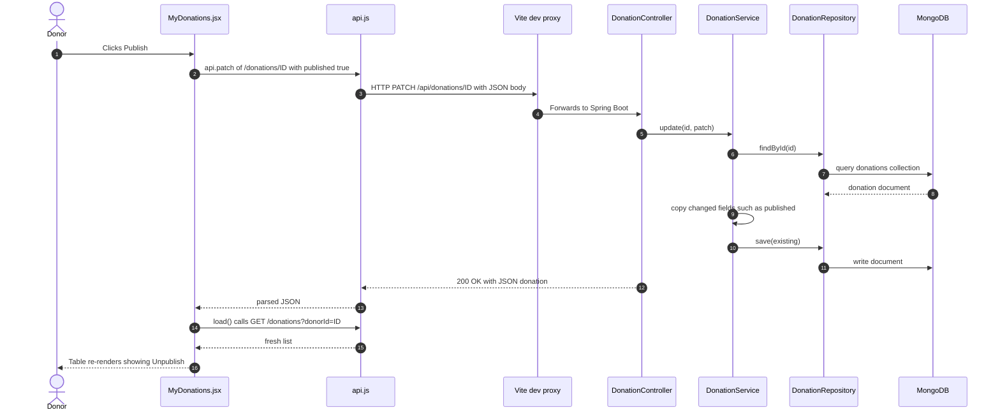

**Why it works this way:** the frontend never updates its own copy of the data. After a change it simply **re-fetches** the list (`load()`). This keeps the screen in line with the server, because the server may have changed other fields too, such as an item's expiry status.

**⚠ Gap: no authentication token.** The request carries no session cookie and no JWT. The backend trusts IDs supplied by the client, such as `donorId` and `beneficiaryId`, and it never checks who is calling. All role checks happen only in the browser (see §3.2.6).

---

## 3.2 Registration, login, verification and access control

### 3.2.1 The story

Imagine "Hope Kitchen", a charity. Its coordinator opens the site and chooses **Receiving Organization**, then fills in the form: contact name, phone, city, people served daily and storage type. Next the platform shows a **Recipient Disclaimer**, which she accepts. Her account is created straight away, but it is marked **pending**.

She can already browse food, but she **cannot request any yet**. On her dashboard she uploads the charity's registration certificate. An administrator opens *Verifications*, views the certificate and clicks **Approve**. From then on she can request food.

**Why this design:** food is an essential resource, so the platform wants to be sure a request comes from a real organization. Letting people browse freely keeps the platform open. Gating requests behind verification keeps it trustworthy.

### 3.2.2 Registration flow

`pages/Register.jsx` offers two top-level roles:

- **Donor** (supermarket or store). This uses the built-in form in `Register.jsx`.
- **Receiving Organization**. This uses `components/BeneficiaryRegistrationForm.jsx`, which then offers **Beneficiary** (charity and relief) or **Farm Partner** (compost and animal feed).

Both paths go through a `stage` state machine: `"form"` → `"agreement"` → submit.

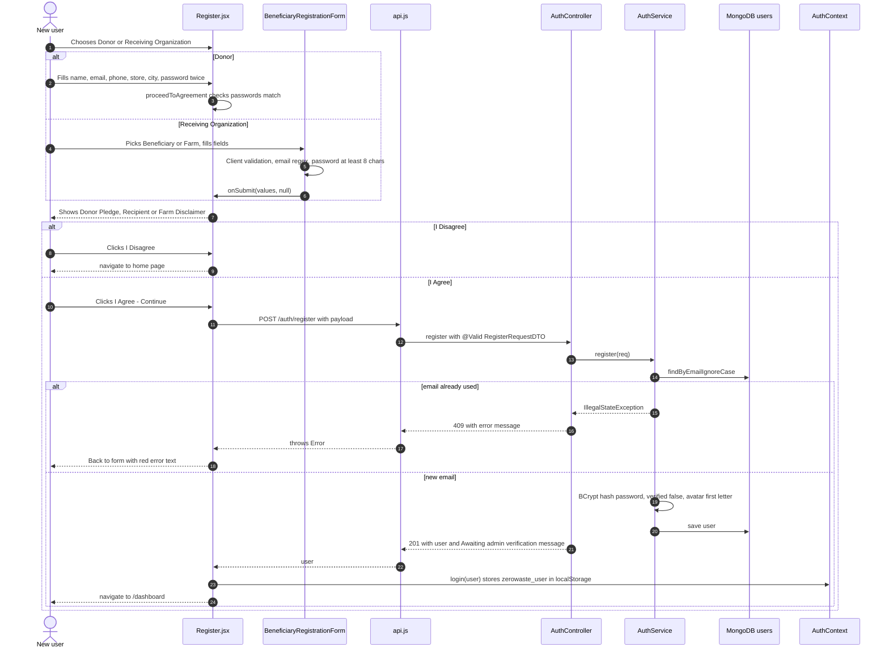

What the server does, in `AuthService.register`:

1. It rejects duplicate emails, ignoring letter case, with **409 Conflict**.
2. It builds a `User`. Missing `organizationSize` and `handlingCapacityKg` become `0`, and `allocationsLast30Days` is set to `0`.
3. It stores the password as a **BCrypt hash** (`PasswordConfig` → `BCryptPasswordEncoder`). The `passwordHash` getter has `@JsonIgnore`, so the hash never goes back to the browser.
4. It sets `verified = false`. The model's default `verificationStatus` is `"pending"`.
5. It sets `avatar` to the first letter of the name.

`RegisterRequestDTO` enforces `@NotBlank` on `role`, `name`, `email` (which also needs `@Email`), `password` and `organizationName`. A failure returns **400** with a message such as `"email must be a well-formed email address"`.

What each role sends:

| Field sent | Donor form | Beneficiary | Farm |
|---|---|---|---|
| `role` | `donor` | `beneficiary` | `farm` |
| `orgType` | `"Donor"` | `"Beneficiary Organization"` | `"Farm"` |
| `organizationSize` | form value, but the donor form has no input for it, so it becomes `0` | "People Served Daily" | `0` (the field is hidden) |
| `handlingCapacityKg` | `0` | **not sent**, so `0` | not sent, so `0` |
| `storageCapacity` | not sent | `"Ambient / Dry"`, `"Refrigerated / Cold"` or `"Deep Freezer"` | not sent |

> **⚠ Gap: the document upload during registration never runs.** `Register.confirmAgreement` would upload `beneficiaryFile` straight after registering. However, `BeneficiaryRegistrationForm.handleSubmit` always calls `onSubmit(values, null)`, so the file is always `null`. In practice every organization uploads its document **after** signing up, from the dashboard banner (§3.2.4).
>
> **⚠ Gap: an extra field is sent and a password rule is missing.** Donor registration sends `confirmPassword` inside `...form`. Jackson ignores it. The donor form also does **not** enforce the 8-character minimum that the organization form does.

### 3.2.3 Login flow

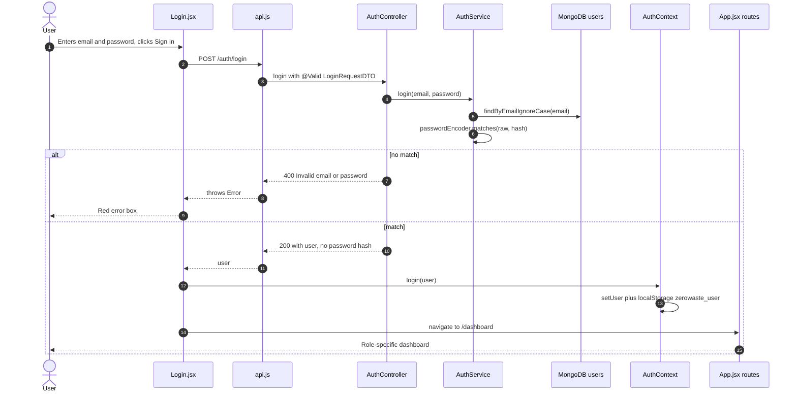

Small details worth knowing:

- The **"Remember me"** checkbox is stored in component state and **never used**. The session is always saved to `localStorage`.
- **"Forgot password?"** only shows a browser `alert()`. There is no reset flow.
- A wrong email and a wrong password give the same message (`"Invalid email or password"`). This avoids telling an attacker which email addresses have accounts.

### 3.2.4 Verification documents and admin approval

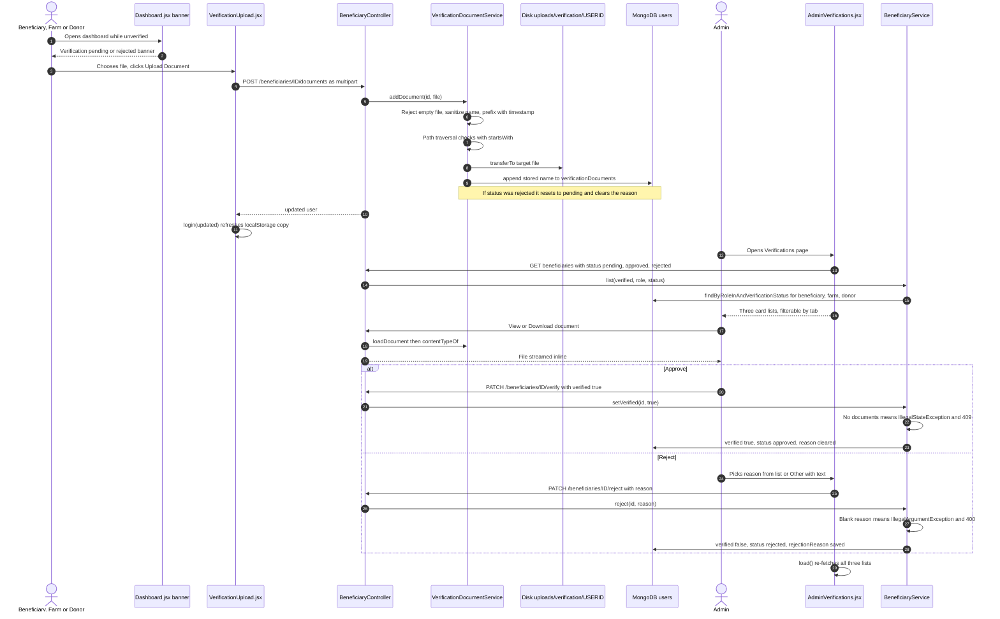

**Verification states** (`User.verificationStatus` plus `User.verified`):

```mermaid
stateDiagram-v2
    [*] --> pending: register
    pending --> approved: admin Approve, needs at least 1 document
    pending --> rejected: admin Reject with reason
    rejected --> pending: user uploads a new document
    approved --> pending: PATCH verify with verified false
    approved --> [*]
    note right of approved
        verified is true
        beneficiary and farm may now request food
    end note
```

The `approved → pending` transition exists in `BeneficiaryService.setVerified(false)`, but **no screen calls it**.

> **⚠ Gap: stale verification status in the browser.** The browser only refreshes its copy of the user on login, on registration and after an upload. Suppose an admin approves Hope Kitchen while its coordinator is logged in. She keeps seeing "Verification pending" and stays locked out of *My Requests* and *Tickets* until she **logs out and back in**. The endpoint `GET /api/auth/me/{id}` exists but the frontend never calls it.
>
> **⚠ Gap: rejected users are not notified.** The reject dialog says the organization "will be notified", but `BeneficiaryService.reject` creates **no** `Notification`. The user only sees the reason on the dashboard banner or the Profile page, and only after logging in again, for the same stale-state reason.
>
> **Donors appear in the verification queue too.** `BeneficiaryService.list` defaults to the roles `beneficiary`, `farm` and `donor`. Unverified donors see a "Verification pending" banner, but **nothing blocks them**. They can list and publish food while they wait.

### 3.2.5 How the session is stored on the frontend

`AuthContext.jsx`:

- On startup it reads `localStorage["zerowaste_user"]`, falling back to the legacy key `foodshare_user`, and parses the JSON into `user`.
- `login(u)` does `setUser(u)` and saves the key.
- `logout()` clears both keys. The Sidebar's **Logout** button calls it. Once `user` is `null`, the route guards send the person to `/login`.
- `loading` becomes `false` right after the first render. It only exists so `Protected` can show "Loading..." for one tick.

Because the "session" is simply a copy of the user object in the browser, **the session never expires**. Several windows of the same site share it too, which is how the separate QR-scanner pop-up window knows who is logged in (§3.5).

`FoodAlertContext` also stores per-user alert history under `zerowaste_alerts_<userId>` (§3.7).

### 3.2.6 How roles gate pages

The roles used in code are `donor`, `beneficiary`, `farm` and `admin` (see the comment on `User.role`).

`App.jsx` defines the route guards:

- `Protected({ roles, requireVerified })`:
  - no user → redirect to `/login`
  - role not in `roles` → redirect to `/dashboard`
  - `requireVerified` and the role is `beneficiary`/`farm` and `!user.verified` → redirect to `/dashboard`
  - otherwise the page renders inside `Layout`, which contains `Sidebar`, `Topbar`, the page itself, and `Chatbot` for everyone except admins
- `BrowseRoute`: guests see `BrowseFood` inside `PublicShell`. Beneficiaries and farms see it inside `Layout`. Donors and admins are redirected to `/dashboard`.
- `/scan` renders `ScanQRPage` only for donors, and has no layout. Anyone else goes to `/login`.
- `/login` and `/register` send users who are already logged in to `/dashboard`. `/` shows `Home` to guests and redirects logged-in users.

| Route | Guest | Donor | Beneficiary (unverified) | Beneficiary (verified) | Farm | Admin |
|---|---|---|---|---|---|---|
| `/` Home | ✔ | → dashboard | → dashboard | → dashboard | → dashboard | → dashboard |
| `/browse` | ✔ (read-only) | → dashboard | ✔ (read-only) | ✔ | ✔ (expired items only) | → dashboard |
| `/dashboard`, `/profile`, `/help`, `/impact` | → login | ✔ | ✔ | ✔ | ✔ | ✔ |
| `/donations`, `/requests`, `/pickups`, `/scan` | → login | ✔ | ✘ | ✘ | ✘ | ✘ |
| `/my-requests` | → login | ✘ | ✘ (→ dashboard) | ✔ | ✔ if verified | ✘ |
| `/tickets` | → login | ✔ | ✘ (→ dashboard) | ✔ | ✔ if verified | ✘ |
| `/admin/beneficiaries`, `/admin/settings`, `/admin/reports` | → login | ✘ | ✘ | ✘ | ✘ | ✔ |

The Sidebar menu is built from `NAV_BY_ROLE` in `Sidebar.jsx`. For unverified beneficiaries and farms it also hides `/my-requests` and `/tickets`. Farms have no "Impact" menu link, although the route still works for them.

> **⚠ Gap: security is enforced only in the browser.** Every rule above lives in React. The Spring Boot API has **no authentication or authorization**. Anyone who can reach `/api` can call `/api/settings`, `/api/beneficiaries/{id}/verify` or `/api/tickets/scan` directly, with any IDs. The backend does enforce a few **business** rules: a request needs a verified beneficiary, a scan needs the donor who owns the item, and approval needs a document. It does not check **identity**.

---

## 3.3 Donation lifecycle and expiry handling

### 3.3.1 The story

A supermarket in Colombo has 20 kg of bread that expires the day after tomorrow, plus 30 kg of canned goods that are good for another six weeks. The store manager opens *My Donations* and adds both.

The system accepts the bread: it is close enough to expiry to count as **surplus**. It **refuses** the canned goods, because they are still **fresh** and can be sold normally. The manager clicks **Publish** on the bread, and charities can now see it.

If nobody claims the bread before its date passes, the system automatically re-labels it **expired**. From then on only **farm partners** (compost and animal feed) see it, not charities feeding people.

**Why:** the platform is meant to rescue food that would otherwise be thrown away, not to compete with normal retail. It also keeps unsafe food away from people.

### 3.3.2 Two ways to create donations

**A. Manual entry.** `MyDonations.jsx` → `AddItemForm` → `POST /api/donations` → `DonationController.create` → `DonationService.create`:

1. `threshold = settingsService.resolveExpiryThresholdDays(category)` (see §3.3.3).
2. If `expiryDate < today` **and** `listingType != "expired"`, it throws `"Expiry date has already passed. List this item under the expired/compost workflow instead."` (400). The manual form never sends `listingType`, so in practice the UI cannot create an already-expired item this way.
3. `status = ExpiryUtil.classify(expiryDate, threshold)`.
4. If `status == "fresh"`, it throws `"This item is still fresh (more than N day(s) from expiry)…"` (400).
5. It sets `published = false` and `createdAt = now`, defaults `unit` to `"kg"` and `listingType` to `"donation"`, then saves.

**B. CSV bulk upload.** "Upload CSV" → `api.upload("/donations/upload", FormData{file, donorId})` → `DonationService.bulkUpload`:

1. Apache Commons CSV parses the file with a header row and trimmed values. Expected headers: `name,category,batchNumber,quantityKg,expiryDate,pickupLocation`. A template is at `frontend/public/sample_inventory.csv`, served by the "Download Sample CSV" button.
2. Rows with a blank `name` or `expiryDate` are skipped silently.
3. `expiryDate` is parsed by trying, in order: `yyyy-MM-dd`, `M/d/yyyy`, `d/M/yyyy`, `M-d-yyyy`, `d-M-yyyy`. One unreadable date aborts the **whole upload** with a 400. Ambiguous dates such as `3/4/2026` are read as **M/d** (March 4).
4. Defaults: `category` → `"Other"`, `batchNumber` → `"N/A"`, `quantityKg` → `0` if missing or not a number, `pickupLocation` → `""`.
5. Each row is classified. **Fresh rows are skipped and counted**. Surplus and expired rows are saved with `published = false` and `listingType = "donation"`. Unlike manual entry, **already-expired rows are accepted**.
6. The response contains `message`, `surplusDetected`, `expiredDetected`, `freshSkipped` and `items`. The page shows, for example: `✅ 3 item(s) imported and classified. 1 row(s) skipped — still fresh… (2 flagged as surplus, 1 expired)`.

### 3.3.3 ExpiryUtil and category rules

`util/ExpiryUtil.java`:

```text
daysUntil(expiryDate) = calendar days between today and expiryDate  (can be negative)
classify(expiryDate, thresholdDays):
    diff < 0              → "expired"
    diff <= thresholdDays → "surplus"
    otherwise             → "fresh"
```

The threshold depends on the **category**. `SettingsService.resolveCategoryKey` matches keywords in the free-text category, ignoring case:

| Category text contains… | Rule key | Default `expiryThresholdHours` | Threshold in days (`max(1, ceil(h/24))`) | Default `collectionWindowHours` |
|---|---|---|---|---|
| cook, bake, bread, meal, hot food | `cooked_bakery` | 4 | **1** | 2 |
| dairy, milk, veg, fruit, produce, perishable | `perishable_dairy` | 36 | **2** | 12 |
| pack, dry, canned, ration, grain | `packaged_dry` | 144 | **6** | 36 |
| anything else (for example "Other") | none, so the global fallback applies | n/a | `expiryThresholdDays` = **3** | `ticketCollectionWindowHours` = **24** |

**Worked example** (today is 17 Sep):

| Item | Category → rule | Expiry | `daysUntil` | Threshold | Result |
|---|---|---|---|---|---|
| Bread | Bakery → cooked_bakery | 19 Sep | 2 | 1 | **fresh** (rejected) |
| Cooked rice | Cooked Meals → cooked_bakery | 18 Sep | 1 | 1 | **surplus** |
| Milk | Dairy → perishable_dairy | 19 Sep | 2 | 2 | **surplus** |
| Rice bags | Packaged Goods → packaged_dry | 22 Sep | 5 | 6 | **surplus** |
| Yoghurt | Dairy | 16 Sep | −1 | 2 | **expired** |

The threshold is converted from hours to days, so the smallest possible window is **one whole day**. A 4-hour rule for cooked food behaves exactly like a 24-hour rule when items are classified.

### 3.3.4 Automatic reclassification

**No background scheduler exists.** Items change status **on read**: every `GET /api/donations`, whatever its filters, first calls `DonationService.reclassifyAll()`:

1. It loads **all** donations.
2. It skips any whose status is `"collected"`.
3. It works out the new status from the current category threshold.
4. If the status changed:
   - new status `expired` → `listingType = "expired"`, which reroutes the item to farms
   - it was `listingType = "expired"` but is no longer expired (for example, an admin loosened the rules) → `listingType = "donation"`
5. It saves the changed items with `saveAll` and returns `findAll()`.

After that the controller filters by `donorId`, `status` and `published`, and adds `daysUntilExpiry` to each item (`withDaysUntilExpiry`).

**Why:** without a job scheduler, this makes sure anyone looking at the list sees statuses that are correct *right now*. The cost is that every list call scans and may rewrite the whole collection.

### 3.3.5 Publishing, editing, deleting

- **Publish/Unpublish:** `PATCH /api/donations/{id}` with `{published}`. The UI hides the button when `status == "fresh"` and shows "Not eligible yet" instead. `DonationService.update` only copies `published`, `quantityKg`, `status` and `listingType`.
- **Visibility:** `BrowseFood` loads `GET /donations?published=true`:
  - beneficiaries and guests see items where `status !== "expired"`
  - farms see only `status === "expired"`
- **Delete:** `DELETE /api/donations/{id}` exists in `DonationController`, but **no UI calls it**.

### 3.3.6 Donation status state diagram

```mermaid
stateDiagram-v2
    [*] --> Rejected_Fresh: create with more than threshold days left
    Rejected_Fresh --> [*]: not saved, 400 error or CSV row skipped
    [*] --> surplus: create or CSV, days left within threshold
    [*] --> expired: CSV row already past expiry

    state "unpublished" as U
    state "published" as P

    surplus --> expired: reclassifyAll after the date passes, listingType becomes expired
    surplus --> fresh: reclassifyAll after admin tightens threshold
    fresh --> surplus: reclassifyAll as expiry nears
    surplus --> reserved: approval reserves all remaining kg
    reserved --> surplus: next reclassifyAll recomputes from date
    reserved --> fresh: releaseStock when a counter-offer is declined
    expired --> surplus: admin loosens rules, listingType back to donation

    U --> P: donor clicks Publish
    P --> U: donor clicks Unpublish
```

Publishing is an **independent flag**. Any saved item can be published or unpublished, whatever its status, although the UI only offers the button when the status isn't `fresh`.

> **⚠ Gap: "reserved" does not stick.** `RequestService.reserveStock` sets `status = "reserved"` when the remaining quantity reaches 0. But `reclassifyAll` only skips `"collected"` items, and `ExpiryUtil.classify` never returns `"reserved"`. The next `GET /donations` therefore turns the item back into `surplus`, `fresh` or `expired`, and a published 0 kg item then shows up again in *Available Food*.
>
> **⚠ Gap: "collected" is never set on a donation.** A successful QR scan marks the **ticket** as collected, not the donation. The donation `"collected"` status, the admin "Saved (Collected)" figure and the skip in `reclassifyAll` are all effectively unused.
>
> **⚠ Gap: seeded data gets reclassified.** The seeder writes `status = "surplus"` for "Bread & Pastries" (Bakery, expires in 2 days) and "Mixed Vegetables" (Vegetables, expires in 3 days). Under the default category rules, those thresholds are 1 and 2 days. So the first `GET /donations` reclassifies both as **fresh**. They are still `published = true`, so they stay visible in Browse.
>
> **⚠ Gap: quantity is not validated.** Neither creation path checks that `quantityKg > 0`. Only the form's `required` attribute exists.

---

## 3.4 Food request lifecycle

### 3.4.1 The story

Two charities see the same 15 kg of bread:

- **Hope Kitchen** (120 people, 200 kg capacity) asks for 15 kg and marks it **High** urgency.
- **Caring Hands** (60 people) asks for 15 kg at **Medium** urgency.

The supermarket gets a notification for each request. On the *Food Requests* page the manager clicks **"Ask AI for Match Insights"**. The AI scores Hope Kitchen 65% and Caring Hands 52%, and suggests Hope Kitchen first.

The manager approves Hope Kitchen for the full 15 kg. Hope Kitchen gets a notification and a collection ticket with a QR code.

Had only 10 kg been available, the manager could send a **counter-offer**. Hope Kitchen would then decide whether to accept the 10 kg.

**Why:** donors keep the final say, and the AI only advises. Counter-offers let a donor share scarce stock without refusing a request outright.

### 3.4.2 Submitting a request

```mermaid
sequenceDiagram
    autonumber
    actor B as Verified beneficiary or farm
    participant BF as BrowseFood.jsx
    participant API as api.js
    participant RC as RequestController
    participant RS as RequestService
    participant DB as MongoDB
    participant NS as NotificationService

    B->>BF: Opens Available Food
    BF->>API: GET /donations?published=true
    Note over API,DB: reclassifyAll runs first, see section 3.3.4
    API-->>BF: donations with daysUntilExpiry
    BF->>BF: Filter, farms see expired, others see non-expired
    B->>BF: Clicks Request This Item
    alt guest
        BF-->>B: LockedModal asking to log in
    else unverified
        BF-->>B: LockedModal saying verification pending
    else verified
        BF-->>B: RequestModal with quantity and urgency
        B->>BF: Submit Request
        BF->>API: POST /requests with itemId, beneficiaryId, quantityKg, urgency, distanceKm
        API->>RC: submit with @Valid FoodRequest
        RC->>RS: submit(request)
        RS->>DB: find beneficiary, must exist
        RS->>RS: beneficiary.verified false means 409
        RS->>DB: find item, must exist
        RS->>RS: item expired and listingType not expired means 400
        RS->>DB: save with status pending, createdAt now, urgency default medium
        RS->>NS: notify donor with type request
        NS->>DB: insert notification
        RC-->>BF: 201 with request
        BF-->>B: Request submitted and the donor has been notified
    end
```

> **⚠ Gap: distance is random.** `RequestModal` sends `distanceKm: Math.round((Math.random() * 8 + 1) * 10) / 10`, a **random value between 1.0 and 9.0 km**. The user and donation models store latitude and longitude, but nothing uses them. So the "distance" part of the AI score, and the "Closest Distance" label, are effectively random.
>
> **⚠ Gap: the requested quantity is not checked on the server.** The browser caps it with `max={item.quantityKg}`. The server does not check it against stock, does not reject duplicate requests, and does not check that the item is published.
>
> **Note:** the `"expired and listingType not expired"` check almost never triggers, because `reclassifyAll` always sets `listingType = "expired"` whenever the status becomes `expired`. In practice farms **and** beneficiaries can submit requests for expired items through the API. The UI simply doesn't show expired items to beneficiaries.

### 3.4.3 Donor review, approval, counter-offer, rejection

Donors can act from two places:

- **Food Requests** (`pages/Requests.jsx`), the main page. It lists `GET /requests?donorId=…` (every request for any of the donor's items, enriched with the `item` and a `beneficiary` summary), with tabs *All / Beneficiary / Farm*, 7 rows per page and a **RequestDetailModal**.
- **My Donations → View Requests** (`RecommendationPanel`), a simpler list that shows the AI ranking with plain Approve/Reject buttons. Approving there **always approves the full requested quantity**.

`PATCH /api/requests/{id}` with a body of `{status, approvedQuantityKg?, reason?}` goes to `RequestService.updateStatus`:

```mermaid
flowchart TD
    A["PATCH /requests/ID with status"] --> B{"status value?"}
    B -->|approved| C{"previous status was counter_offer?"}
    C -->|yes| C1["status becomes approved, createTicket with approvedQuantityKg, notify beneficiary type ticket"]
    C -->|no| D["qty = approvedQuantityKg or requested kg, then capped at item kg"]
    D --> E{"qty less than requested?"}
    E -->|yes| F["status becomes counter_offer, reserveStock(qty), notify beneficiary to review the offer"]
    E -->|no| G["status becomes approved, reserveStock(qty), createTicket(qty), notify beneficiary that a ticket was generated"]
    B -->|rejected| H["status becomes rejected, save rejectionReason, notify beneficiary that it was declined"]
    B -->|cancelled| I["status becomes cancelled, releaseStock(approvedQuantityKg), no notification"]
    B -->|anything else| J["status saved as given, no side effects"]
```

Stock arithmetic:

- `reserveStock`: `item.quantityKg = max(0, quantityKg − qty)`. If that leaves 0, `status = "reserved"`.
- `releaseStock`: `item.quantityKg += qty`. If the status was `"reserved"`, it becomes `"fresh"`. The next `reclassifyAll` recomputes it.

**Automatic counter-offer:** approving 15 kg when only 10 kg remain caps `qty` at 10. That is below the 15 kg requested, so the request **turns into a counter-offer automatically**, even if the donor didn't intend one.

On the beneficiary side, `pages/MyRequests.jsx` shows every request for the user (8 per page):

- `counter_offer` rows show **"Accept X kg"**, which sends `PATCH {status:"approved"}`, and **"Decline Offer"**, which sends `PATCH {status:"cancelled"}`.
- `rejected` rows show **"View Reason"**, which opens `RejectionReasonModal` with the donor's text or a default sentence.
- `pending` rows show "Awaiting donor response".

### 3.4.4 Request state diagram

```mermaid
stateDiagram-v2
    [*] --> pending: beneficiary submits
    pending --> approved: donor approves full qty, stock reserved and ticket created
    pending --> counter_offer: donor approves less, or stock is short
    pending --> rejected: donor declines with reason
    counter_offer --> approved: beneficiary accepts, ticket created
    counter_offer --> cancelled: beneficiary declines, stock released
    approved --> [*]
    rejected --> [*]
    cancelled --> [*]
```

> **⚠ Gap: nothing stops invalid transitions.** The server doesn't check the current status before changing it. For example, approving an already-`approved` request a second time reserves stock **again** and creates a **second ticket**. The UI only shows action buttons for `pending` and `counter_offer`, which limits this in normal use.
>
> **⚠ Gap: side effects the model promises but never delivers.**
> - Nothing ever increments `User.allocationsLast30Days`, which the AI uses for fairness, after an approval. It only changes through seeded data.
> - Declining a counter-offer does not notify the donor.
> - `Requests.jsx`'s `act()` has no `try/catch`, so a failed PATCH there shows no error message.

### 3.4.5 AI match insights on the Requests page

When the donor clicks **"Ask AI for Match Insights"** (`fetchAiInsights`):

1. The page collects the distinct `itemId`s that have **pending** requests.
2. It calls `GET /api/requests/recommendations/{itemId}` for all of them **in parallel** (`Promise.all`).
   - `RequestService.recommendationsFor` loads the item, the pending requests (`findByItemIdAndStatus`) and the requesting users.
   - `AIClientService.rankRequests` then POSTs them to the Python service (§3.6).
3. For each returned ranking entry, it stores `{score, rank = position + 1, total, justification}`.
4. The **justification label** is worked out in the **browser** (`computeJustification`), not by the AI:
   - only one pending sibling → **"Best Match"**
   - this request has the smallest `distanceKm` among its siblings → **"Closest Distance"**
   - its urgency is the highest among siblings and is at least `high` → **"Highest Urgency"**
   - otherwise → **"Best Overall Fit"**

   The label is only shown for rank #1. Other ranks show "Priority #N".
5. The table gets an **AI Insight** column (`"65% Match - Closest Distance"`), and the detail modal shows `"65% Match · Priority #1"`.

The toggle is page-local and is not stored anywhere. Pressing it again hides the column.

---

## 3.5 Tickets, QR codes and pickup confirmation

### 3.5.1 The story

Hope Kitchen's request was approved, so a **collection ticket** now appears on its *My Tickets* page. The ticket includes a QR code, the pickup address, a date, a time and a countdown ("⏱️ 2 hr Collection Window").

A volunteer drives to the supermarket and shows the QR code on a phone. The store manager clicks **Scan QR Code** in the sidebar. A small camera window opens, reads the code, and the system confirms the handoff. The volunteer's app now says "Confirmed", and Hope Kitchen gets a notification: *"Donation complete!"*

**Why:** the QR code proves the person collecting the food is the approved organization. It also leaves a record that the handoff actually happened, which is what the impact figures are built on.

### 3.5.2 Ticket generation

Tickets are only created inside `RequestService.createTicket`, which runs on full approval or when a counter-offer is accepted:

| Field | Value |
|---|---|
| `id` | `"t-" + first 8 characters of a random UUID`, for example `t-3cb084a2` |
| `requestId`, `itemId`, `beneficiaryId` | copied from the request and item |
| `quantityKg` | the approved quantity |
| `pickupLocation` | `item.pickupLocation` |
| `pickupDate` | **tomorrow** (`LocalDate.now().plusDays(1)`) |
| `pickupTime` | **always `"10:00 AM"`** (hard-coded) |
| `status` | `"pending"` |
| `qrCode` | `"FSQR-" + ticketId + "-" + itemId + "-" + beneficiaryId`, for example `FSQR-t-3cb084a2-d-1002-u-ngo-1` |
| `createdAt` | now |
| `expiresAt` | now + `resolveCollectionWindowHours(item.category)` hours |

> **⚠ Gap: the pickup date contradicts the collection window.** A "Cooked Meals" ticket gets `expiresAt` = now + **2 h** but a `pickupDate` of **tomorrow at 10:00 AM**. On the beneficiary's screen the ticket will show "Window Expired" well before the suggested pickup time.

### 3.5.3 Displaying the QR code

`pages/Tickets.jsx`:

- Beneficiaries and farms call `GET /tickets?beneficiaryId=…`. Donors call `GET /tickets?donorId=…`, which finds the tickets for any of the donor's items.
- `TicketController.list` adds the `item` and a **live** `collectionWindowHours`, worked out again from the *current* settings.
- `CollectionTicketCard`:
  - For beneficiaries and farms it turns the `qrCode` string into a PNG data URL **in the browser**, using the `qrcode` npm library (`QRCode.toDataURL`, width 220). The QR image is never stored on the server.
  - **"Download Ticket"** saves that PNG as `ticket-<id>.png`.
  - For pending tickets with an `expiresAt`, a `setInterval` updates `now` **every 60 seconds** to keep the countdown live.
  - `useCollectionWindow` decides what the badge says:
    - collected → no badge
    - `expiresAt` has passed → **"⏱️ Window Expired"**, and the status badge is shown as **Expired**
    - 1 hour or less left → **"⏱️ 45m left"**
    - otherwise → **"⏱️ N hr Collection Window"**

  It also shows "Valid until 3:15 PM".
- Donors see the same card **without** the QR code or the download button.

### 3.5.4 Scanning and completing a pickup

```mermaid
sequenceDiagram
    autonumber
    actor Donor
    participant SB as Sidebar.jsx
    participant Pop as ScanQRPage in pop-up window
    participant Panel as ScanTicketPanel.jsx
    participant Cam as Camera and jsQR
    participant TC as TicketController
    participant TS as TicketService
    participant DB as MongoDB
    participant NS as NotificationService

    Donor->>SB: Clicks Scan QR Code
    SB->>Pop: window.open of /scan, 440 by 740
    alt pop-up blocked
        SB-->>Donor: Toast asking to allow pop-ups
    end
    Pop->>Pop: Reads logged-in donor from shared localStorage
    Panel->>Cam: getUserMedia with facingMode environment
    alt camera unavailable or denied
        Panel-->>Donor: Enter the pickup code manually below
    end
    loop every animation frame
        Cam->>Panel: draw video frame on hidden canvas
        Panel->>Cam: jsQR(imageData)
    end
    alt QR decoded
        Cam-->>Panel: code.data is the FSQR string
    else manual entry
        Donor->>Panel: Types ticket ID and clicks Complete
    end
    Panel->>TC: POST /tickets/scan with qrCode and donorId
    TC->>TS: completeByQrCode(qrCode, donorId)
    TS->>DB: findByQrCode, or findById as fallback for manual IDs
    alt not found
        TS-->>Panel: 400 QR code not recognized
    end
    TS->>DB: load item for the ticket
    alt item missing
        TS-->>Panel: 404 item no longer exists
    else item belongs to another donor
        TS-->>Panel: 400 ticket belongs to a different donor
    else ticket already collected
        TS-->>Panel: 409 already marked as collected
    else valid
        TS->>DB: ticket status collected, updatedAt now
        TS->>NS: notify beneficiary that pickup was confirmed
        TC-->>Panel: ticket and item
        Panel->>Panel: stopCamera
        Pop-->>Donor: Pickup confirmed, donation complete
        Pop->>SB: window.opener.postMessage zerowaste-scan-completed
        Pop->>Pop: window.close after 1.2 s
        SB->>SB: Checks message origin, shows toast
        SB->>SB: window.location.reload after 1.2 s
    end
```

Why a separate window? `ScanQRPage` is a stand-alone page (`/scan`) opened with `window.open`. The camera view sits in its own small window while the main dashboard stays open. It reports back with `postMessage`, and the Sidebar checks `e.origin === window.location.origin` before trusting the message. When the page is opened directly with no opener window, it shows a **Close** button instead.

The browser only allows camera access (`getUserMedia`) on a secure origin: `https` or `localhost`. Anywhere else the panel falls back to manual entry.

### 3.5.5 Ticket state diagram

```mermaid
stateDiagram-v2
    [*] --> pending: createTicket on approval
    pending --> collected: donor scans or enters code, POST /tickets/scan
    pending --> expired_display: expiresAt passes, shown in the browser only
    expired_display --> collected: scan still succeeds, server does not check expiresAt
    collected --> [*]
    note right of expired_display
        The server never writes status expired.
        Tickets.jsx derives it from expiresAt.
    end note
```

> **⚠ Gap: expired tickets can still be scanned.** `completeByQrCode` never compares `expiresAt` with the current time. The Ticket model lists an `"expired"` status, but nothing on the server ever writes it. `PATCH /api/tickets/{id}` (`TicketService.updateStatus`) exists, but **no screen calls it**.
>
> **Also:** collecting a ticket does **not** change the request or the donation. The request stays `approved`, and the donation stays `surplus`/`fresh`/`expired` (see §3.3.6).

### 3.5.6 Pickup history

`pages/PickupHistory.jsx` is donor-only. It calls `GET /tickets?donorId=…` and shows every ticket for the donor's items as cards, 6 per page. Each card shows the item name, the ticket ID, the kg, date and time, the location, and a status pill: **Completed** for `collected`, **Pending**, or **Expired**. The status comes straight from the server, so "Expired" never actually appears here.

---

## 3.6 AI features in depth

### 3.6.1 The story

The AI does two jobs:

1. **Who should get this food first?** It gives every pending request a score from 0 to 1 using clear, weighted rules. A charity that is urgent, nearby, large and hasn't received much lately goes to the top.
2. **How much surplus should we expect next week?** It draws a best-fit straight line through recent daily surplus figures for each food category, then extends the line forward.

Both run in a **separate Python service** (FastAPI, `ai-service/app`). Spring Boot calls it over HTTP. If it is switched off, the platform still works: ranking falls back to first-come-first-served, and the forecast panel shows an empty "AI service unavailable" note.

### 3.6.2 How the backend calls the AI service

`service/AIClientService.java` uses a `RestTemplate` from `config/RestClientConfig.java`, with a **5 s connection timeout** and a **10 s read timeout**. The base URL comes from `foodshare.ai-service.base-url`.

```mermaid
sequenceDiagram
    autonumber
    participant FE as Requests.jsx or MyDonations.jsx
    participant RC as RequestController
    participant RS as RequestService
    participant AIC as AIClientService
    participant PY as FastAPI main.py
    participant PR as ml/priority.py

    FE->>RC: GET /requests/recommendations/ITEMID
    RC->>RS: recommendationsFor(itemId)
    RS->>RS: load item, pending requests, beneficiary users
    RS->>AIC: rankRequests(item, pending, beneficiaries)
    AIC->>AIC: build JSON with item, requests, beneficiaries
    AIC->>PY: POST /recommend/priority
    alt service reachable
        PY->>PR: rank_requests(payload)
        PR->>PR: score_request for each pending request
        PR-->>PY: list sorted by score, highest first
        PY-->>AIC: ranking list
        AIC-->>RS: list of RecommendationDTO
    else RestClientException, meaning down, timeout or error status
        AIC->>AIC: log warning
        AIC-->>RS: fallbackRanking in stored order, name Unknown, score 0.0
    end
    RC-->>FE: itemId and ranking
```

The forecast path works the same way:

- `Impact.jsx` → `GET /api/ai/predict?daysAhead=7`
- → `AIController.predict` loads **all** `HistoryPoint`s
- → `AIClientService.predictSurplus`
- → `POST {base}/predict/surplus` with `{daysAhead, history:[{category, date, quantityKg}]}`
- → `ml/prediction.py`

### 3.6.3 Priority scoring algorithm (`ai-service/app/ml/priority.py`)

`score_request(request, beneficiary)`:

| Factor | Formula | Weight |
|---|---|---|
| Urgency | `critical = 1.0`, `high = 0.75`, `medium = 0.5`, `low = 0.25` (unknown → 0.5) | **0.40** |
| Distance | `1 − min(distanceKm / 50, 1)` (closer is better; 50 km or more scores 0) | **0.20** |
| Organization size | `min((organizationSize or 1) / 500, 1)` | **0.15** |
| Handling capacity | `min((handlingCapacityKg or 50) / 500, 1)` | **0.15** |
| Fair-share history | `1 − min((allocationsLast30Days or 0) / 10, 1)` | **0.10** |

`score = Σ factor × weight`, rounded to 3 decimals. `rank_requests` keeps only `status == "pending"` requests. A request whose beneficiary profile is missing gets score `0.0` and the name `"Unknown"`. The list is sorted by score, highest first.

In Python, `x or default` also replaces **0**. So an organization registered with capacity `0`, which is every self-registered beneficiary (see §3.2.2), is scored as if it had **50 kg**. An organization size of `0` is scored as **1**.

**Worked example** using the seeded requests for "Bread & Pastries" (`r-1`, `r-2`):

| | Hope Kitchen (`r-1`) | Caring Hands (`r-2`) |
|---|---|---|
| Urgency | high → 0.75 × 0.40 = **0.300** | medium → 0.50 × 0.40 = **0.200** |
| Distance | 4.2 km → (1 − 0.084) = 0.916 × 0.20 = **0.1832** | 3.5 km → (1 − 0.07) = 0.93 × 0.20 = **0.186** |
| Org size | 120/500 = 0.24 × 0.15 = **0.036** | 60/500 = 0.12 × 0.15 = **0.018** |
| Capacity | 200/500 = 0.40 × 0.15 = **0.060** | 100/500 = 0.20 × 0.15 = **0.030** |
| History | 3 allocations → (1 − 0.3) = 0.7 × 0.10 = **0.070** | 1 allocation → (1 − 0.1) = 0.9 × 0.10 = **0.090** |
| **Score** | **0.649 → "65% Match", Priority #1** | **0.524 → "52% Match", Priority #2** |

On the Requests page, Hope Kitchen is rank #1. `computeJustification` first checks distance: 4.2 km is not the smallest, because Caring Hands is at 3.5 km. It then checks urgency: `high` (3) is the highest among the siblings and at least 3. So the label is **"Highest Urgency"**. The page shows "65% Match - Highest Urgency" for Hope Kitchen and "52% Match - Priority #2" for Caring Hands.

**Why a rule-based model:** the docstring in `priority.py` explains that when essential resources are allocated, a transparent and auditable formula is easier to justify than a black box. The weights are named constants, so they are easy to tune.

### 3.6.4 Surplus prediction algorithm (`ai-service/app/ml/prediction.py`)

`predict_surplus(history, days_ahead)`:

1. Group the history entries by `category`.
2. For each category, sort by date and set `y = [quantityKg …]` and `x = 0, 1, …, n−1` (the **position** in the sorted list, not the actual date).
3. Fit a line:
   - `n < 2`: predicted daily = the single value
   - scikit-learn installed: `LinearRegression().fit(x, y)`, predict `x = n … n+days_ahead−1`, clip negatives to 0, take the mean
   - otherwise: `_fit_linear_pure_python`, the same ordinary least squares done by hand: `slope = Σ(x−x̄)(y−ȳ) / Σ(x−x̄)²`, `intercept = ȳ − slope·x̄`
4. `total = round(max(predicted_daily, 0) × days_ahead, 1)`.

`main.py` then returns `{daysAhead, predictions:{category: kg}, totalPredictedKg: sum rounded to 1 dp, note}`.

**Worked example (simple).** Bakery history for 5 days is `[8, 9, 10, 11, 12]` kg, and `days_ahead = 7`:

- x̄ = 2, ȳ = 10. Σ(x−x̄)(y−ȳ) = (−2)(−2)+(−1)(−1)+0+1·1+2·2 = 10, and Σ(x−x̄)² = 10, so **slope = 1**, **intercept = 10 − 1·2 = 8**.
- Future x = 5…11 gives predictions 13, 14, …, 19. Their mean is **16 kg/day**.
- Total = 16 × 7 = **112.0 kg** forecast for Bakery over the next 7 days.

**Worked example (the seeded data).** `DataSeeder.seedHistory` creates 20 days × 6 categories using `qty = base + trend·(20−i) + noise`. Here `(20−i)` equals the x position 0…19. For Bakery, `base = 8` and `trend = 0.3`. Ignoring the noise (a sine wave of ±3 plus a random value of ±1), the fitted line is about `8 + 0.3x`. The next 7 days are x = 20…26, with a mean x of 23, so daily ≈ 8 + 0.3 × 23 = **14.9 kg**, and the 7-day total ≈ **104 kg**. Real outputs differ a little because of the noise.

`Impact.jsx` draws one horizontal bar per category, with width = `kg / max(kg) × 100%`. Below the bars it shows the note and `totalPredictedKg`.

> **⚠ Gap: the forecast never learns from real data.** The `history` collection is only written by the seeder. Real donations are never added to it, so the forecast always reflects the **demo data** created on the first boot, and those dates grow older every day. Also, because `x` is the list position rather than the actual date, gaps in the history are ignored.

### 3.6.5 What happens when the AI service is down

| Feature | What happens | What the user sees |
|---|---|---|
| Priority ranking (`rankRequests`) | `RestClientException` is caught and a warning logged. `fallbackRanking` returns pending requests in **database order** with `beneficiaryName = "Unknown"` and `score = 0.0` | *Requests*: every pending row shows **"0% Match"**, rank #1 still gets a justification label. *My Donations → View Requests*: names show as **"Unknown"** with "AI priority score: 0". Approve and Reject still work |
| Surplus forecast (`predictSurplus`) | Caught. Returns `predictions = {}`, `totalPredictedKg = 0`, and the note *"AI service unavailable - showing no forecast. Start the ai-service (see README) to enable predictions."* | *Impact*: no bars, just the note and "Total predicted surplus: 0 kg" |
| Slow AI service | A connection over 5 s or a read over 10 s counts as a `RestClientException` and gets the same fallbacks | Same as above, after a delay |

Everything else, including requests, approvals, tickets and scanning, works **without** the AI service.

---

## 3.7 Notifications and the food alert engine

The bell in the top bar merges **two independent notification sources**.

### 3.7.1 Source A: server notifications (stored in MongoDB)

`NotificationService.notify(userId, type, message)` inserts a `Notification` with `read = false`. It is called from these places:

| Trigger (code) | Recipient | `type` | Message pattern |
|---|---|---|---|
| `RequestService.submit` | donor | `request` | New request received for "ITEM" (N kg). |
| `updateStatus`: full approval | beneficiary | `ticket` | Your request was approved! Collection ticket generated. |
| `updateStatus`: counter-offer | beneficiary | `request` | The donor could only approve X kg of your Y kg request for "ITEM". Please review the offer. |
| `updateStatus`: counter-offer accepted | beneficiary | `ticket` | Collection ticket generated for the X kg you accepted. |
| `updateStatus`: rejected | beneficiary | `request` | Your request for "ITEM" was declined. |
| `TicketService.completeByQrCode` | beneficiary | `ticket` | Your pickup for "ITEM" was confirmed by the donor. Donation complete! |
| `DataSeeder` (demo only) | donor | `request` / `ticket` / `expiry` | four sample messages |

These events create **no** notification: registration, verification approval or rejection, a declined counter-offer, and an item expiring (only the seed data has an `expiry` example).

The endpoints are `GET /api/notifications/{userId}` (returns `notifications` newest first, plus `unreadCount`), `PATCH /api/notifications/{id}/read` and `PATCH /api/notifications/{userId}/read-all`.

### 3.7.2 Source B: the food alert engine (browser only, donors only)

This has two files with separate jobs:

- **`alertEngine.js`**: pure functions that decide **what** alert applies. It has no React, network or storage code.
- **`FoodAlertContext.jsx`**: decides **when** to check, removes duplicates, and persists the alerts.

**The polling loop** (`FoodAlertProvider`):

1. It only runs when `user.role === "donor"`.
2. It scans **immediately**, then **every 60 seconds** (`POLL_INTERVAL_MS = 60_000`) using `setInterval`. The interval is cleared on logout or when the user changes.
3. Each scan fetches three things in parallel:
   - `GET /donations?donorId=…` (which also triggers `reclassifyAll`)
   - `GET /requests?donorId=…`
   - `GET /settings`
4. It counts the requests per item (every status counts).
5. For each donation that isn't `collected`, it calls `evaluateItem(item, requestCount, settings, now)` and turns each resulting state into a message with `buildAlert`.
6. **Deduplication:** it skips an alert if one with the same `itemId` **and** `type` already exists. Each state maps to a unique `type`, so each item gets **at most one alert per state, ever**.
7. New alerts are added at the front, and the list is capped at **50** (`MAX_STORED_ALERTS`).
8. Every change is saved to `localStorage["zerowaste_alerts_<userId>"]`, so alerts survive a page refresh.
9. Errors are swallowed silently. A missed scan simply gets another try 60 seconds later.

**`evaluateItem` logic:**

```mermaid
flowchart TD
    S["Donation, request count, settings, now"] --> V{"expiryDate and createdAt present?"}
    V -->|no| N["no states"]
    V -->|yes| X["expiresAt = expiryDate at 23:59:59.999 local time. hoursRemaining = expiresAt minus now. hoursListed = now minus createdAt"]
    X --> E{"hoursRemaining at or below 0?"}
    E -->|yes| EX["EXPIRED only"]
    E -->|no| U{"hoursListed at least 1 and zero requests?"}
    U -->|yes| UA["add UNCLAIMED"]
    U -->|no| T
    UA --> T{"hoursRemaining at or below the category expiryThresholdHours?"}
    T -->|yes| TA["add URGENT"]
    T -->|no| DONE["return states"]
    TA --> DONE
```

`ruleFor(category, settings)` copies the server's keyword matching (`resolveCategoryKey`). With no matching rule, the fallback is `expiryThresholdDays × 24` hours. Unlike the server, it uses the rule's **raw hours**, not rounded to whole days. A 4-hour cooked-food rule therefore makes the urgent alert fire only in the **last 4 hours of the expiry day**.

| State | Title | `type` (dot colour) | Message |
|---|---|---|---|
| UNCLAIMED | Unclaimed Food | `warning` (amber) | ⚠️ Unclaimed Food: ITEM has had no claims for 1 hour. Available for immediate pickup! |
| URGENT | Urgent Expiry Alert | `urgent` (red) | 🚨 Urgent Expiry Alert: ITEM expires in N hours! Priority matching active. |
| EXPIRED | Rerouted to Composting | `info` (green) | 🌱 Rerouted to Composting: ITEM is no longer suitable for human meals and routed to Farm Partners. |

The URGENT message's "N hours" is the value **at the moment the alert was created**. Because of deduplication it never updates.

**Where "Unclaimed" can mislead:** the check counts **every** request, including rejected and cancelled ones, and it applies to **unpublished** items too.

### 3.7.3 How the bell merges and marks them read

`components/Topbar.jsx`:

```mermaid
sequenceDiagram
    autonumber
    participant TB as Topbar.jsx
    participant API as api.js
    participant NC as NotificationController
    participant FAC as FoodAlertContext

    TB->>API: GET /notifications/USERID when mounted or user changes
    API->>NC: list(userId)
    NC-->>TB: notifications and unreadCount
    FAC-->>TB: client alerts and their unreadCount, updated every 60 s for donors
    TB->>TB: combine both sources, sort newest first, show top 8
    TB->>TB: badge = server unread plus alert unread
    Note over TB: Opening the dropdown with unread items calls markAllRead
    TB->>TB: optimistic UI, clear badge and mark all read
    TB->>FAC: markAllRead for local alerts
    TB->>API: PATCH /notifications/USERID/read-all, errors ignored
    Note over TB: Clicking one unread item marks just that item
```

Relative times such as "just now", "5m ago", "2h ago" and "3d ago" come from `timeAgo.js`.

> **⚠ Gap: server notifications are not polled.** They are only fetched when the Topbar mounts or the user changes. So a donor won't see a new request notification until the page reloads (for example after a scan, which reloads the page) or the app shell is mounted again. The **client alerts**, by contrast, update every 60 s.

---

## 3.8 Dashboard and impact metrics

### 3.8.1 The story

Each role's dashboard answers one question: **"What do I need to act on, and what difference have I made?"**

- Donors see how much food they have given away and the equivalent in meals and CO₂.
- Charities see listings available now and their upcoming pickups.
- Admins see how the whole network is performing.

These figures are **estimates** based on fixed conversion constants, not measurements.

The constants, in `DashboardService` and `ReportService`: **`MEALS_PER_KG = 2.0`** and **`CO2_KG_SAVED_PER_KG_FOOD = 2.5`**.

### 3.8.2 Donor dashboard (`GET /api/dashboard/{donorId}` → `DashboardService.donorDashboard`)

| Figure | Exact calculation |
|---|---|
| `totalDonations` | number of donations with this `donorId` |
| `totalFoodKg` | Σ over those donations of (**current** `quantityKg` + Σ `quantityKg` of all tickets for that donation). Stock reserved for tickets is subtracted from the donation, so this adds it back |
| `mealsEquivalent` / `mealsProvided` | `round(totalFoodKg × 2)` |
| `co2SavedKg` | `round1(totalFoodKg × 2.5)` |
| `peopleHelped` | for each **distinct** beneficiary with a ticket on these items: `round(organizationSize × 0.3)` if the size is above 0, otherwise **20**. The results are summed |
| `impact.communitiesHelped` | number of distinct beneficiaries with tickets |
| `impact.wasteDivertedKg` | same as `totalFoodKg` |
| `impact.percentile` | 0 if the donor has donated nothing. Otherwise it totals the *current* `quantityKg` of every donor's items, overrides this donor's total with `totalFoodKg`, and returns `round(donorsWithLessKg × 100 / otherDonors)`. It returns **100** when there are no other donors |
| `recentDonations` | the 5 newest donations. The server sets `status` to `COMPLETED` if the first matching ticket is collected, `SCHEDULED` if a ticket exists, or the item status in upper case otherwise |
| `nextPickup` | the pending ticket with the earliest `pickupDate`, returned as `{date, time, itemName, quantityKg, pickupLocation}` |
| `activeListings` | number of donations with `published = true` |
| `pendingRequests` | requests on these items with `status == "pending"` |

**Worked example on fresh seed data** (one donor, `u-donor-1`):

- Donations total 40 + 15 + 22 + 12 + 8 + 30 = **127 kg**. Ticket `t-9001` adds 40 kg for `d-1001`, so `totalFoodKg` = **167 kg**.
- Meals = 167 × 2 = **334**. CO₂ = 167 × 2.5 = **417.5 kg**.
- People helped: Hope Kitchen (size 120) → round(36) = **36**. Communities = **1**.
- Percentile = **100**, since there are no other donors.
- Active listings = **4** (d-1001 to d-1004). Pending requests = **2** (r-1, r-2).

The seed data never subtracted ticket `t-9001`'s 40 kg from `d-1001`, so this example **double-counts** that 40 kg. With real approvals, `reserveStock` subtracts it and the formula stays consistent.

How `Dashboard.jsx` (DonorDashboard) shows the figures:

- It shows the stat cards, the progress ring (`ProgressRing percent={impact.percentile}`), 3 of the recent donations, and the next pickup card.
- **⚠ Gap:** every recent donation row shows a **hard-coded "COMPLETED"** badge and ignores the status the server sent.
- **⚠ Gap:** the "next pickup" card displays `nextPickup.pickupTime`, but the server's key is `time`, so **the time is blank**.
- **⚠ Gap:** the row image looks up `d.category`, which the server doesn't send, so it always falls back to the "Other" image unless the item name happens to match a category.

### 3.8.3 Beneficiary and farm dashboard (calculated in the browser)

`BeneficiaryDashboard` makes three parallel calls: `GET /donations?published=true`, `GET /tickets?beneficiaryId=…` and `GET /requests?beneficiaryId=…`.

- **Available Listings** = published items that aren't expired (for farms: only expired items).
- **Your Requests** = total, with the number of `pending` ones underneath.
- **Active Tickets** = tickets with status `pending`.
- **Org Capacity** = `user.handlingCapacityKg` from the browser's stored user object. This is 0 for self-registered beneficiaries.
- It also lists the 5 newest listings and the 5 pending collections.

### 3.8.4 Admin dashboard (`GET /api/dashboard/admin/overview`)

| Figure / chart | Calculation (`DashboardService.adminOverview`) |
|---|---|
| Total Users | all users; the subtitle counts roles `donor` and `beneficiary` (farms and admins are not listed separately) |
| Pending Verifications | users who are not admins and have `verified = false` (this **includes rejected** users) |
| Active Listings | **all** donations, whether published or not; the subtitle shows how many are `surplus` and how many are `expired` |
| Tickets Issued | all tickets; the subtitle shows requests with status `pending` |
| Most Donated Items (vertical bar chart) | `topItems`: sum of `quantityKg` per item **name**, top 6 |
| Request Approval Status (donut) | counts of `pending`, `approved` and `rejected` (`counter_offer` and `cancelled` are left out) |
| Top Donors | kg per donor's organization name (or name, or ID), top 6 |
| Top Receiving Organizations | Σ ticket kg per beneficiary organization, top 6 (collected or not) |
| Surplus Food Outcome | Saved = kg of donations with `status == "collected"` (**always 0**, see §3.3.6). Wasted = kg where `listingType == "donation"` and `status == "expired"` |
| Expired Foods % | `Expired` = kg where `listingType == "expired"`. `Rest` = (Σ `categoryBreakdown`) − Expired, worked out in the browser |

This endpoint reads the stored statuses **without** running `reclassifyAll`. It can therefore be out of date until someone loads a donation list.

### 3.8.5 Impact page (`pages/Impact.jsx`)

What each role sees:

- **Donor:** the donor dashboard data plus the AI forecast (`GET /ai/predict?daysAhead=7`). It shows "Overall Impact" (ring, meals, CO₂, communities) and a "Donation Summary" (total donations, kg, people helped, active listings, pending requests).
- **Admin** (menu label "AI Insights"): **only** the AI forecast. The dashboard figures aren't loaded for admins.
- **Beneficiary/Farm** (`BeneficiaryImpact`), from its tickets and requests:
  - `collectedKg = round1(Σ kg of tickets with status collected)`
  - `mealsReceived = round(collectedKg × 2)`
  - `peopleFed = round(mealsReceived / 3)`
  - Pending Requests; Ready for Pickup (pending tickets); Collections Completed

> **⚠ Gap: placeholder numbers replace real zeros.** The donor Impact card uses fallbacks such as `dash.impact.percentile || 78`, `wasteDivertedKg || 520`, `mealsProvided || 1040`, `co2SavedKg || 128` and `communitiesHelped || 5`. Because JavaScript treats `0` as false, **a new donor with no donations sees these made-up numbers** instead of zeros. The Dashboard page doesn't do this. The Home page's statistics ("500+ kg", "1,000+ meals") are also static text.

---

## 3.9 Admin reports and PDF generation

### 3.9.1 The story

At the end of the month an administrator needs a summary for funders: how much food came in, how much was collected, and how many organizations were served. The admin picks **2026 → August**, clicks **Generate**, reviews the charts on screen, then clicks **Download PDF** for a branded report to attach to an email.

### 3.9.2 Choosing the date range (browser)

`pages/AdminReports.jsx` has three cascading dropdowns: **Year**, then **Month (optional)**, then **Day (optional)**.

- The year list runs from *today − 2 years* to the current year. Months and days outside `[today − 2y, today]` are hidden.
- `computeRange()`:
  - year only → Jan 1 to Dec 31
  - year and month → from the 1st to the last day of that month
  - year, month and day → that single day
  - the result is then clamped to `[minISO, todayISO]`
- If no year is selected: "Select at least a year to generate a report."

### 3.9.3 Generating the report (server)

```mermaid
sequenceDiagram
    autonumber
    actor Admin
    participant AR as AdminReports.jsx
    participant API as api.js
    participant RC as ReportController
    participant RS as ReportService
    participant PDF as ReportPdfService
    participant DB as MongoDB

    Admin->>AR: Picks year, month, day then Generate
    AR->>API: GET /reports with startDate and endDate
    API->>RC: generate(startDate, endDate) as ISO dates
    RC->>RS: generateReport
    RS->>RS: validateRange
    alt invalid
        RS-->>AR: 400 with reason
        AR-->>Admin: red error text
    end
    RS->>DB: findAll donations, tickets, requests
    RS->>RS: filter each by createdAt in UTC range
    RS->>RS: summary, categoryBreakdown, statusBreakdown, trend, donation rows
    RC-->>AR: report JSON
    AR-->>Admin: stat cards, category bars, status bars, trend columns, table

    Admin->>AR: Download PDF
    AR->>API: api.download of /reports/pdf with same range
    API->>RC: pdf(startDate, endDate)
    RC->>RS: generateReport, run again
    RC->>PDF: build(report)
    PDF->>PDF: OpenPDF A4 document written to a byte array
    RC-->>API: application/pdf with Content-Disposition attachment
    API->>API: blob, object URL, hidden anchor click, revoke URL
    API-->>Admin: foodshare-report-START_to_END.pdf saved
```

`ReportService.validateRange` rejects:

- missing dates
- `endDate < startDate`
- `endDate` after today
- `startDate` more than two years ago

It then filters by `createdAt` in `[start 00:00 UTC, end + 1 day 00:00 UTC)` and calculates:

| Output | Calculation |
|---|---|
| `summary.totalDonations` / `totalQuantityKg` | count and Σ kg of donations created in the range |
| `summary.totalTickets` | tickets created in the range |
| `summary.collectedKg` | Σ kg of those tickets with `status == "collected"` |
| `summary.totalRequests` | requests created in the range |
| `summary.beneficiariesServed` | distinct `beneficiaryId` among the tickets in the range |
| `summary.mealsProvided` | `round(totalQuantityKg × 2)` (based on *donated* kg, not collected kg) |
| `summary.co2SavedKg` | `round1(totalQuantityKg × 2.5)` |
| `categoryBreakdown` | kg per category (null → "Other"), sorted highest first |
| `statusBreakdown` | count of donations per current status |
| `trend` | **daily** buckets labelled "MMM d" if the range is 31 days or shorter, otherwise **monthly** buckets labelled "MMM yyyy". Every bucket is created first, including empty ones, then filled with donation count and kg |
| `donations` | rows with `id, name, category, quantityKg, status, pickupLocation, createdAt` (date), newest first |
| `period` | `startDate`, `endDate`, `groupedBy` |

**Worked example:** the admin selects August 2026. That covers 31 days, so the trend is **daily** with 31 bars from "Aug 1" to "Aug 31". Selecting all of 2026 on 17 Sep 2026 clamps the range to Jan 1 – Sep 17. That is more than 31 days, so the trend is **monthly** with 9 bars.

### 3.9.4 What the PDF contains (`ReportPdfService.build`)

The PDF is built with **OpenPDF** (`com.lowagie.text`) on A4 and uses the brand green `#1E7B34`. It contains:

1. The title "Zero Waste - Admin Report" and a subtitle with the period and generation date.
2. **Summary**: a 4-column grid of 8 stat cells (Total Donations, Total Quantity, Tickets Issued, Collected, Requests Received, Beneficiaries Served, Meals, CO₂).
3. **Donations by Category (kg)**: horizontal bars drawn as nested two-cell tables. The filled cell's width is `max(2, value / max × 260)` points.
4. **Daily Trend** or **Monthly Trend (kg donated)**: the same bar style.
5. **Donation Records**: a table (Date, Item, Category, Qty, Status, Location) with a green header row that repeats on every page and striped rows.

Empty sections print "No data for this period." A `DocumentException` becomes a `RuntimeException`, which the global handler returns as a 500 error. Because `api.download` checks `res.ok` first, the browser shows that error message instead of saving a broken file.

A test class, `ReportSmokeTest.java`, exists for the report path.

---

## 3.10 The chatbot

### 3.10.1 The story

A visitor who hasn't signed up types *"what food is available in Kandy?"*. The assistant replies with up to five live listings near Kandy, soonest-expiring first. Each line shows how much food there is, where to collect it and how many days are left. Donor names are never shown.

If the visitor asks *"how do I get verified?"* instead, it replies with a prepared FAQ answer.

This is **not** an AI language model. It is a **keyword matcher**, so it is predictable, works offline and costs nothing to run.

### 3.10.2 Where it appears and how messages flow

`components/Chatbot.jsx` is a floating button that opens a chat window. It appears on:

- `Home`
- `PublicShell` (the guest Browse page)
- `Layout` for **every role except admin**

Each message goes to `POST /api/chatbot` with `{message}`. `ChatbotController` wraps `ChatbotService.reply(message)` in `{reply}`. If the request fails, the widget shows *"Sorry, I couldn't reach the server. Please try again."*

The conversation lives only in component state. It is lost on reload and **is not sent to the server as context**, so every message is handled on its own.

### 3.10.3 Decision flowchart (`ChatbotService.reply`)

```mermaid
flowchart TD
    M["Incoming message"] --> B{"null or blank?"}
    B -->|yes| G["Greeting and list of topics"]
    B -->|no| L["lowercase and trim"]
    L --> AV{"availability question? contains available, what food, whats on, any food, or food plus today or now"}
    AV -->|yes| C["extractCity with regex: in CITY at end of message"]
    C --> SW{"city is a stop word such as the app, stock, my area, general, total?"}
    SW -->|yes| NC["city = none"]
    SW -->|no| WC["city = captured text"]
    NC --> Q
    WC --> Q["findByPublished true, drop expired, collected, reserved. If city given, pickupLocation must contain it. Sort by expiryDate, take 5"]
    Q --> E{"any items?"}
    E -->|no| EM["Nothing published right now, or none found near the city"]
    E -->|yes| LIST["Bullet list with name, qty and unit, location, days left or expires today, plus a tip to log in as a verified beneficiary"]
    AV -->|no| F["Check FAQ entries in order, first keyword contained in message wins"]
    F --> F1{"donate, publish, list food, surplus"} -->|match| A1["How to publish a donation"]
    F1 -->|no| F2{"expiry, expire, threshold, near-expiry"} -->|match| A2["Expiry threshold explanation"]
    F2 -->|no| F3{"request, reserve, beneficiary, ngo, charity, cooked"} -->|match| A3["How browsing and requesting works"]
    F3 -->|no| F4{"ticket, qr, collect, pickup"} -->|match| A4["QR ticket explanation"]
    F4 -->|no| F5{"register, sign up, verify, verification"} -->|match| A5["Verification explanation"]
    F5 -->|no| F6{"predict, forecast, ai"} -->|match| A6["AI surplus prediction explanation"]
    F6 -->|no| F7{"co2, impact, environment"} -->|match| A7["Impact dashboard explanation"]
    F7 -->|no| F8{"expired, compost, farm, livestock"} -->|match| A8["Expired food goes to farms"]
    F8 -->|no| FB["Fallback: not sure, contact Help and Support"]
```

**Worked examples:**

| Message | Path | Reply |
|---|---|---|
| "What food is available in Kandy?" | availability; city = "kandy" | Up to 5 listings whose `pickupLocation` contains "kandy" |
| "any food now" | availability; no city | Up to 5 listings from anywhere |
| "How do I get verified?" | FAQ 5 ("verif…" is contained in "verified") | Verification answer |
| "What happens to expired food?" | FAQ 2, because **"expire"** is contained in "expired" and entry 2 is checked before entry 8 | Expiry-threshold answer, **not** the compost answer |
| "Can you email me?" | FAQ 6, because **"ai"** is contained in "em**ai**l" | AI prediction answer |

> **⚠ Gap: keyword matching gives odd answers.** Matching uses `String.contains` on substrings, and entries are checked in order, so some answers land on the wrong topic (see the last two rows above). The city extractor only works when "in <city>" comes **at the end** of the message. The availability summary skips `reserved` items, but as §3.3.6 explains that status is always recomputed away.

---

## 3.11 Admin settings and how changes propagate

### 3.11.1 The story

During a heatwave, the administrator decides cooked food must reach charities faster. She opens *Settings*, picks the **"Strict / Rapid Redistribution"** preset, reviews the numbers and clicks **Save**.

From the next page load onwards:

- cooked meals get **1-hour** pickup windows on new tickets
- dairy counts as "surplus" only when it is within **24 hours** of expiry
- donors' alert bells use the new thresholds within a minute

### 3.11.2 What the settings control

One `Settings` document holds everything. `SettingsService.getSettings` creates it with the defaults if it doesn't exist yet.

| Setting | Default | Used by | Effect |
|---|---|---|---|
| `expiryThresholdDays` (global fallback) | 3 | `resolveExpiryThresholdDays` for categories that match no rule; `alertEngine.ruleFor` fallback (× 24 h) | fresh/surplus boundary; urgent alert window |
| `ticketCollectionWindowHours` (global fallback) | 24 | `resolveCollectionWindowHours` fallback; `alertEngine.ruleFor` | ticket `expiresAt` and the window badge |
| `categoryRules.cooked_bakery` | 4 h / 2 h | keyword categories: cook, bake, bread, meal, hot food | same as above, per category |
| `categoryRules.perishable_dairy` | 36 h / 12 h | dairy, milk, veg, fruit, produce, perishable | same |
| `categoryRules.packaged_dry` | 144 h / 36 h | pack, dry, canned, ration, grain | same |

### 3.11.3 The editing screen (`pages/AdminSettings.jsx`)

- On load it calls `GET /api/settings`. It sets the default display units for each category: cooked food expiry in **hours**, the other expiry values in **days**, and all windows in **hours**.
- **Quick Presets** fill the form **locally only**:
  - **Strict**: global 2 d / 12 h; cooked 2/1 h; perishable 24/6 h; packaged 96/24 h
  - **Relaxed**: global 5 d / 48 h; cooked 6/4 h; perishable 48/24 h; packaged 168/48 h
- Each rule card has **hours ⇄ days** toggles. Values are always **stored in hours** (`unitToHours`: days × 24, rounded).
- There are **two separate Save buttons**:
  - **Global Fallback** form → `PATCH /api/settings` with `{expiryThresholdDays, ticketCollectionWindowHours}`. Null fields stay unchanged.
  - **Category Rules** → `PATCH /api/settings/category-rules` with the full rules map, which **replaces** the stored map.

  Applying a preset changes both sections, so **both** must be saved. A "saved" confirmation shows for 2–2.5 s.

> **⚠ Gap: saving can fail silently.** Neither save function has a `catch` block. If a save fails, the button re-enables but no error is shown. The server doesn't validate the values either: 0 or negative numbers are accepted. A 0-hour rule still gives a 1-day expiry threshold, because of `max(1, …)`, but a **0-hour ticket window**.

### 3.11.4 How changes propagate

Nothing is cached. **Every** use reads the settings document from MongoDB again, so a change takes effect on the **next operation that reads it**:

```mermaid
flowchart LR
    S["Admin saves settings to MongoDB"] --> R1["Next GET /donations from any user runs reclassifyAll, statuses of existing items may change"]
    S --> R2["Next manual create or CSV upload uses the new fresh or surplus boundary"]
    S --> R3["Next approval stamps new tickets with the new expiresAt. Existing tickets keep their old expiresAt"]
    S --> R4["GET /tickets shows the new collectionWindowHours label on existing tickets, which may now disagree with their stored expiresAt"]
    S --> R5["Donor alert engine picks up new hours within 60 s on its next poll"]
    S --> R6["Chatbot text still says default 3 days, it is hard-coded"]
```

Examples:

- **Tightening** the dairy rule from 36 h (2 days) to 12 h (1 day): a dairy item 2 days from expiry changes from `surplus` to `fresh` the next time anyone loads a donation list. It stays published and visible, but can no longer be created again.
- **Loosening** a rule after an item has expired: `reclassifyAll` switches `expired` items back only when `daysUntil` is 0 or more. That can't happen for a date already in the past, so expired items stay expired.

---

## 3.12 Data seeding on first startup

### 3.12.1 The story

When a developer or examiner starts the backend against an empty database, the app fills itself with a small, realistic demo world. It includes a supermarket donor, two verified charities, a farm, an organization still awaiting verification, an admin, six food listings, requests in several states, a ticket, some notifications and 20 days of history for the AI forecast. Everyone can sign in straight away with `password123`.

### 3.12.2 What `DataSeeder.run` does

`config/DataSeeder.java` implements `CommandLineRunner`, so Spring Boot runs it once the application context is ready.

```mermaid
flowchart TD
    Start["Spring Boot starts, CommandLineRunner runs"] --> BF["backfillMissingPasswords: any user without passwordHash gets BCrypt of password123"]
    BF --> C{"users collection count above 0?"}
    C -->|yes| Stop["Return, already seeded, restart is safe"]
    C -->|no| ST{"settings count is 0?"}
    ST -->|yes| SS["save default Settings"]
    ST -->|no| U
    SS --> U["Insert 6 users"]
    U --> D["Insert 6 donations with dates relative to today"]
    D --> RQ["Insert 5 requests"]
    RQ --> T["Insert ticket t-9001"]
    T --> N["Insert 4 donor notifications"]
    N --> H["seedHistory: 20 days times 6 categories = 120 HistoryPoints"]
    H --> Done["Ready"]
```

**Seeded users** (password for all: `password123`):

| ID | Role | Email | Organization | Verified | Size / capacity / allocations |
|---|---|---|---|---|---|
| `u-donor-1` | donor | perera@abcsupermarket.lk | ABC Supermarket Hub, Colombo 05 | ✔ | – |
| `u-admin-1` | admin | admin@foodshare.lk | – | ✔ | – |
| `u-ngo-1` | beneficiary (NGO) | contact@hopekitchen.lk | Hope Kitchen Foundation, Kandy | ✔ | 120 / 200 kg / 3 |
| `u-ngo-2` | beneficiary (Charity) | info@caringhands.lk | Caring Hands Charity, Kandy | ✔ | 60 / 100 kg / 1 |
| `u-farm-1` | farm | farm@greenacres.lk | Green Acres Farm, Kadawatha | ✔ | – |
| `u-ngo-3` | beneficiary (NGO) | pending@newhope.lk | New Hope Community Center, Peradeniya | ✘ (pending, **no documents**, so it can't be approved until one is uploaded) | 40 / 60 kg / 0 |

**Seeded donations** (T = today):

| ID | Item | Category | kg | Expiry | Listing / status | Published |
|---|---|---|---|---|---|---|
| d-1001 | Cooked Rice & Curry | Cooked Meals | 40 | T+1 | donation / surplus | ✔ |
| d-1002 | Bread & Pastries | Bakery | 15 | T+2 | donation / surplus (becomes fresh on first reclassification, §3.3.6) | ✔ |
| d-1003 | Mixed Vegetables | Vegetables | 22 | T+3 | donation / surplus (becomes fresh) | ✔ |
| d-1004 | Dairy Yoghurt Cups | Dairy | 12 | T−1 | expired / expired | ✔ (visible to farms) |
| d-1005 | Assorted Fruits | Fruits | 8 | T+6 | donation / fresh | ✘ |
| d-1006 | Canned Packaged Goods | Packaged Goods | 30 | T+45 | donation / fresh | ✘ |

**Seeded requests:**

| ID | Item | Requester | Details |
|---|---|---|---|
| r-1 | d-1002 | Hope Kitchen | 15 kg, high, 4.2 km, pending |
| r-2 | d-1002 | Caring Hands | 15 kg, medium, 3.5 km, pending |
| r-3 | d-1001 | Hope Kitchen | 40 kg, critical, approved (40 kg) |
| r-4 | d-1003 | Caring Hands | rejected, with a reason |
| r-5 | d-1005 | Hope Kitchen | 20 kg, `counter_offer` of 10 kg. **Stock was never reserved** for this in the seed. |

**Other seeded records:**

- **Ticket:** `t-9001` for r-3, 40 kg. Pickup T+3 at 11:30 AM, pending, QR `FSQR-9001-D1001-NGO1`, `expiresAt` = now + 2 h. After about 2 hours it shows "Window Expired".
- **Notifications** (all to the donor):
  - two new-request messages (unread)
  - a "ticket generated" message (read)
  - an expiry/compost message (unread)
- **History:** `qty = max(1, round1(base + trend·(20−i) + sin(i·1.3 + len(category))·3 + random(−1..1)))`, using these values:

  | Category | base | trend |
  |---|---|---|
  | Vegetables | 18 | 0.10 |
  | Dairy | 10 | 0.05 |
  | Bakery | 8 | 0.30 |
  | Cooked Meals | 14 | 0.25 |
  | Fruits | 9 | 0.05 |
  | Packaged Goods | 6 | 0.02 |

The seeder does not create uploaded files, so the `uploads/verification` folder starts empty.

---

## 3.13 Role-by-role journeys and a day in the life

### 3.13.1 Donor (`donor`: supermarket or store)

```mermaid
flowchart TD
    A["Register as Donor and accept the Donor Pledge"] --> B["Dashboard shows pending verification banner"]
    B --> B2["Optional: upload document for admin review"]
    B --> C["My Donations: add an item or upload CSV"]
    C --> D{"Item classified?"}
    D -->|fresh| D1["Rejected or skipped, try closer to expiry"]
    D -->|surplus or expired| E["Click Publish"]
    E --> F["Alert bell polls every 60 s for Unclaimed, Urgent, Rerouted"]
    E --> G["Notification: new request received"]
    G --> H["Food Requests page, optionally Ask AI for Match Insights"]
    H --> I{"Decide"}
    I -->|Accept full| J["Ticket generated for beneficiary"]
    I -->|Approve less| K["Counter-offer sent"]
    I -->|Decline with reason| L["Beneficiary notified"]
    K --> J
    J --> M["Beneficiary arrives with QR code"]
    M --> N["Sidebar: Scan QR Code in pop-up, or type ticket ID"]
    N --> O["Ticket collected, beneficiary notified"]
    O --> P["Dashboard, Impact and Pickup History update"]
```

### 3.13.2 Beneficiary (`beneficiary`: NGO or charity)

```mermaid
flowchart TD
    A["Guest browses Available Food and asks the chatbot"] --> B["Register as Receiving Organization then Beneficiary"]
    B --> C["Accept Recipient Disclaimer"]
    C --> D["Dashboard: Verification pending, upload document"]
    D --> E{"Admin decision"}
    E -->|Rejected| F["Banner shows reason after re-login, upload a corrected document"]
    F --> E
    E -->|Approved| G["Log out and back in to refresh verified status"]
    G --> H["Available Food: Request This Item with quantity and urgency"]
    H --> I["My Requests: pending"]
    I --> J{"Donor response"}
    J -->|Approved| K["My Tickets: QR code and collection window countdown"]
    J -->|Counter-offer| L{"Accept or decline offer"}
    L -->|Accept| K
    L -->|Decline| M["Cancelled, stock released"]
    J -->|Rejected| N["View Reason, then browse again"]
    K --> O["Show or download QR at the donor's store"]
    O --> P["Notification: pickup confirmed"]
    P --> Q["Impact: meals received and people fed"]
```

### 3.13.3 Farm partner (`farm`: compost or animal feed)

```mermaid
flowchart TD
    A["Register as Receiving Organization then Farm Partner"] --> B["Accept Farm and Compost Partner Disclaimer"]
    B --> C["Upload document, wait for approval, then re-login"]
    C --> D["Expired Food page shows only expired published items"]
    D --> E["Request an expired item"]
    E --> F["Donor sees it under the Farm tab in Food Requests"]
    F --> G["Same approval, counter-offer, ticket and QR flow as beneficiaries"]
    G --> H["Collect, then pickup confirmed notification"]
```

### 3.13.4 Administrator (`admin`)

```mermaid
flowchart TD
    A["Log in as admin"] --> B["System Overview dashboard: users, verifications, listings, tickets, charts"]
    B --> C["Verifications: review pending donors, NGOs and farms"]
    C --> D{"Document present?"}
    D -->|no| D1["Approve disabled, can only Reject"]
    D -->|yes| E{"Valid?"}
    E -->|yes| F["Approve"]
    E -->|no| G["Reject with a listed reason or Other"]
    B --> H["Generate Reports: choose year, month, day"]
    H --> I["View charts, download PDF"]
    B --> J["Settings: presets, category rules, global fallback, then Save"]
    B --> K["AI Insights: 7-day surplus forecast"]
```

Admins have **no chatbot** (`Layout` hides it) and no alert-engine polling. They still see the notification bell, but no code ever sends notifications to admins.

### 3.13.5 A day in the life: every flow together

This walk-through uses the seeded accounts and the default settings. **Today is 17 September.**

| Time | Who | What they do | What happens underneath |
|---|---|---|---|
| 07:55 | **System** | The backend starts against an empty database | `DataSeeder` fills in users, listings, requests, ticket `t-9001`, notifications and 120 history points (§3.12) |
| 08:00 | **Mr Perera** (donor) | Logs in and lands on the Dashboard | `POST /auth/login` → BCrypt match → user saved in `localStorage`. `GET /dashboard/u-donor-1` → 167 kg, 334 meals, 417.5 kg CO₂ (§3.8.2). `FoodAlertContext` starts its 60 s polling: `GET /donations` triggers `reclassifyAll`, so Bread and Vegetables become **fresh** |
| 08:01 | Perera | The bell shows alerts | Yoghurt (expired yesterday) gives **"Rerouted to Composting"**. Canned Packaged Goods (0 requests, listed 2 days ago) gives **"Unclaimed Food"**, even though it is unpublished. Cooked Rice, Bread, Vegetables and Fruits each have at least one request (of any status), so they get no "Unclaimed" alert. Cooked Rice expires at the end of tomorrow (about 40 h away), which is outside its 4 h urgent window, so it gets no "Urgent" alert yet |
| 08:10 | Perera | Uploads `inventory.csv` with 4 rows | `bulkUpload`: milk (Dairy, T+1, threshold 2) → surplus; bread (Bakery, T+1, threshold 1) → surplus; carrots (Vegetables, T+6) → **fresh, skipped**; bananas (T−2) → expired. Message: "3 item(s) imported… 1 row(s) skipped" |
| 08:12 | Perera | Publishes the milk and the bread | `PATCH /donations/{id} {published:true}` twice |
| 09:00 | **Hope Kitchen** coordinator | Logs in, opens Available Food, requests 20 kg of milk at **critical** urgency | `POST /requests` → verified ✔ → saved as `pending` with a random distance (e.g. 6.3 km) → donor notified |
| 09:05 | **Caring Hands** | Requests 20 kg of the same milk at **medium** urgency | Another `pending` request plus another donor notification |
| 09:30 | **New Hope Community Center** (unverified) | Tries to request bread | The UI shows "Verification pending". Even a direct API call would get a 409 from `RequestService.submit` |
| 09:32 | New Hope | Uploads its NGO certificate from the dashboard | `POST /beneficiaries/u-ngo-3/documents` → file saved to disk → name added to `verificationDocuments` |
| 10:00 | **Ms Fernando** (admin) | Opens Verifications and approves New Hope | `PATCH /beneficiaries/u-ngo-3/verify {verified:true}` → there is a document ✔ → `approved`. New Hope must log in again to see the change |
| 10:15 | Perera | Reloads, sees 2 new requests, opens Food Requests and clicks **Ask AI** | `GET /requests/recommendations/{milkId}` → Python ranks Hope Kitchen (critical: 0.40 + distance + size + capacity + history) above Caring Hands. At a random distance of 6.3 km, Hope Kitchen scores 0.400 + 0.175 + 0.036 + 0.060 + 0.070 = 0.741, shown as "74% Match - Highest Urgency" if its distance isn't the smallest |
| 10:17 | Perera | Only 25 kg of milk exists, so he approves **all 20 kg** for Hope Kitchen | `updateStatus(approved, 20)` → 20 is not below 20 → `approved` → `reserveStock(20)` leaves 5 kg → `createTicket`: pickup tomorrow 10:00 AM, `expiresAt` = now + **12 h** (perishable rule) → Hope Kitchen notified |
| 10:18 | Perera | Accepts Caring Hands' 20 kg request | `qty = min(20, 5) = 5` → **counter_offer** → 5 kg reserved, 0 kg left, item set to `reserved` → Caring Hands told "The donor could only approve 5kg…" |
| 10:40 | Caring Hands | Opens My Requests and clicks **Accept 5 kg** | `updateStatus(approved)` on a `counter_offer` → `approved` → ticket for 5 kg → notified |
| 10:41 | Anyone | Loads a donation list | `reclassifyAll` turns the 0 kg "reserved" milk back into `surplus`, and it reappears in Browse (§3.3.6 gap) |
| 14:00 | Hope Kitchen volunteer | Arrives at the store and shows the QR code from My Tickets | The QR image was drawn in the browser from `FSQR-t-xxxx-{milkId}-u-ngo-1`. The badge reads "⏱️ 12 hr Collection Window" |
| 14:01 | Perera | Clicks **Scan QR Code** and points the laptop camera | Pop-up `/scan` → jsQR decodes → `POST /tickets/scan` → owner check ✔ → `collected` → Hope Kitchen notified → pop-up posts a message → main window reloads |
| 14:05 | Hope Kitchen | Opens Impact | `collectedKg = 20` → **40 meals** → **13 people fed** |
| 16:00 | Perera | The bell shows **"Urgent Expiry Alert"** for the CSV milk | The milk expires tomorrow at 23:59. The perishable rule is 36 h, so the alert first fired on the poll just after **about 12:00 today**, when fewer than 36 h remained. The CSV bread uses the 4 h cooked/bakery rule, so its urgent alert will only fire **tomorrow after 20:00** |
| 17:00 | Ms Fernando | Generates the September report and downloads the PDF | `GET /reports?startDate=2026-09-01&endDate=2026-09-17` → daily trend with 17 buckets → `GET /reports/pdf` → OpenPDF bytes → browser download |
| 17:10 | Ms Fernando | Applies the **Strict** preset and saves both sections | `PATCH /settings` and `PATCH /settings/category-rules`. Tickets created from now on for perishables get a 6 h window; existing tickets keep 12 h |
| 17:15 | Ms Fernando | Opens AI Insights | `GET /ai/predict?daysAhead=7` → Python linear trends on the seeded history → e.g. Bakery ≈ 104 kg, Cooked Meals ≈ … kg |
| 19 Sep, 00:00+ | **System** (on the next read) | The CSV bread (expired 18 Sep) was never claimed | The next `GET /donations` → `daysUntil = −1` → `expired`, `listingType = "expired"` → hidden from charities, shown to **Green Acres Farm**. A logged-in donor gets a "Rerouted to Composting" alert within 60 s |
| 19 Sep, 09:00 | Green Acres Farm | Opens Expired Food and requests the bread | Same request → approval → ticket → QR flow as above |

---

## 3.14 Error handling at runtime

### 3.14.1 The story

When something goes wrong, for example a mistyped password, food listed too early, or a QR code from another store, the system tries to **say what happened in plain words**, right where the user is looking. When a background task fails, such as the alert poll or a dashboard load, it **stays quiet** so the user isn't interrupted. The downside is that some failures leave a page stuck on "Loading…".

### 3.14.2 The backend error pipeline

`config/GlobalExceptionHandler.java` turns every exception into `{"error": "…"}`:

| Exception thrown | HTTP status | Typical sources |
|---|---|---|
| `IllegalArgumentException` whose message contains "not found" (any case) | **404** | "User not found", "Item not found", "Ticket not found", "Document not found", "Notification not found" |
| Other `IllegalArgumentException` | **400** | "Invalid email or password"; fresh-item and past-expiry rejections; "A rejection reason is required"; "QR code not recognized…"; "This ticket belongs to a different donor's donation."; invalid CSV dates; report date-range errors; "No file was provided"; path traversal attempts |
| `IllegalStateException` | **409** | "An account with this email already exists"; "Your organization must be verified…"; "Verification document required for approval"; "This ticket has already been marked as collected." |
| `MethodArgumentNotValidException` (`@Valid`) | **400** | `"<field> <message>"` for the **first** failing field, e.g. `"password must not be blank"` |
| Any other `Exception` | **500** | `"Unexpected error: " + message`, for example database down, malformed JSON, PDF build failure, a missing `@RequestParam`, or an upload larger than 10 MB |

Two quirks:

- **"Not found" detection works by searching the message text.** "QR code not recognized" contains "not " but not "not found", so it returns 400. A message like "The item for this ticket no longer exists." returns 400 as well.
- Spring's own framework exceptions (missing parameter, bad date format, oversized upload) are caught by the generic handler and return **500** instead of 400.

### 3.14.3 The frontend error pipeline

`api.js → handle()` throws `Error(data.error || "Request failed")`. If the body isn't JSON (for example a proxy error page when the backend is down), `data` becomes `{}` and the message is **"Request failed"**. A network failure makes `fetch` itself reject with a browser `TypeError` such as "Failed to fetch".

### 3.14.4 What users see, screen by screen

| Screen / action | On failure the user sees |
|---|---|
| Login | Red box with the server message, e.g. "Invalid email or password" |
| Register | Back on the form with a red box, e.g. "An account with this email already exists". Field errors appear inline before submitting (organization form) |
| Add item (My Donations) | Red text under the form: the fresh/expired rejection message |
| CSV upload | Card reading "❌ Could not read expiry date '…'. Use YYYY-MM-DD…" |
| Publish toggle, RecommendationPanel approve/reject, Requests `act()` | **Nothing is shown.** These have no `try/catch`, so the promise rejection goes unhandled and the list simply doesn't change |
| Request modal (Browse) | Red text, e.g. "Your organization must be verified…" |
| My Requests accept/decline | Red card above the table |
| AI Insights button | Each item's failure is swallowed (`.catch(() => null)`), so affected rows show "—". If the AI service is down, rows show "0% Match" (§3.6.5) |
| Verification upload | Red text under the upload button |
| Admin approve | Red card: "Verification document required for approval" (the button is also disabled when there is no document) |
| Admin reject | Red text inside the modal |
| Admin Verifications list load | No handling, so the lists stay empty |
| QR scan | Red text in the panel ("QR code not recognized…", "belongs to a different donor", "already been marked as collected"). The camera stops on success only; after an error, scanning continues |
| Camera denied or unsupported | Grey note: "Camera unavailable — enter the pickup code manually below." |
| Scanner pop-up blocked | Toast: "Please allow pop-ups for this site to use the QR scanner." |
| Chatbot | Bot bubble: "Sorry, I couldn't reach the server. Please try again." |
| Reports generate / PDF download | Red text with the server reason, e.g. "endDate cannot be in the future" |
| Admin settings save | **Nothing shown** (no `catch`), the button just re-enables |
| Donor, beneficiary or admin dashboards; Impact | Errors are swallowed (`.catch(() => {})`). Donor and admin dashboards stay on **"Loading dashboard..."** indefinitely. The beneficiary dashboard shows zeros and empty lists. The Impact forecast stays on "Analyzing historical inventory data..." |
| Notifications bell | Errors swallowed, so the bell is empty. Mark-read calls ignore failures, and the UI has already updated optimistically |
| Food alert engine | Errors swallowed and retried in 60 s |
| Tickets, Pickup History, My Donations list, Requests list | No handling, so the page shows its empty state ("No tickets yet", etc.) |
| Unknown route | Redirect to `/dashboard` (logged in) or `/login` (guest) |
| Role not allowed on a route | Silent redirect to `/dashboard` |

### 3.14.5 When whole services are down

| Down | Effect |
|---|---|
| **Python AI service** | Graceful. Ranking falls back to FCFS with score 0, and the forecast is empty with a note (§3.6.5). Everything else works |
| **Spring Boot backend** | Every API call fails. Login and register show "Request failed" or a network error. Pages that are already logged in (the session lives in `localStorage`) still open, but show loading or empty states. The chatbot shows its "couldn't reach the server" bubble |
| **MongoDB** | Spring Boot calls fail with **500 "Unexpected error: …"** (connection timeout messages), and the frontend shows those messages where it handles errors |
| **Dev proxy mismatch** | `vite.config.js` proxies `/api` to **`http://localhost:8081`**, while `application.yml` and the README use port **8080**. Unless the backend is started on 8081, every call from the dev server fails and shows "Request failed" (see Part 2 for configuration) |

---

## 3.15 Summary of known gaps

This table lists the **⚠ Gap** notes above in one place, for anyone planning fixes.

| # | Area | Gap | Where |
|---|---|---|---|
| 1 | Security | No server-side authentication or authorization; the backend trusts IDs from the client; role gating is only in React | all controllers, `App.jsx` |
| 2 | Session | The user object in `localStorage` is never refreshed, so approval or rejection only shows after logging in again; `/auth/me` is unused | `AuthContext.jsx` |
| 3 | Registration | The document upload during registration is dead code (the file is always `null`); the donor form has no minimum password length | `BeneficiaryRegistrationForm.jsx`, `Register.jsx` |
| 4 | Verification | Rejection does not send the promised notification | `BeneficiaryService.reject` |
| 5 | Donations | The `reserved` status is overwritten by `reclassifyAll`; the donation `collected` status is never set | `DonationService`, `TicketService` |
| 6 | Donations | Seeded "surplus" items are reclassified as `fresh` under the default rules; no `quantityKg > 0` check; no UI for delete | `DataSeeder`, `DonationService` |
| 7 | Requests | `distanceKm` is random; no server check of quantity or duplicate requests; any status transition is allowed (double approval makes two tickets); `allocationsLast30Days` is never updated | `BrowseFood.jsx`, `RequestService` |
| 8 | Tickets | Pickup date is always "tomorrow 10:00 AM" and conflicts with short windows; `expiresAt` is not enforced when scanning; the `expired` status is never stored | `RequestService.createTicket`, `TicketService` |
| 9 | AI | Forecast uses only the static seeded history; the x-axis is the list position, not the date | `AIController`, `prediction.py` |
| 10 | Notifications | Server notifications are fetched once, not polled; no notifications for declined counter-offers, verification decisions or expiry | `Topbar.jsx`, services |
| 11 | Dashboards | "COMPLETED" badge is hard-coded; next pickup time is blank (`pickupTime` vs `time`); Impact shows placeholder numbers when the real value is 0; admin "Saved" is always 0; admin overview skips reclassification | `Dashboard.jsx`, `Impact.jsx`, `DashboardService` |
| 12 | Chatbot | Substring matching gives wrong answers ("email" → AI answer; "expired" → threshold answer) | `ChatbotService` |
| 13 | Settings | No server validation; failed saves show no message; the chatbot's "default: 3 days" text is hard-coded | `SettingsService`, `AdminSettings.jsx` |
| 14 | Error UX | Several actions and pages have no `catch` (publish toggle, request approve/reject, settings save, list loads); some dashboards can hang on "Loading…"; framework exceptions return 500 | multiple pages, `GlobalExceptionHandler` |
| 15 | Dev setup | The Vite proxy targets port 8081 but the backend defaults to 8080 | `vite.config.js`, `application.yml` |

---

# Part 4 — Consolidated Findings and Recommendations

> While reading the code for Parts 1–3, the review found a number of gaps. This part lists the most important ones **in one place, by priority**, so you can plan fixes. The full lists are in [1.11](#111-known-limitations-and-improvement-suggestions) (34 items), [2.14](#214-known-configuration-issues-found-during-review) (10 items) and [3.15](#315-summary-of-known-gaps) (15 items).

## 4.1 Priority overview

```mermaid
flowchart TD
    P1["Priority 1: Security<br/>anyone can call any API"] --> P2["Priority 2: Setup blockers<br/>fresh clone or dev run fails"]
    P2 --> P3["Priority 3: Logic bugs<br/>statuses and numbers are wrong"]
    P3 --> P4["Priority 4: Quality<br/>performance, UX, tests, docs"]
```

## 4.2 Priority 1 — Security

| # | Finding | Why it matters | Fix | Details |
|---|---|---|---|---|
| S1 | **No server-side authentication.** Login returns the user object, but no token or session. The backend trusts `donorId` / `beneficiaryId` / `userId` sent by the browser. | Anyone who can reach the API can read or change any data, including admin actions like approving organisations or changing settings. | Add Spring Security with JWT or HTTP-only session cookies. Take identity from the token. | [1.9](#19-cross-cutting-concerns), [3.1](#31-the-life-of-a-request) |
| S2 | **Role checks exist only in React** (`App.jsx`, `Sidebar.jsx`). | Hiding a page is not protection. The endpoints behind it are still open. | Enforce roles and ownership on every controller. | [1.1](#11-big-picture-overview) |
| S3 | **Self-registration as `admin` is possible** through a direct API call. | Anyone can become an administrator. | Allow only `donor` / `beneficiary` / `farm` in `AuthService.register`. | [1.11](#111-known-limitations-and-improvement-suggestions) |
| S4 | **Shared demo password** in `DataSeeder` (also back-filled onto users without a password). MongoDB runs without authentication, and ports 27017 / 8000 / 8080 are published. | Fine for a demo, dangerous in production. | Follow the [2.16 checklist](#216-production-security-checklist). | [2.16](#216-production-security-checklist) |
| S5 | **QR tickets are predictable** (`FSQR-<ticketId>-<itemId>-<beneficiaryId>`), and `expiresAt` is not checked when scanning. | Expired tickets can still be redeemed. | Enforce expiry on scan. Consider signed or random codes. | [3.5](#35-tickets-qr-codes-and-pickup-confirmation) |

## 4.3 Priority 2 — Setup blockers

| # | Finding | Effect | Fix |
|---|---|---|---|
| C1 | `vite.config.js` proxies `/api` to **port 8081**, but the backend runs on **8080**. | Local dev: every API call fails. | Use one port everywhere. |
| C2 | Required files are **untracked in git** (`PasswordConfig.java`, `tailwind.config.js`, `postcss.config.js`, several pages and components). | A fresh clone does not build. | Commit them. |
| C3 | nginx has no `client_max_body_size`. | Docker: uploads over 1 MB fail with HTTP 413. | Add `client_max_body_size 10M;`. |
| C4 | No `.dockerignore` in `frontend/`. No volume for `uploads/`. | Frontend image build can break. Verification documents disappear when the container is recreated. | Add `.dockerignore` and an uploads volume. |
| C5 | `README.md` is out of date: demo passwords, missing quick-login buttons, proxy port. | Confuses new users. | Update the README. |

Details: [2.14](#214-known-configuration-issues-found-during-review).

## 4.4 Priority 3 — Logic bugs

| # | Finding | Effect | Where |
|---|---|---|---|
| L1 | Donations never become `collected` after a pickup is scanned. | Admin "Saved (Collected)" is always 0. | `TicketService` |
| L2 | `reserved` status is overwritten by `reclassifyAll` on the next list load. | Fully reserved items reappear as available. | `DonationService` |
| L3 | `distanceKm` is a **random number** made up in `BrowseFood.jsx`, and `allocationsLast30Days` is never updated. | Two of the AI priority inputs are meaningless. | `BrowseFood.jsx`, `RequestService` |
| L4 | Ticket pickup is always "tomorrow at 10:00 AM", and the `expired` status is never saved. | Pickup time can conflict with short collection windows. | `RequestService.createTicket` |
| L5 | Upload during registration never runs (the file is always `null`). | Organisations must upload again from the dashboard. | `BeneficiaryRegistrationForm.jsx` |
| L6 | Logged-in user data is never refreshed from the server. | Approval or rejection only shows after logging out and back in. | `AuthContext.jsx` |
| L7 | Any request status transition is accepted. | Approving twice creates two tickets. | `RequestService` |
| L8 | Impact page shows placeholder numbers when a real value is 0. The chatbot's keyword matching gives some wrong answers. | Misleading information for users. | `Impact.jsx`, `ChatbotService` |

Details: [3.15](#315-summary-of-known-gaps) and [1.11.2](#1112-correctness--logic-gaps-found-in-the-code).

## 4.5 Priority 4 — Quality and scalability

- **Performance:** `GET /api/donations` writes to the database on every call, and many services use `findAll()` and filter in memory. Move reclassification to a scheduled job, and add queries, indexes and server-side pagination. See [1.11.3](#1113-performance-and-scalability).
- **Error UX:** several pages have no error handling, and some can hang on "Loading…". See [3.14](#314-error-handling-at-runtime).
- **AI quality:** the forecast only uses synthetic seed history. Record real history points. See [1.11.4](#1114-data-and-ai-quality).
- **Tests:** only one smoke test exists (`ReportSmokeTest`). Add unit tests for services, the alert engine and the Python models. See [2.13](#213-testing-sample-data-and-gitignore).
- **Maintainability:** replace string statuses and roles with enums, remove dead endpoints, and remove committed logs and `ai-service.zip`. See [1.11.5](#1115-maintainability-and-documentation).

## 4.6 What the system already does well

- **Clean layering:** controller → service → repository in the backend, and a single `api.js` gateway in the frontend.
- **Graceful AI degradation:** if the Python service is down, ranking falls back to first-come-first-served and forecasting returns an explanatory note. The rest of the app keeps working.
- **Configurable business rules:** expiry thresholds and collection windows can be set per food category by the admin, without code changes.
- **Consistent error format:** every backend error is `{"error": "..."}`, which the frontend displays directly.
- **One-command deployment:** `docker compose up --build` starts all four services.
- **Real end-to-end workflow:** verification, request, counter-offer, QR ticket, camera scan and PDF reporting all work together.

---

*End of document.*
